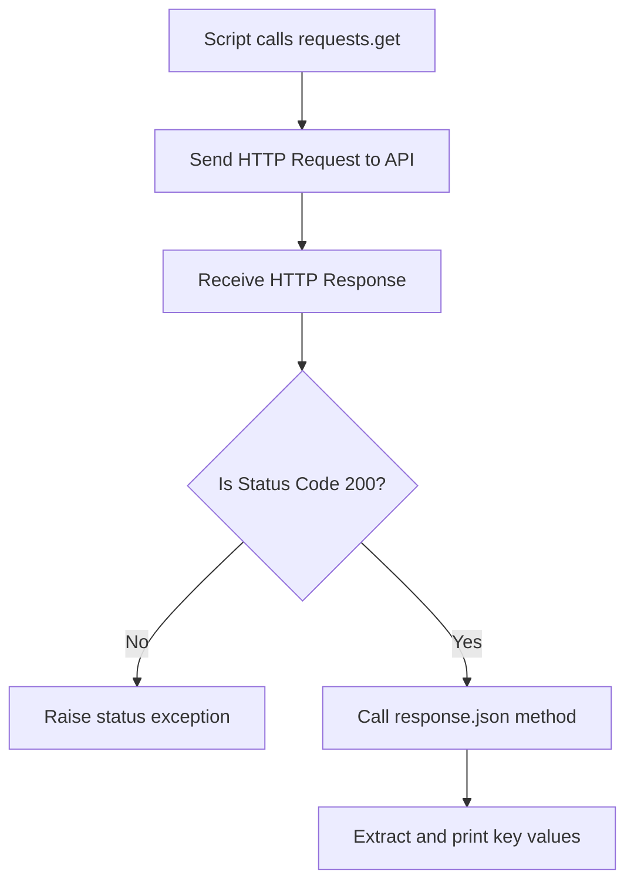

# JSON in Web API Responses

When you build integrations between systems, they will communicate using web APIs. For example, if you send an alert notification to Slack or query system metrics from an API, the data payload will be sent as JSON. Python's third-party `requests` library provides built-in tools to make these HTTP requests and parse the JSON responses automatically.

In this guide, we will look at how to handle JSON in API responses. We will compare built-in and third-party request tools, make a web request, and write an API status parser.

## API Request-Response Workflow

When you request data from a web service, the server processes your request and returns a response containing an HTTP status code, headers, and a text body. If it is a web API, the text body is formatted as a JSON string.

Let's compare the built-in `urllib` module with the third-party `requests` library when parsing JSON from APIs.

| Feature | Built-in `urllib.request` | Third-Party `requests` |
| :--- | :--- | :--- |
| **Code Verbosity** | High (Requires opening connection, reading bytes, decoding text, and loading JSON) | Low (Single method call: `response.json()`) |
| **Exception Handling**| Manual (Must catch individual HTTP and URL errors) | Simple (Use `response.raise_for_status()`) |
| **Authentication** | Verbose (Requires custom password manager classes) | Easy (Pass auth tuple: `auth=("user", "pass")`) |
| **Dependency** | None (Built-in) | Needs installation via `pip` |
| **DevOps Preference** | Used for minimal setups (bootstrap scripts) | Standard tool for API scripts |

Here is a diagram showing how the `requests` library processes an API response:



## Making an API Request and Parsing JSON

Let's write a script that sends a request to a mock service and reads the parsed JSON data.

First, verify that `requests` is installed. Create a file named `fetch_api.py` and write the code below.

```python
import requests

# A public testing URL that returns JSON
url = "https://httpbin.org/get"

print("Requesting metadata from testing endpoint...")

try:
    response = requests.get(url, timeout=5)
    
    # Verify the request succeeded (status code 200)
    response.raise_for_status()
    
    # Parse the JSON body directly into a Python dictionary
    payload = response.json()
    
    print("\nAPI Response Loaded Successfully:")
    print("User Agent: " + payload["headers"]["User-Agent"])
    print("Origin IP:  " + payload["origin"])
    
except requests.exceptions.RequestException as error:
    print(" ❌ Connection failed: " + str(error))
```

Run this file in your terminal.

```bash
python3 fetch_api.py
```

Expected output:
```text
Requesting metadata from testing endpoint...

API Response Loaded Successfully:
User Agent: python-requests/2.31.0
Origin IP:  192.168.1.1
```

## Real-World Example: Health Status Monitor

Let's write a script that monitors a simulated microservice health page. The API endpoint returns a JSON payload containing the server status, active connections, and replication latency. The script will request the page, parse the JSON, and output a warning if replication latency is too high.

Create a file named `check_api_health.py` and write the code below.

```python
import requests
import json

# Using httpbin POST to simulate checking status
api_endpoint = "https://httpbin.org/post"

# Mock server metrics payload to send
payload_data = {
    "service": "database-replication",
    "latency_seconds": 12.5,
    "active_sync": True
}

def check_replication_delay():
    print("=== Pinging Service Monitoring API ===")
    
    try:
        # Send post request with JSON data
        response = requests.post(api_endpoint, json=payload_data, timeout=8)
        response.raise_for_status()
        
        # Parse the JSON response
        data = response.json()
        
        # httpbin echoes the sent JSON inside the 'json' key
        metrics = data.get("json", {})
        service = metrics.get("service", "unknown")
        delay = metrics.get("latency_seconds", 0.0)
        
        print(f"Service Checked: {service}")
        print(f"Sync Latency:    {delay} seconds")
        
        # Check constraints
        if delay > 10.0:
            print(" ⚠️  ALERT: Replication delay exceeds warning threshold (10s)!")
        else:
            print(" ✅ Sync latency is within safe parameters.")
            
    except requests.exceptions.HTTPError as err:
        print(f" ❌ HTTP Error: {err}")
    except Exception as err:
        print(f" ❌ Connection Error: {err}")

check_replication_delay()
```

Run the script.

```bash
python3 check_api_health.py
```

Expected output:
```text
=== Pinging Service Monitoring API ===
Service Checked: database-replication
Sync Latency:    12.5 seconds
 ⚠️  ALERT: Replication delay exceeds warning threshold (10s)!
```

## Common Mistakes

### Calling .json() on Non-JSON Pages
If the web service fails (returning a 500 server error or a 404 missing page), it will often return an HTML error page instead of a JSON string. If you call `.json()` on this response, the script will crash with a decode error.

* **The Bad Way:**
```python
response = requests.get("https://httpbin.org/status/500")
# This crashes with a JSONDecodeError because 500 returns raw text, not JSON!
data = response.json()
```

* **The Good Way:**
Always run `response.raise_for_status()` to catch HTTP errors before trying to parse the JSON.
```python
try:
    response = requests.get("https://httpbin.org/status/500")
    response.raise_for_status()
    data = response.json()
except requests.exceptions.HTTPError as err:
    print("Failed to load page: " + str(err))
```

### Confusing .json() as an Attribute
In Python `requests`, `.json()` is a method (a function), not a static attribute. You must write parentheses after it. If you forget them, Python will return a function reference instead of parsing the data.

* **The Bad Way:**
```python
response = requests.get("https://httpbin.org/get")
# This stores the function reference, not the data dictionary!
data = response.json
print(type(data).__name__) # Prints 'method'
```

* **The Good Way:**
```python
response = requests.get("https://httpbin.org/get")
data = response.json()
print(type(data).__name__) # Prints 'dict'
```

## Summary

* Web APIs communicate by sending structured JSON data payloads over HTTP.
* The third-party `requests` library is the standard tool for making API calls.
* Use `response.json()` to parse a JSON response body into a Python dictionary.
* Use `response.raise_for_status()` to verify that the request succeeded.
* Calling `.json()` on HTML error pages will trigger a `JSONDecodeError`.
* Remember that `.json()` is a method call that requires parentheses `()`.
* The `timeout` parameter prevents scripts from hanging when an API goes offline.
* Use POST requests with the `json=` argument to transmit payloads to APIs.
* Parsing monitoring metrics from APIs allows you to automate status alerts.
* Checking status codes before parsing ensures your pipeline handlers are reliable.
