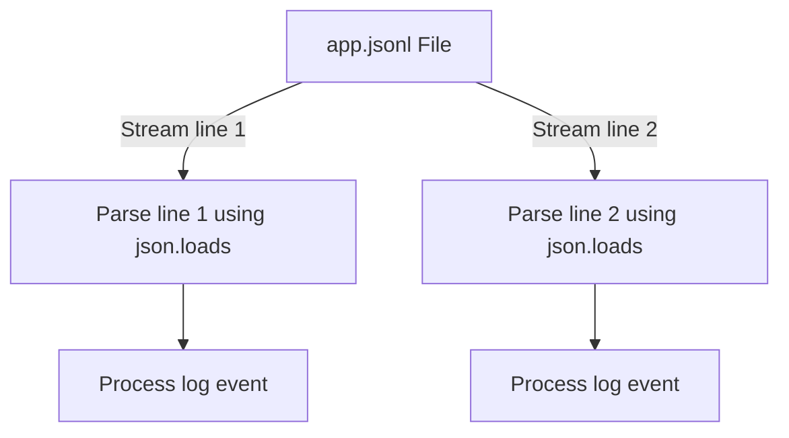

# JSON Best Practices

When managing infrastructure, JSON is everywhere. However, if your scripts process JSON files incorrectly, they will introduce issues. A script might run out of memory when loading huge files, crash on missing keys, or leak passwords saved in configurations. Following standard best practices for reading, writing, and organizing JSON data keeps your automation secure, fast, and stable.

In this guide, we will look at JSON best practices. We will compare standard JSON with Line-Delimited JSON, discuss memory safety, and write a JSON Lines parser.

## Standard JSON vs JSON Lines (JSONL)

Standard JSON requires the entire file to be a single valid object or array. This means the parser must load the complete file into memory before it can read a single key. If you are logging millions of events, you should use **JSON Lines (JSONL)** or **Line-Delimited JSON (LDJSON)** instead. In a JSONL file, each line is an independent, complete JSON object.

Let's compare these two formats.

| Aspect | Standard JSON | JSON Lines (JSONL / NDJSON) |
| :--- | :--- | :--- |
| **File Structure** | `[ {"id": 1}, {"id": 2} ]` (A single array) | `{"id": 1}\n{"id": 2}` (Multiple separate lines) |
| **Memory Profile** | High (Must load entire file into RAM) | Very Low (Can process line-by-line) |
| **Appending Data** | Hard (Must parse, append to list, rewrite file)| Easy (Just append new line to end of file) |
| **Parsing Errors** | A single syntax error breaks the whole file | Syntax error on line 2 does not affect line 3 |
| **DevOps Use Case** | Small configuration setting files | Large application logs, continuous events |

Here is a diagram showing how a script streams through a JSON Lines file:



## Reading and Writing JSON Lines

Let's write a script that creates a JSONL log file and reads it back line-by-line using a generator.

Create a file named `jsonl_basics.py` and write the code below.

```python
import json

# Simulated events list
events = [
    {"event": "login", "user": "admin", "status": "success"},
    {"event": "backup", "user": "system", "status": "failed"},
    {"event": "deploy", "user": "dev", "status": "success"}
]

log_file = "events.jsonl"

# 1. Writing to a JSONL file (Appending line-by-line)
print("Writing events to JSON Lines file...")
with open(log_file, "w") as file:
    for event in events:
        # Convert single dictionary to compact JSON string and add newline
        json_line = json.dumps(event)
        file.write(json_line + "\n")

# 2. Reading from a JSONL file (Memory-safe stream)
print("\nReading events back...")
with open(log_file, "r") as file:
    for line in file:
        # Parse each line independently
        event_data = json.loads(line.strip())
        print(f"User [{event_data['user']}] triggered: {event_data['event']} -> status: {event_data['status']}")
```

Run this file in your terminal.

```bash
python3 jsonl_basics.py
```

Expected output:
```text
Writing events to JSON Lines file...

Reading events back...
User [admin] triggered: login -> status: success
User [system] triggered: backup -> status: failed
User [dev] triggered: deploy -> status: success
```

## Real-World Example: Large Log Audit Script

Let's write a script that processes a simulated active log. Each line is a JSON object. The script will stream through the lines, identify failed actions, and extract their details without loading the entire log file into memory.

Create a file named `audit_jsonl.py` and write the code below.

```python
import json

# Create a sample JSONL file containing logs
logs_data = """{"level": "info", "msg": "Sync active", "code": 200}
{"level": "warning", "msg": "Disk space low", "code": 403}
{"level": "error", "msg": "Database sync failed", "code": 500}
{"level": "info", "msg": "Replication caught up", "code": 200}"""

with open("active_logs.jsonl", "w") as f:
    f.write(logs_data)

def audit_jsonl_logs(filepath):
    print("=== Scanning Log Streams ===")
    error_count = 0
    
    try:
        # Stream the file line-by-line
        with open(filepath, "r") as file:
            for line_num, line in enumerate(file, start=1):
                try:
                    log_entry = json.loads(line.strip())
                    
                    # Audit critical errors
                    if log_entry.get("level") == "error":
                        print(f" ❌ CRITICAL: Line {line_num} - {log_entry['msg']} (Code: {log_entry['code']})")
                        error_count += 1
                        
                except json.JSONDecodeError:
                    print(f" ⚠️  WARNING: Skipping corrupt JSON syntax at line {line_num}")
                    continue
                    
    except FileNotFoundError:
        print("Error: Target log file missing.")
        
    print(f"\nAudit complete. Total failures processed: {error_count}")

audit_jsonl_logs("active_logs.jsonl")
```

Run the script.

```bash
python3 audit_jsonl.py
```

Expected output:
```text
=== Scanning Log Streams ===
 ❌ CRITICAL: Line 3 - Database sync failed (Code: 500)

Audit complete. Total failures processed: 1
```

## Common Mistakes

### Loading Massive JSON Arrays Into RAM
If you try to load a 10 GB file containing a single standard JSON array of objects using `json.load()`, Python will use all your server's RAM and crash with an Out of Memory error.

* **The Bad Way:**
```python
# Fails on large datasets
with open("huge_data.json", "r") as file:
    data = json.load(file) # Crashes if file is larger than system memory
```

* **The Good Way:**
Convert the file structure to JSON Lines (JSONL) and process it line-by-line.

### Committing Configurations Containing Secrets to Git
Never save API tokens, AWS keys, or database passwords in JSON files that are tracked by Git. Always replace secrets with environment variable lookups or use config templates.

* **The Bad Way:**
```json
// Inside config.json:
{
    "db_password": "super_secret_password_123"
}
```

* **The Good Way:**
Add `config.json` to `.gitignore` and load settings using environment variables.

## Summary

* Standard JSON requires loading the entire file into memory, which can cause RAM leaks.
* JSON Lines (JSONL) stores one independent JSON object per line.
* JSONL files can be processed line-by-line, keeping memory usage minimal.
* Appending data to a JSONL file is faster because you do not have to rebuild the file.
* A syntax error on one line of a JSONL file does not stop the parser from reading other lines.
* Use `json.dumps()` and write a newline `\n` to append lines to JSONL files.
* Use `json.loads(line)` inside a loop to stream through JSONL files.
* Never commit active JSON files containing private passwords to Git.
* Standardize configuration schemas to prevent unexpected key errors.
* Processing logs using JSONL is the industry standard for cloud integrations.
