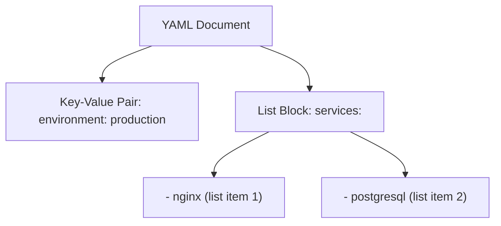

# Understanding YAML

When managing modern infrastructure, you will run into YAML (YAML Ain't Markup Language) files everywhere. It is the default configuration format for Docker Compose files, Kubernetes manifests, Ansible playbooks, and Github Actions workflows. YAML is popular because it focuses on readability and simplicity, making it easy for humans to read and write.

In this guide, we will learn how YAML works. We will compare it to JSON, break down its core syntax rules, and inspect a standard infrastructure config.

## What is YAML?

YAML is a human-readable data serialization standard. Unlike XML or JSON, which use tags, brackets, and braces to define structures, YAML uses indentation (spaces) to define hierarchy. This creates clean files with minimal visual clutter.

Let's compare JSON and YAML side-by-side.

| Feature | JSON | YAML |
| :--- | :--- | :--- |
| **Comments** | Not supported natively | Supported using `#` |
| **Visual Clutter** | High (Requires double quotes, colons, braces, and brackets) | Low (Uses spaces and hyphens) |
| **Hierarchy** | Defined by curly braces `{}` | Defined by indentation alignment |
| **Multi-line Text** | Hard (Must use `\n` in a single string) | Easy (Provides `\|` and `>` block markers) |
| **DevOps Use Case** | Web API payloads, database rows | Configuration files (Kubernetes, Docker Compose) |

Here is a diagram showing how a YAML key-value pair and list are structured:



## Core YAML Syntax Rules

To prevent syntax errors in your configuration pipelines, you must follow these rules:
1. **Spaces Only for Indentation**: You must use spaces to indent your files. **Never use the Tab key**. If you mix tabs and spaces, parsers will crash.
2. **Space After Colons and Hyphens**: Every colon (`:`) separating a key and value, and every hyphen (`-`) denoting a list item, must be followed by a space.
3. **Case Sensitivity**: Keys and values are case-sensitive.
4. **No Double Quotes Required**: Unlike JSON, strings in YAML usually do not require quotation marks unless they contain special characters.

Let's look at a sample YAML config representing server setup details:

```yaml
# A sample YAML configuration profile
environment: production
active_ports:
  - 80
  - 443
database:
  host: db-server-01.local
  port: 5432
```

## Real-World Example: Docker Compose Format Analysis

Let's look at a Docker Compose file. This is a common YAML file used to define multi-container applications. We will break down how keys, nested dictionaries, and lists are written in this configuration.

```yaml
# docker-compose.yml
version: "3.8"

services:
  web:
    image: nginx:1.25
    ports:
      - "80:80"
    environment:
      - DEBUG=false

  database:
    image: postgres:15
    volumes:
      - db_data:/var/lib/postgresql/data

volumes:
  db_data:
```

### Explaining the Docker Compose Structure

1. **`services:`**: This is a top-level key. Its value is a nested dictionary containing our application components (`web` and `database`).
2. **`image: nginx:1.25`**: A standard key-value pair. Note the space after the colon.
3. **`ports:`**: This key holds a list of port mappings. Each list item starts with a hyphen (`-`) and a space, indented at the same level.
4. **`volumes:`**: The `volumes:` key at the bottom defines a shared storage block, which is independent of the services configuration block.

## Common Mistakes

### Using Tabs Instead of Spaces
If you press the Tab key to indent lines in a YAML file, parsers will throw a syntax error. Most code editors can be configured to insert spaces when you press Tab, which helps prevent this issue.

* **The Bad Way:**
```yaml
# Indented using a Tab character
services:
	web:
		image: nginx
```

* **The Good Way:**
```yaml
# Indented using exactly 2 or 4 spaces
services:
  web:
    image: nginx
```

### Missing Spaces After Colons or Hyphens
If you forget to add a space after a colon or a hyphen, the YAML parser will treat the entire line as a single string instead of key-value pairs or list items.

* **The Bad Way:**
```yaml
# Missing spaces after colon and hyphen
host:10.0.0.1
ports:
-80
```

* **The Good Way:**
```yaml
# Clean spacing configuration
host: 10.0.0.1
ports:
  - 80
```

### Inconsistent Indentation Depth
If items in the same list or sub-dictionary are not aligned at the exact same indentation depth, the file will be invalid.

* **The Bad Way:**
```yaml
# Mismatched list alignment
services:
  - nginx
   - postgresql # Misaligned!
```

* **The Good Way:**
```yaml
services:
  - nginx
  - postgresql # Aligned perfectly
```

## Summary

* YAML is a human-readable data format widely used for DevOps tool configurations.
* YAML uses indentation (spaces) instead of braces or brackets to define hierarchy.
* You can write comments in YAML using the `#` symbol.
* String values in YAML do not require quotation marks in most cases.
* Always use spaces for indentation; never use the Tab key.
* Ensure there is a space after every colon and hyphen.
* Align items in lists and sub-dictionaries to the exact same indentation depth.
* Missing spaces after colons will cause parsers to treat keys and values as single strings.
* Understanding YAML layouts is essential for configuring Kubernetes and Docker Compose.
* YAML's clean syntax reduces visual noise, making configurations easy to audit.
