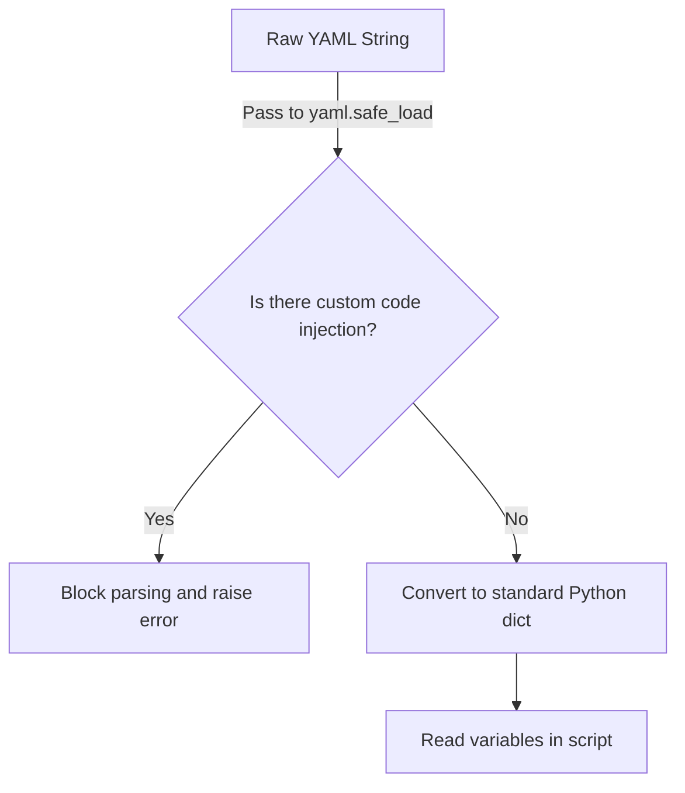

# The PyYAML Library

Python does not include a YAML parser in its standard library. To read and write YAML files in your scripts, you must install a popular third-party library called PyYAML. Understanding how to install this library, import it, and use its safe loading functions is essential for managing server configurations securely.

In this guide, we will learn how to set up PyYAML. We will discuss the security risks of standard YAML loading, install the package, and write a basic configuration parser.

## Installing PyYAML

To use PyYAML in your scripts, make sure your virtual environment is active and install the package using `pip`. Note that the package name is `pyyaml` in lowercase, but the module name you import in your code is `yaml`.

```bash
pip install pyyaml
```

Expected output:
```text
Collecting pyyaml
  Downloading PyYAML-6.0.1-cp310-cp310-manylinux_2_17_x86_64.manylinux2014_x86_64.whl (713 kB)
Installing collected packages: pyyaml
Successfully installed pyyaml-6.0.1
```

Let's compare the functions PyYAML provides to read YAML data.

| Function | Security Level | Risk Details | When to Use It |
| :--- | :--- | :--- | :--- |
| **`yaml.safe_load()`** | **High (Safe)** | Only builds standard Python objects (lists, dicts) | **Always use this** for untrusted user inputs |
| **`yaml.load()`** | **Low (Insecure)** | Allows execution of arbitrary Python objects and code from the YAML file | **Never use this** (Deprecated/unsupported in modern PyYAML) |

Here is a diagram showing the process of loading YAML securely using PyYAML:



## Basic Loading and Dumping

Let's write a script that converts a YAML string into a Python dictionary and then converts the dictionary back to a YAML string.

Create a file named `yaml_basics.py` and write the code below.

```python
import yaml

# A valid YAML string
yaml_content = """
environment: staging
port: 8080
allowed_hosts:
  - localhost
  - 127.0.0.1
"""

print("Loading YAML content safely...")
# Convert YAML text to Python dictionary
config = yaml.safe_load(yaml_content)

print("Parsed Config Type: " + type(config).__name__)
print("Active Port:        " + str(config["port"]))
print("Allowed Hosts:      " + str(config["allowed_hosts"]))
print("-" * 34)

# Convert Python dictionary back to YAML format
yaml_output = yaml.safe_dump(config, default_flow_style=False)
print("Generated YAML text:")
print(yaml_output.strip())
```

Run this file in your terminal.

```bash
python3 yaml_basics.py
```

Expected output:
```text
Loading YAML content safely...
Parsed Config Type: dict
Active Port:        8080
Allowed Hosts:      ['localhost', '127.0.0.1']
----------------------------------
Generated YAML text:
allowed_hosts:
- localhost
- 127.0.0.1
environment: staging
port: 8080
```

## Real-World Example: Database Credentials Resolver

Let's write a script that simulates loading database connection parameters from a YAML payload. The script will parse the settings and verify if the database host is configured correctly.

Create a file named `resolve_yaml.py` and write the code below.

```python
import yaml

# Simulated config payload
db_yaml = """
database:
  host: db-server-production
  port: 5432
  credentials:
    username: sys_admin
    ssl_required: true
"""

def parse_database_config(raw_yaml):
    print("=== Parsing Database Configuration ===")
    
    try:
        # Load the YAML content safely
        config = yaml.safe_load(raw_yaml)
        
        db_details = config.get("database", {})
        host = db_details.get("host")
        ssl = db_details.get("credentials", {}).get("ssl_required", False)
        
        print("Database Target: " + str(host))
        print("SSL Connection:  " + str(ssl))
        
        if not ssl:
            print(" ⚠️  SECURITY ALERT: SSL is disabled in this configuration profile!")
        else:
            print(" ✅ Security Check Passed: SSL connection active.")
            
    except yaml.YAMLError as err:
        print(" ❌ Error parsing YAML configuration: " + str(err))

parse_database_config(db_yaml)
```

Run the script.

```bash
python3 resolve_yaml.py
```

Expected output:
```text
=== Parsing Database Configuration ===
Database Target: db-server-production
SSL Connection:  True
 ✅ Security Check Passed: SSL connection active.
```

## Common Mistakes

### Using yaml.load() Without Specifying Loader
If you call `yaml.load()` in older versions of PyYAML, it defaults to an insecure parser. In modern versions, calling it without a Loader argument will raise a TypeError.

* **The Bad Way:**
```python
# Insecure and deprecated
config = yaml.load(yaml_content)
```

* **The Good Way:**
```python
# Safe and standard
config = yaml.safe_load(yaml_content)
```

### Confusing PyYAML Installation Name with Import Name
If you write `import pyyaml` in your code, Python will crash with a ModuleNotFoundError. You must install `pyyaml` but import `yaml`.

* **The Bad Way:**
```python
# Raises a ModuleNotFoundError
import pyyaml
```

* **The Good Way:**
```python
import yaml
```

## Summary

* The PyYAML library is the standard tool for parsing YAML files in Python.
* Install PyYAML using the package name `pyyaml` via pip.
* Import the module in your code using `import yaml`.
* Never use `yaml.load()` as it presents a severe security risk.
* Always use `yaml.safe_load(text)` to parse configurations safely.
* Use `yaml.safe_dump(dict)` to convert Python dictionaries to YAML text format.
* The `YAMLError` exception is raised when parsing invalid YAML text.
* Dictionaries returned from `safe_load()` can be searched using `.get()` to prevent key errors.
* Running safe YAML parsers keeps your pipeline script environments secure.
* Resolving config values using PyYAML is crucial for managing containers.
