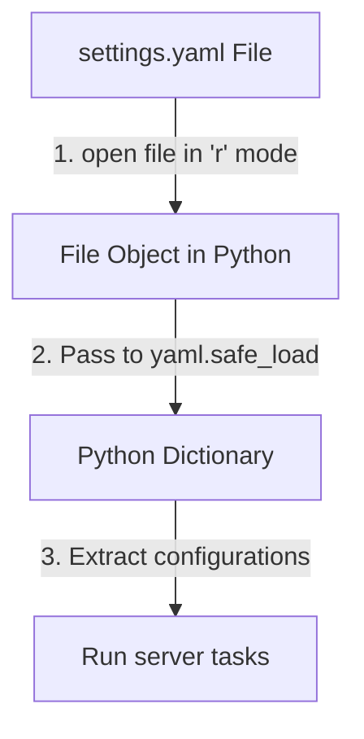

# Reading YAML Files

In system automation, configuration settings are frequently stored in `.yaml` or `.yml` files on disk. For example, your script might need to read a server inventory file or audit a Kubernetes service manifest. To do this, you open the file using Python's built-in file helpers and parse it using PyYAML.

In this guide, we will learn how to read YAML files. We will look at single-document loading, parsing multi-document files, and validating server environments.

## Loading Files Safely

To read a YAML file, you open it in read-only mode (`"r"`) using a context manager (`with open`) and pass the file object directly to `yaml.safe_load()`.

Let's compare loading configurations from file objects versus string variables.

| Method | Syntax | Input Source | DevOps Use Case |
| :--- | :--- | :--- | :--- |
| **`yaml.safe_load(file)`** | `yaml.safe_load(file_object)`| An open file on disk | Loading persistent configuration settings |
| **`yaml.safe_load(string)`**| `yaml.safe_load(yaml_string)`| A text variable in memory | Loading environment settings or API responses |
| **`yaml.safe_load_all(file)`**| `yaml.safe_load_all(file_object)`| Multi-document file | Loading multi-resource Kubernetes manifests |

Here is a diagram showing the workflow of reading a configuration file using PyYAML:



## Reading a Single YAML Document

Let's write a script that opens a YAML file and parses its contents. First, we will create a sample configuration file named `config_profile.yaml`.

Create a file named `read_yaml_file.py` and write the code below.

```python
import yaml

# Create a sample YAML configuration file
config_content = """
environment: production
timeout: 30
database:
  host: 10.0.4.15
  port: 5432
"""
with open("config_profile.yaml", "w") as f:
    f.write(config_content)

print("Opening config_profile.yaml file...")

# Open the file safely using a context manager
with open("config_profile.yaml", "r") as file:
    # Load and parse the file object directly
    settings = yaml.safe_load(file)

print("\nResolved Config Settings:")
print("Environment:   " + settings["environment"])
print("Timeout limit: " + str(settings["timeout"]))
print("Database Host: " + settings["database"]["host"])
```

Run this file in your terminal.

```bash
python3 read_yaml_file.py
```

Expected output:
```text
Opening config_profile.yaml file...

Resolved Config Settings:
Environment:   production
Timeout limit: 30
Database Host: 10.0.4.15
```

## Parsing Multi-Document YAML Files

In DevOps, especially when working with Kubernetes, you will find files that contain multiple YAML documents separated by three hyphens (`---`). If you try to read this file using `yaml.safe_load()`, it will only return the first document and ignore the rest. You must use `yaml.safe_load_all()` to parse all documents.

Let's write a script that parses a multi-document file.

```python
import yaml

# A YAML file representing multiple server specifications
multi_spec = """
hostname: web-server-01
role: frontend
---
hostname: database-01
role: backend
"""

# safe_load_all returns a generator object
specs = yaml.safe_load_all(multi_spec)

print("=== Parsing Multi-Document Configuration ===")
for index, spec in enumerate(specs, start=1):
    print(f"Document #{index}: Host [{spec['hostname']}] is configured as [{spec['role']}]")
```

Run the script.

```bash
python3 read_multi_yaml.py
```

Expected output:
```text
=== Parsing Multi-Document Configuration ===
Document #1: Host [web-server-01] is configured as [frontend]
Document #2: Host [database-01] is configured as [backend]
```

## Real-World Example: Kubernetes Manifest Auditor

Let's write a script that audits a Kubernetes deployment manifest file (`deployment.yaml`). The script loads the manifest and verifies that the deployment replicas count matches our production policy limit (minimum 2 replicas required).

Create a file named `audit_deployment.py` and write the code below.

```python
import yaml

# Simulated Kubernetes deployment manifest
manifest_content = """
apiVersion: apps/v1
kind: Deployment
metadata:
  name: web-app
spec:
  replicas: 1 # Insecure count (needs to be >= 2)
  template:
    metadata:
      labels:
        app: web
    spec:
      containers:
        - name: nginx
          image: nginx:1.25
"""

with open("deployment.yaml", "w") as f:
    f.write(manifest_content)

def audit_manifest(filepath):
    print("=== Auditing Deployment Manifest ===")
    
    try:
        with open(filepath, "r") as file:
            manifest = yaml.safe_load(file)
            
        replicas = manifest["spec"]["replicas"]
        name = manifest["metadata"]["name"]
        
        print(f"Application Name: {name}")
        print(f"Desired Replicas: {replicas}")
        
        # Audit replicas limit
        if replicas < 2:
            print(" ❌ AUDIT FAILED: Production deployment requires at least 2 replicas!")
        else:
            print(" ✅ Audit Passed: Replicas count meets policies.")
            
    except FileNotFoundError:
        print("Error: deployment.yaml file not found.")
    except Exception as err:
        print("Error reading manifest: " + str(err))

audit_manifest("deployment.yaml")
```

Run the script.

```bash
python3 audit_deployment.py
```

Expected output:
```text
=== Auditing Deployment Manifest ===
Application Name: web-app
Desired Replicas: 1
 ❌ AUDIT FAILED: Production deployment requires at least 2 replicas!
```

## Common Mistakes

### Using safe_load on Multi-Document Files
If you load a file containing `---` separators using `safe_load()`, PyYAML will only return the first document and discard the rest without raising any warning.

* **The Bad Way:**
```python
# Returns only the first dictionary, ignoring the second doc
config = yaml.safe_load(open("multi_doc.yaml"))
```

* **The Good Way:**
Use `safe_load_all()` and iterate through the results or convert them to a list.
```python
# Returns all documents
configs = list(yaml.safe_load_all(open("multi_doc.yaml")))
```

### Accessing Deep Keys Without Verification
Kubernetes manifests contain highly nested structures. Chaining brackets blindly (like `manifest["spec"]["template"]["spec"]`) will crash your script if any parent key is missing.

* **The Bad Way:**
```python
# Raises KeyError if 'spec' or 'replicas' key is missing
replicas = manifest["spec"]["replicas"]
```

* **The Good Way:**
Use safe `.get()` defaults or verify keys before accessing deep paths.
```python
spec = manifest.get("spec", {})
replicas = spec.get("replicas", 2) # Fallback to default of 2
```

## Summary

* Open YAML files using context managers (`with open`) to ensure they close cleanly.
* Pass the file object directly to `yaml.safe_load()` to parse the YAML file content.
* Use `yaml.safe_load_all()` to parse files containing multiple documents (`---`).
* `safe_load_all()` returns a generator that must be looped over or cast to a list.
* Chaining bracket accesses on nested structures can trigger `KeyError` crashes.
* Use `.get()` with empty defaults `{}` to read nested keys safely.
* The `YAMLError` exception will help catch formatting errors in YAML files.
* Auditing replicas limits in Kubernetes manifests is a common task in CI pipelines.
* Catching file errors prevents deployment scripts from failing silently.
* Storing configurations in separate YAML files isolates settings from logic code.
