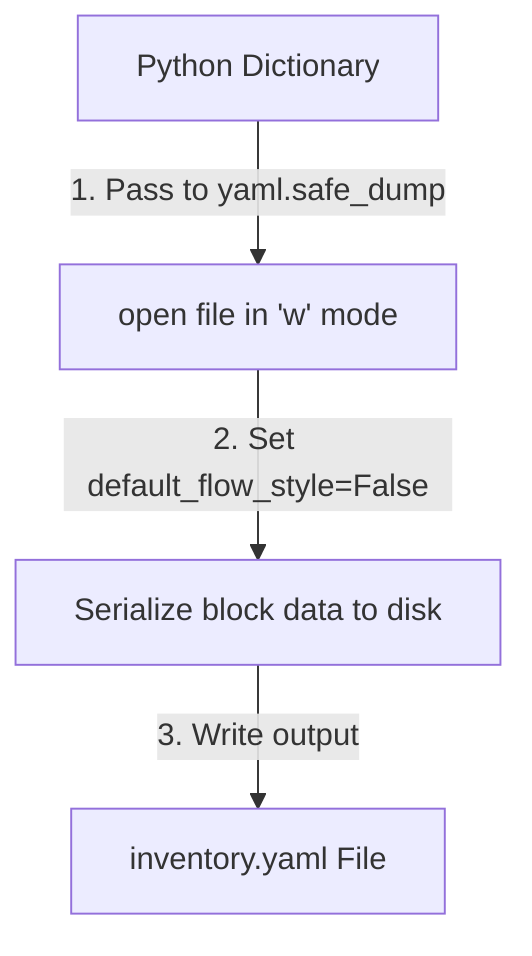

# Writing YAML Files

When writing automation scripts, you will often need to generate configuration files dynamically. This includes updating server settings files, writing custom container settings, or creating deployment manifests for deployment tools. Python's PyYAML library has built-in functions to serialize Python data structures (like dictionaries and lists) into clean YAML text.

In this guide, we will learn how to write YAML files. We will look at key formatting parameters, block vs flow styles, and serializing configurations back to disk.

## The safe_dump Function

Unlike JSON, which has separate functions for strings (`dumps`) and files (`dump`), PyYAML uses a single function called `yaml.safe_dump()` to handle both:
* If you pass a **file stream** as the second argument, `yaml.safe_load` writes the YAML data directly to that file.
* If you **omit** the second argument, `yaml.safe_dump` returns the serialized YAML data as a string variable in memory.

Let's compare the key parameters you can pass to `yaml.safe_dump()` to control the output format.

| Parameter | Type | Default Value | What it Does | Why it matters in DevOps |
| :--- | :--- | :--- | :--- | :--- |
| **`default_flow_style`**| Boolean | `None` (Mixes styles) | If `False`, forces clean block style with hyphens. If `True`, uses braces and brackets. | **CRITICAL**: Set to `False` to prevent ugly, JSON-like bracket formatting. |
| **`sort_keys`** | Boolean | `True` | If `True`, sorts keys alphabetically. If `False`, preserves the dictionary order. | Set to `False` when order matters (like in Ansible playbook steps). |
| **`indent`** | Integer | `2` | Configures the number of spaces for indentation. | Keeps files aligned with standard code guidelines. |
| **`explicit_start`** | Boolean | `False` | If `True`, prepends the document separator `---` to the start. | Useful for standard multi-document configurations. |

Here is a diagram showing the workflow of writing data to a file using `yaml.safe_dump()`:



## Creating YAML Strings and Files

Let's write a script that converts a Python dictionary into a YAML string and saves it to a file. We will configure both block style and preserve the original key order.

Create a file named `write_yaml.py` and write the code below.

```python
import yaml

# Server inventory details dictionary
inventory = {
    "web_servers": ["10.0.0.1", "10.0.0.2"],
    "db_servers": ["10.0.0.50"],
    "settings": {
        "ssh_port": 22,
        "backup_enabled": True
    }
}

# 1. Convert dictionary to YAML string
# We set default_flow_style=False to force block style, and sort_keys=False
yaml_text = yaml.safe_dump(inventory, default_flow_style=False, sort_keys=False)
print("=== Generated YAML String ===")
print(yaml_text.strip())
print("-" * 30)

# 2. Write dictionary directly to file
print("Saving configuration to inventory.yaml...")
with open("inventory.yaml", "w") as file:
    yaml.safe_dump(inventory, file, default_flow_style=False, sort_keys=False)
print("File saved successfully.")
```

Run this file in your terminal.

```bash
python3 write_yaml.py
```

Expected output:
```text
=== Generated YAML String ===
web_servers:
- 10.0.0.1
- 10.0.0.2
db_servers:
- 10.0.0.50
settings:
  ssh_port: 22
  backup_enabled: true
------------------------------
Saving configuration to inventory.yaml...
File saved successfully.
```

Let's inspect the saved file to verify the block style:
```bash
cat inventory.yaml
```

Expected output:
```text
web_servers:
- 10.0.0.1
- 10.0.0.2
db_servers:
- 10.0.0.50
settings:
  ssh_port: 22
  backup_enabled: true
```

## Real-World Example: Multi-Document Playbook Writer

Let's write a script that creates an Ansible playbook containing multiple configuration tasks. Since the playbook contains multiple documents, we will use the `yaml.safe_dump_all()` function to write them to a single file, separating them with `---`. We must set `explicit_start=True` to include the document headers.

Create a file named `write_playbook.py` and write the code below.

```python
import yaml

# Define two separate tasks as a list of dictionaries
playbook_documents = [
    {
        "name": "Configure Frontend Server",
        "hosts": "webservers",
        "tasks": [
            {"name": "Install Nginx", "apt": "name=nginx state=present"}
        ]
    },
    {
        "name": "Configure Database Node",
        "hosts": "dbservers",
        "tasks": [
            {"name": "Start Postgres", "service": "name=postgresql state=started"}
        ]
    }
]

playbook_path = "setup_playbook.yaml"
print("=== Generating Multi-Document Playbook ===")

# Write all documents to a single file stream
with open(playbook_path, "w") as file:
    yaml.safe_dump_all(
        playbook_documents, 
        file, 
        default_flow_style=False, 
        sort_keys=False,
        explicit_start=True
    )

print(f"✅ Success: Playbook saved to {playbook_path}")
```

Run the script.

```bash
python3 write_playbook.py
```

Expected output:
```text
=== Generating Multi-Document Playbook ===
✅ Success: Playbook saved to setup_playbook.yaml
```

Let's view the generated playbook file to verify the multi-document separation:
```bash
cat setup_playbook.yaml
```

Expected output:
```text
---
name: Configure Frontend Server
hosts: webservers
tasks:
- name: Install Nginx
  apt: name=nginx state=present
---
name: Configure Database Node
hosts: dbservers
tasks:
- name: Start Postgres
  service: name=postgresql state=started
```

## Common Mistakes

### Omitting default_flow_style=False
If you do not set `default_flow_style=False`, PyYAML will default to flow style, which uses brackets for nested objects. This looks like JSON and is considered bad practice for configurations.

* **The Bad Way:**
```python
# Generates ugly JSON-like text
yaml_text = yaml.safe_dump({"ports": [80, 443]})
print(yaml_text) # Prints: 'ports: [80, 443]\n'
```

* **The Good Way:**
```python
# Generates clean, standard block style
yaml_text = yaml.safe_dump({"ports": [80, 443]}, default_flow_style=False)
print(yaml_text)
# Prints:
# ports:
# - 80
# - 443
```

### Sorting Keys When Order is Critical
By default, `safe_dump` sorts dictionary keys alphabetically. If you are writing task configurations (like Ansible playbooks or Github Actions steps) where operations must be executed in a specific sequence, sorting keys will scramble your task order.

* **The Bad Way:**
```python
# Let's say you want step 1 then step 2
tasks = {"step_2": "restart", "step_1": "download"}
# This will output step_1 first because of alphabetical sorting,
# which changes the configuration meaning.
yaml.safe_dump(tasks)
```

* **The Good Way:**
Always set `sort_keys=False` when the order of keys is important for the final tool.
```python
yaml.safe_dump(tasks, sort_keys=False)
```

## Summary

* Use `yaml.safe_dump(data, file)` to write YAML directly to an open file.
* Omit the file argument to return the serialized YAML data as a string.
* Always set `default_flow_style=False` to ensure clean, block-formatted YAML output.
* Set `sort_keys=False` to preserve the original order of your dictionary keys.
* Use `yaml.safe_dump_all(list, file)` to write files with multiple documents.
* Set `explicit_start=True` to include the standard `---` separator at document starts.
* Avoid passing non-serializable objects (like datetime) to `safe_dump`.
* Generating clean configuration files dynamically is easy using PyYAML dumps.
* Structuring multi-document playbooks helps automate multi-server configurations.
* Well-formatted YAML files are easy for other systems administrators to audit.
