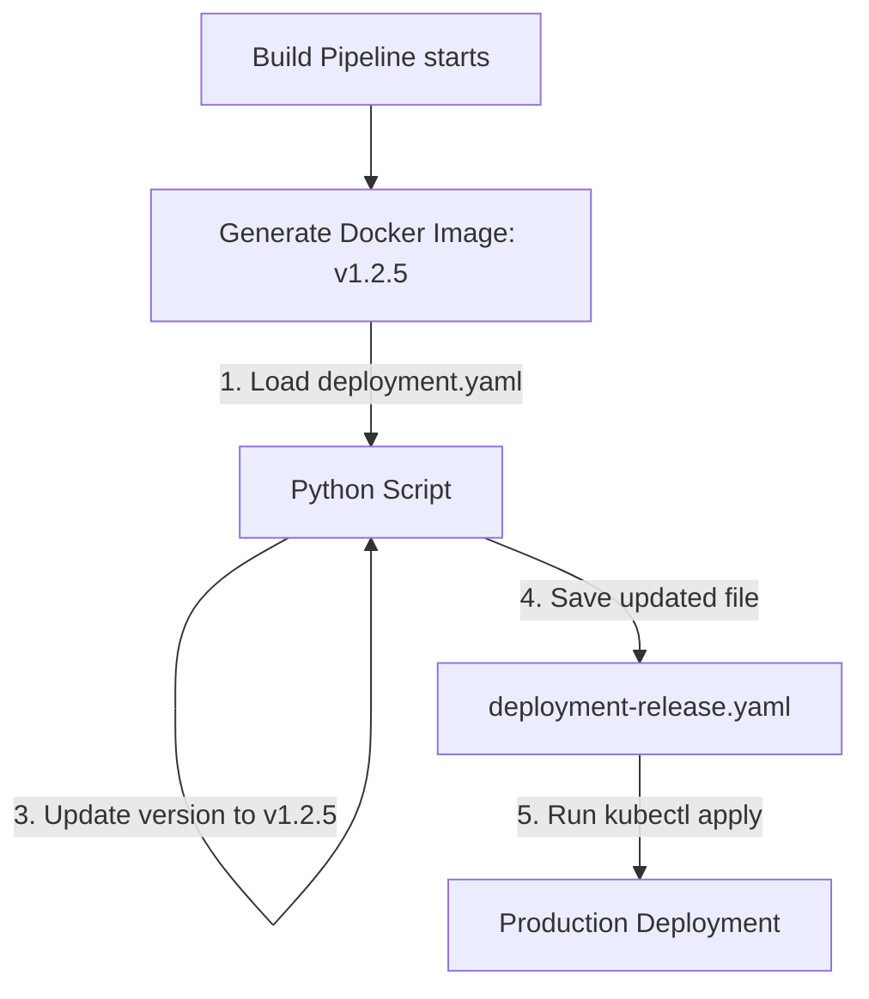

# YAML in Systems Automation

In modern infrastructure, you will rarely use YAML in isolation. Instead, you will write Python scripts to read, validate, modify, and generate configurations for other tools. For example, your CI/CD pipeline might need to update a Kubernetes manifest with the latest Docker image tag, or generate an Ansible inventory dynamically from your cloud servers.

In this guide, we will look at how Python drives YAML automation. We will compare common YAML formats, write a manifest update script, and discuss pipeline integrations.

## YAML in the Automation Cycle

In a deployment pipeline, Python acts as the editor. It opens configuration templates, modifies specific fields (like version numbers or replica counts), and saves the final production manifest.

Let's compare how different automation tools use YAML.

| Format / Tool | Purpose | Key Structures | Python Usage |
| :--- | :--- | :--- | :--- |
| **Kubernetes Manifest** | Defines container deployments | `apiVersion`, `kind`, `spec` | Updating container images, scaling replicas |
| **Ansible Inventory** | Lists target host configurations | `hosts`, `vars`, groups | Generating target server IP lists dynamically |
| **GitHub Actions** | Configures build pipelines | `on`, `jobs`, `steps` | Auditing pipeline steps for security issues |
| **Docker Compose** | Configures local containers | `version`, `services`, `ports` | Updating port overrides for test stacks |

Here is a diagram showing how a pipeline script updates a deployment configuration:



## Modifying YAML Configurations

Let's write a script that opens a YAML configuration file, reads a value, updates it, and saves it back to the disk.

First, create a sample configuration file named `service_settings.yaml`.

Create a file named `update_config.py` and write the code below.

```python
import yaml

# Create a test configuration file
initial_config = """
service:
  name: user-auth-api
  version: v1.0.0
  replicas: 1
"""
with open("service_settings.yaml", "w") as f:
    f.write(initial_config)

print("=== Modifying Service Version ===")

# 1. Read existing config safely
with open("service_settings.yaml", "r") as file:
    config = yaml.safe_load(file)

print("Current Version: " + config["service"]["version"])

# 2. Modify the version in the dictionary
config["service"]["version"] = "v1.1.0"
config["service"]["replicas"] = 3

# 3. Save the updated configuration back to disk
with open("service_settings.yaml", "w") as file:
    yaml.safe_dump(config, file, default_flow_style=False, sort_keys=False)

print("✅ Success: Config file updated.")
```

Run this file in your terminal.

```bash
python3 update_config.py
```

Expected output:
```text
=== Modifying Service Version ===
Current Version: v1.0.0
✅ Success: Config file updated.
```

Let's verify the updated file:
```bash
cat service_settings.yaml
```

Expected output:
```text
service:
  name: user-auth-api
  version: v1.1.0
  replicas: 3
```

## Real-World Example: Kubernetes Image Tag Updater

Let's build a real release pipeline utility. In release pipelines, when a new Docker image is built, the pipeline must update the Kubernetes deployment manifest file (`deploy.yaml`) with the new image tag. We will write a Python function that accepts a file path and a new tag, updates the container image field, and writes the output.

Create a file named `image_updater.py` and write the code below.

```python
import yaml

# Simulated Kubernetes Deployment manifest
deploy_yaml = """
apiVersion: apps/v1
kind: Deployment
metadata:
  name: payment-processor
spec:
  template:
    spec:
      containers:
        - name: processor
          image: company/payments:v1.0.2
          ports:
            - containerPort: 8080
"""

with open("deploy.yaml", "w") as f:
    f.write(deploy_yaml)

def update_container_image(filepath, new_image_tag):
    print(f"Updating deployment container image tag to: {new_image_tag}...")
    
    try:
        # Load the manifest
        with open(filepath, "r") as file:
            manifest = yaml.safe_load(file)
            
        # Navigate to the container list
        # spec -> template -> spec -> containers
        containers = manifest["spec"]["template"]["spec"]["containers"]
        
        # Update the image string for the first container
        old_image = containers[0]["image"]
        base_image_name = old_image.split(":")[0]
        containers[0]["image"] = f"{base_image_name}:{new_image_tag}"
        
        # Save the updated manifest back to disk
        with open(filepath, "w") as file:
            yaml.safe_dump(manifest, file, default_flow_style=False, sort_keys=False)
            
        print("✅ Release manifest updated successfully.")
        
    except FileNotFoundError:
        print("Error: deploy.yaml file not found.")
    except Exception as err:
        print("Error updating file: " + str(err))

update_container_image("deploy.yaml", "v1.1.0-release")
```

Run the script.

```bash
python3 image_updater.py
```

Expected output:
```text
Updating deployment container image tag to: v1.1.0-release...
✅ Release manifest updated successfully.
```

Let's view the updated deployment file to confirm the new image tag is saved:
```bash
cat deploy.yaml
```

Expected output:
```text
apiVersion: apps/v1
kind: Deployment
metadata:
  name: payment-processor
spec:
  template:
    spec:
      containers:
      - name: processor
        image: company/payments:v1.1.0-release
        ports:
        - containerPort: 8080
```

## Common Mistakes

### Losing Comments When Using Standard PyYAML
The standard PyYAML library does not preserve comments or layout details. When you load a file and write it back, all original comments (lines starting with `#`) are discarded.

* **The Problem:**
If your Kubernetes manifest contains comments explaining firewall settings, running `yaml.safe_dump` will delete them.

* **The Solution:**
Use advanced libraries like `ruamel.yaml` (which we cover in File 6) if you need to preserve comments during modification.

### Navigating Incorrect Nested Structures
If you make a typo in any parent key when navigating nested configurations, your script will crash with a `KeyError` or a `TypeError`.

* **The Bad Way:**
```python
# Typo: 'specs' instead of 'spec'
# This raises a KeyError: 'specs'
containers = manifest["specs"]["template"]["spec"]["containers"]
```

* **The Good Way:**
Use intermediate variables and check if keys exist at each level.
```python
spec = manifest.get("spec", {})
template = spec.get("template", {})
```

## Summary

* Python is used to automate configuration edits (like updating version numbers or ports).
* YAML is the default configuration format for Docker, Kubernetes, and Ansible.
* Load a configuration file, update its dictionary values, and save it back using `safe_dump`.
* Updating Docker container image tags in Kubernetes manifests is a standard CI/CD task.
* The standard PyYAML library deletes all file comments when writing data back.
* Typos in nested keys will raise `KeyError` crashes; verify keys when navigating structures.
* Use `default_flow_style=False` to preserve block formatting on write.
* Keep configuration edits isolated from deployment logic code.
* Automatic schema updates prevent manual typing errors during releases.
* Clean version configuration checks ensure staging settings match production rules.
