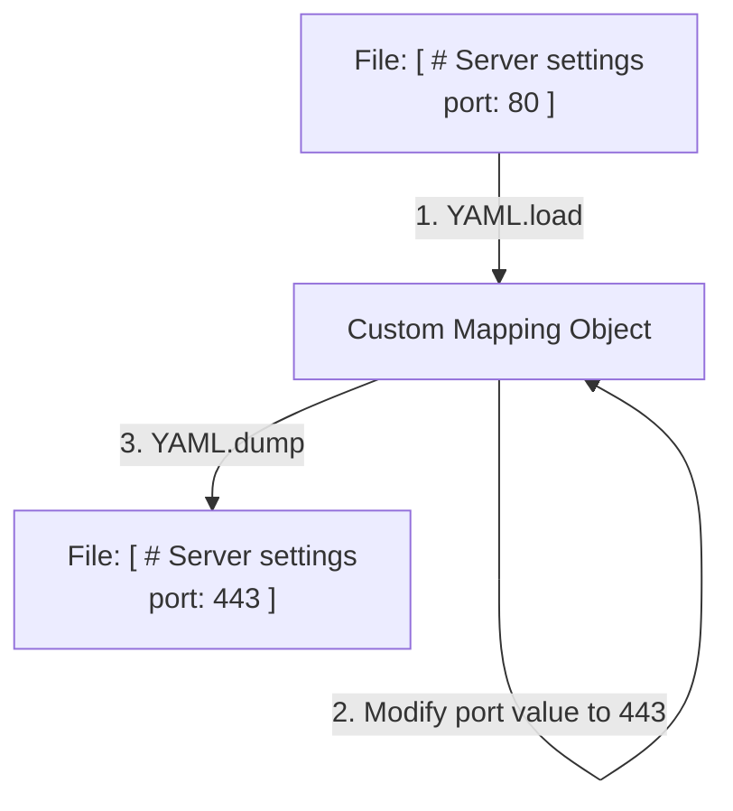

# Preserving Comments with ruamel.yaml

While the standard PyYAML library is excellent for basic reading and writing, it has a significant limitation: it does not preserve comments, file structure, or spacing when writing data back to disk. If your Kubernetes manifests or Docker Compose files contain documentation comments, using PyYAML will delete them. To solve this, you can use an advanced, round-trip YAML parser called `ruamel.yaml`.

In this guide, we will learn how to use `ruamel.yaml`. We will compare it with PyYAML, write a script to modify files while preserving comments, and look at round-trip parsing.

## PyYAML vs ruamel.yaml

The `ruamel.yaml` library is designed for round-trip engineering. When it reads a YAML file, it stores comment lines, blank lines, and key sorting structures in custom objects so it can write them back to disk exactly as they were.

Let's compare PyYAML and `ruamel.yaml`.

| Feature | PyYAML | `ruamel.yaml` |
| :--- | :--- | :--- |
| **Comment Preservation** | No (All comments are deleted on write) | **Yes** (All comments remain in place) |
| **Spacing & Indent** | Standardizes spaces (Alters original spacing) | **Yes** (Preserves original indentation and empty lines) |
| **Key Sorting** | Sorts alphabetically by default | **Yes** (Preserves the exact order of keys) |
| **Import Syntax** | `import yaml` | `from ruamel.yaml import YAML` |
| **Library Type** | Simple, fast parser | Advanced, round-trip configuration editor |

Here is a diagram showing the round-trip workflow of `ruamel.yaml`:



## Installing ruamel.yaml

To use this library, make sure your virtual environment is active and install it via `pip`. Note that the package name contains a dot (`ruamel.yaml`).

```bash
pip install ruamel.yaml
```

Expected output:
```text
Collecting ruamel.yaml
  Downloading ruamel.yaml-0.18.5-py3-none-any.whl (116 kB)
Installing collected packages: ruamel.yaml
Successfully installed ruamel.yaml-0.18.5
```

## Round-Trip Writing with Comments

Let's write a script that opens a YAML file containing comments, updates a setting, and saves the file. We will verify if the comments are preserved.

Create a file named `round_trip.py` and write the code below.

```python
from ruamel.yaml import YAML

# Create a sample YAML file with comments
initial_yaml = """
# Production Web Server Configuration
# Keep port 80 open for load balancer checks
port: 80
ssl: true # Required for secure connections
"""
with open("production_config.yaml", "w") as f:
    f.write(initial_yaml)

print("=== Modifying Configuration with ruamel.yaml ===")

# 1. Initialize the YAML object
# typ='rt' configures round-trip mode (preserves comments and spacing)
yaml_parser = YAML(typ='rt')

# 2. Read the file
with open("production_config.yaml", "r") as file:
    config = yaml_parser.load(file)

print("Current Port: " + str(config["port"]))

# 3. Update the port value
config["port"] = 8080

# 4. Save the file back to disk
with open("production_config.yaml", "w") as file:
    yaml_parser.dump(config, file)

print("✅ Success: Configuration file updated.")
```

Run this file in your terminal.

```bash
python3 round_trip.py
```

Expected output:
```text
=== Modifying Configuration with ruamel.yaml ===
Current Port: 80
✅ Success: Configuration file updated.
```

Let's inspect the updated file to verify the comments are still there:
```bash
cat production_config.yaml
```

Expected output:
```text
# Production Web Server Configuration
# Keep port 80 open for load balancer checks
port: 8080
ssl: true # Required for secure connections
```

Notice that both the header comments and the inline comment (`# Required for secure connections`) were preserved perfectly, and only the port value was changed.

## Common Mistakes

### Confusing Import Syntax
If you try to write `import ruamel.yaml`, your imports might behave unexpectedly depending on how the package namespace is loaded. Always use the recommended class import syntax.

* **The Bad Way:**
```python
# Avoid importing the namespace package directly
import ruamel.yaml
```

* **The Good Way:**
```python
# Standard and safe import for round-trip parsing
from ruamel.yaml import YAML
```

### Modifying Structure in Non-Round-Trip Mode
If you initialize the YAML object without specifying `typ='rt'`, it will run using basic parsers that behave like PyYAML and discard comments.

* **The Bad Way:**
```python
# Standard parser, does not preserve comments
yaml_parser = YAML()
```

* **The Good Way:**
```python
# Round-trip editor mode
yaml_parser = YAML(typ='rt')
```

## Summary

* The `ruamel.yaml` library is an advanced, round-trip YAML parser for Python.
* Install the library using `pip install ruamel.yaml` inside your virtual environment.
* Import the editor class using `from ruamel.yaml import YAML`.
* Always initialize the class using `YAML(typ='rt')` to preserve comments and spacing.
* Standard PyYAML deletes all file comments and empty lines when writing data.
* `ruamel.yaml` preserves both header and inline comments during modifications.
* Key ordering and custom indentation are kept intact by `ruamel.yaml`.
* Use `.load(file)` to parse files and `.dump(data, file)` to write them back.
* Preserving comments is essential when automating edits to shared team manifests.
* Writing clean configurations helps developers audit deployment settings safely.
