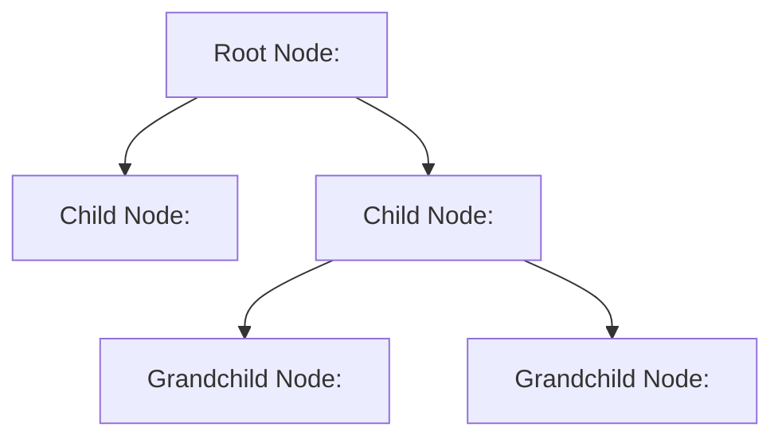

# Understanding XML

When working with older enterprise networks, Java applications, or legacy APIs, you will run into XML (Extensible Markup Language). While modern systems prefer JSON or YAML, XML is still widely used to configure application servers (like Tomcat), build package manifests (like Maven pom.xml files), and exchange data over SOAP web services. Understanding how XML documents are structured is essential for parsing legacy systems configurations.

In this guide, we will look at how XML works. We will compare XML, JSON, and CSV formats, break down XML tag structures, and inspect a standard system config.

## What is XML?

XML is a markup language that defines a set of rules for encoding documents in a format that is both human-readable and machine-readable. It uses tags defined by angle brackets `<>` to wrap data, creating a nested tree hierarchy of parent and child nodes.

Let's compare XML, JSON, and CSV formats.

| Dimension | XML | JSON | CSV |
| :--- | :--- | :--- | :--- |
| **Syntax** | Tags and Attributes: `<port id="1">80</port>` | Objects and Arrays: `{"port": 80}` | Tabular Columns: `port, 80` |
| **Comments** | Supported: `<!-- comment -->` | Not supported natively | Sometimes supported with `#` |
| **Data Hierarchy**| High (Can represent complex trees) | High (Supports nested maps/lists)| Low (Strictly flat table columns) |
| **Verbosity** | Very High (Requires opening and closing tags)| Medium | Extremely Low |
| **Use Case** | Legacy APIs, Java config files | Web API JSON payloads | Database exports, spreadsheet inputs |

Here is a diagram showing the parent-child node tree of an XML configuration file:



## Core XML Syntax Rules

To write valid XML, you must follow these rules:
1. **Root Element Required**: Every XML document must contain exactly one root element that wraps all other child elements.
2. **Closing Tags Required**: Every opening tag (for example, `<server>`) must have a corresponding closing tag (`</server>`).
3. **Case Sensitivity**: XML tags are case-sensitive. `<Server>` and `<server>` are treated as two completely different tags.
4. **Attributes Must be Quoted**: If you define an attribute inside a tag (for example, `<port type="http">`), the value must be wrapped in double or single quotes.

Let's look at a sample XML configuration representing system settings:

```xml
<?xml version="1.0" encoding="UTF-8"?>
<!-- System configuration details -->
<config>
    <environment>production</environment>
    <database host="10.0.5.12">
        <port>5432</port>
        <ssl>active</ssl>
    </database>
</config>
```

### Explaining the XML Components

1. **`<?xml ...?>`**: This is the XML prolog. It defines the XML version and character encoding (UTF-8). It is optional but recommended.
2. **`<config>`**: This is the root node. It wraps all other configuration settings.
3. **`<database host="10.0.5.12">`**: A child node. The `host` variable is defined as an **attribute** inside the tag, while the database port is defined as a nested **element** tag (`<port>5432</port>`).

## Common Mistakes

### Forgetting Closing Tags
In HTML, browsers are forgiving if you forget to close a tag. In XML, parsers are extremely strict. If you miss a single closing slash (`/`), the entire document is invalid and parsers will crash.

* **The Bad Way:**
```xml
<!-- Invalid XML -->
<services>
    <service>web-01
</services>
```

* **The Good Way:**
```xml
<!-- Valid XML -->
<services>
    <service>web-01</service>
</services>
```

### Mixing Tag Cases
Since XML is case-sensitive, opening a tag in uppercase and closing it in lowercase will raise parsing errors.

* **The Bad Way:**
```xml
<!-- Invalid XML: Case mismatch -->
<Port>8080</port>
```

* **The Good Way:**
```xml
<!-- Valid XML -->
<port>8080</port>
```

### Using Invalid Characters in Text Nodes
You cannot use the characters `<` or `&` directly inside XML text nodes because parsers treat them as the start of a tag or entity. You must use safe escape codes like `&lt;` or `&amp;`.

* **The Bad Way:**
```xml
<!-- Invalid: Breaks parser -->
<formula>cpu < 90 & memory == ok</formula>
```

* **The Good Way:**
```xml
<!-- Valid: Uses escape codes -->
<formula>cpu &lt; 90 &amp; memory == ok</formula>
```

## Summary

* XML is a hierarchical data format used in legacy systems, Java setups, and SOAP APIs.
* XML documents use tag nodes (`<element>`) and attributes to structure data.
* Every XML document must have exactly one root element.
* Opening tags must be closed with a matching closing tag.
* XML tags are case-sensitive.
* Attribute values must always be wrapped in quotes.
* The characters `<` and `&` must be escaped inside XML text nodes.
* XML is more verbose than JSON or YAML but supports complex document validation.
* Understanding XML is required when automating legacy Java application servers.
* Proper document structure checks prevent configuration parsing crashes.
