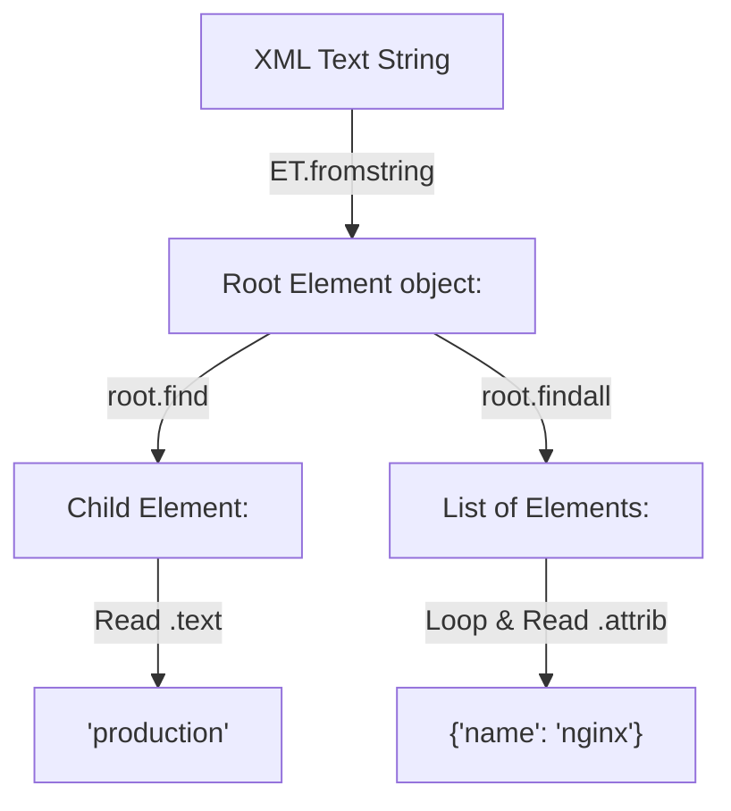

# Parsing XML with ElementTree

Python includes a built-in module called `xml.etree.ElementTree` to parse and manipulate XML data. Unlike JSON, where you get a simple dictionary after parsing, XML is parsed into a tree of element objects. You use specific methods to search this tree, read node text, and extract attributes.

In this guide, we will learn how to use ElementTree. We will compare query methods, parse an XML string, and write a system configuration auditor.

## The ElementTree API

The `xml.etree.ElementTree` module represents the entire XML document as a tree, and each node inside the tree as an `Element` object.

Let's compare the core methods you use to search for elements in the tree.

| Method | What it does | Return Value | Best Use Case |
| :--- | :--- | :--- | :--- |
| **`ET.fromstring()`** | Parses raw XML string data | Root `Element` object | Parsing API text responses |
| **`ET.parse()`** | Opens and parses an XML file | `ElementTree` object | Reading config files on disk |
| **`.find(tag)`** | Searches for the *first* matching child | Single `Element` or `None` | Finding unique values (like server IP) |
| **`.findall(tag)`** | Searches for *all* matching children | List of `Element` objects | Looping over repeated nodes (like server list) |
| **`.iter(tag)`** | Recursively searches all nested levels | Generator yielding `Element` objects | Finding items deep inside complex manifests |

Here is a diagram showing how ElementTree parses an XML string:



## Parsing a Basic XML String

Let's write a script that parses an XML configuration string and reads node text and attributes.

Create a file named `parse_xml.py` and write the code below.

```python
import xml.etree.ElementTree as ET

# A valid XML string config
xml_data = """
<system_config environment="production">
    <database>
        <host>10.0.0.5</host>
        <port>5432</port>
    </database>
    <services>
        <service name="nginx" status="active" />
        <service name="redis" status="stopped" />
    </services>
</system_config>
"""

# Parse the XML string
root = ET.fromstring(xml_data)

# Read root attribute
env = root.attrib.get("environment")
print(f"Environment: {env}")

# Find database details (using find to get first match)
db_host = root.find("database/host").text
db_port = root.find("database/port").text
print(f"Database:    {db_host}:{db_port}")
print("-" * 34)

# Find all service details
print("Active Services:")
services = root.findall("services/service")
for s in services:
    name = s.attrib.get("name")
    status = s.attrib.get("status")
    print(f" - {name}: {status}")
```

Run this file in your terminal.

```bash
python3 parse_xml.py
```

Expected output:
```text
Environment: production
Database:    10.0.0.5:5432
----------------------------------
Active Services:
 - nginx: active
 - redis: stopped
```

## Real-World Example: Java Web App Config Auditor

Let's write an auditor script that opens a Java application configuration file (`web.xml`). The script parses the XML structure, scans all configured servlets, and alerts us if any servlet is mapped to run in debug mode.

Create a file named `audit_web_config.py` and write the code below.

```python
import xml.etree.ElementTree as ET

# Simulated web.xml deployment file
web_xml = """
<web-app>
    <servlet>
        <servlet-name>PaymentProcessor</servlet-name>
        <servlet-class>com.company.PaymentServlet</servlet-class>
        <init-param>
            <param-name>debug</param-name>
            <param-value>true</param-value>
        </init-param>
    </servlet>
    <servlet>
        <servlet-name>UserAuthentication</servlet-name>
        <servlet-class>com.company.AuthServlet</servlet-class>
        <init-param>
            <param-name>debug</param-name>
            <param-value>false</param-value>
        </init-param>
    </servlet>
</web-app>
"""

with open("web.xml", "w") as f:
    f.write(web_xml)

def audit_java_servlets(filepath):
    print("=== Auditing Java App Configurations ===")
    
    try:
        # Load and parse the XML file
        tree = ET.parse(filepath)
        root = tree.getroot()
        
        # Loop through all servlet elements
        servlets = root.findall("servlet")
        for servlet in servlets:
            name = servlet.find("servlet-name").text
            
            # Find init parameters safely
            param_name = servlet.find("init-param/param-name").text
            param_val = servlet.find("init-param/param-value").text
            
            print(f"Servlet: {name} | Param: {param_name} = {param_val}")
            
            if param_name == "debug" and param_val == "true":
                print(f" ⚠️  WARNING: Servlet [{name}] is running with debug mode ACTIVE!")
                
    except FileNotFoundError:
        print("Error: Config file not found.")
    except Exception as err:
        print("Parsing failed: " + str(err))

audit_java_servlets("web.xml")
```

Run the script.

```bash
python3 audit_web_config.py
```

Expected output:
```text
=== Auditing Java App Configurations ===
Servlet: PaymentProcessor | Param: debug = true
 ⚠️  WARNING: Servlet [PaymentProcessor] is running with debug mode ACTIVE!
Servlet: UserAuthentication | Param: debug = false
```

## Common Mistakes

### Crashing on Missing Nodes
If you chain element lookups (like `root.find("db/host").text`) and the intermediate node `db` is missing, Python will return `None` for the find search. Trying to read `.text` from `None` will crash your script with an `AttributeError`.

* **The Bad Way:**
```python
# If database node is missing, this crashes!
# AttributeError: 'NoneType' object has no attribute 'text'
db_host = root.find("database/host").text
```

* **The Good Way:**
Verify the element is not `None` before trying to read its text.
```python
db_node = root.find("database/host")
if db_node is not None:
    db_host = db_node.text
else:
    db_host = "localhost" # Fallback
```

### Confusing find() with findall()
Calling `.find()` when you have multiple matching tags will only return the first occurrence, ignoring the rest. Use `.findall()` to process lists.

* **The Bad Way:**
```python
# Only returns the first service node
services = root.find("services/service")
```

* **The Good Way:**
```python
# Returns a list containing all service nodes
services = root.findall("services/service")
```

## Summary

* Python's built-in `xml.etree.ElementTree` module is used to parse XML.
* Use `ET.fromstring(text)` to parse raw XML strings in memory.
* Use `ET.parse(file)` to read and parse XML files from disk.
* Use `.find(path)` to locate the first matching child element.
* Use `.findall(path)` to get a list of all matching child elements.
* Access tag names using `.tag`, text values using `.text`, and attributes using `.attrib`.
* Verify that an element search did not return `None` before accessing `.text`.
* Standardize xpath queries to search nested elements safely.
* ElementTree is ideal for parsing legacy Java `web.xml` deployment settings.
* Validating parameter variables in XML blocks prevents runtime errors.
