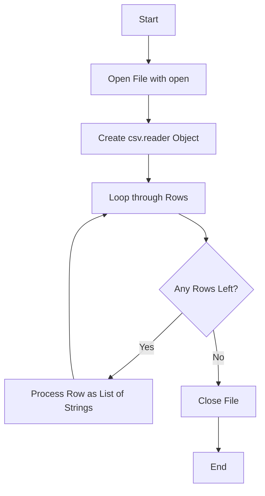

# Reading CSV Files with Python

If you manage servers or handle deployments, you will run into CSV files all the time. CSV stands for Comma-Separated Values. It is a simple, text-based format for storing tables of data. You might get a CSV file containing list of users to create, servers to clean up, or IP addresses to scan. 

In this guide, we will look at how to open and read these files using Python's built-in tools. We do not need to install any external libraries.

---

## Why Use CSV in DevOps?

CSV is a universal format. Every spreadsheet tool can open it, and it is easy to generate from databases or CLI tools. Here is why you will use it:
* Exporting lists of virtual machines or cloud resources.
* Importing user accounts or access lists to configure permissions.
* Reading audit logs or system metric reports.

---

## How CSV Reading Works

Python has a built-in module called `csv`. When you read a CSV file, Python handles the parsing of commas, quotation marks, and line breaks for you. You should not try to parse CSV files using string splits (`line.split(',')`), because fields that contain commas inside quotes will break your code.

Here is the flow of reading a CSV file:



---

## The Basic CSV Reader

Let us start with a simple CSV file called `servers.csv`. Imagine it looks like this:

```text
hostname,ip_address,environment
web-prod-01,192.168.1.10,production
web-prod-02,192.168.1.11,production
db-prod-01,192.168.1.20,production
test-dev-01,10.0.0.5,development
```

To read this file, we open it using the built-in [open](https://docs.python.org/3/library/functions.html#open) function and pass it to [csv.reader](https://docs.python.org/3/library/csv.html#csv.reader).

Here is the Python script to read and print each line:

```python
import csv

# We open the file. We use newline='' as recommended by the python documentation.
with open("servers.csv", mode="r", encoding="utf-8", newline="") as file:
    reader = csv.reader(file)
    
    # Each row is returned as a list of strings
    for row in reader:
        print(row)
```

### Expected Output

```text
['hostname', 'ip_address', 'environment']
['web-prod-01', '192.168.1.10', 'production']
['web-prod-02', '192.168.1.11', 'production']
['db-prod-01', '192.168.1.20', 'production']
['test-dev-01', '10.0.0.5', 'development']
```

---

## Skipping the Header Row

In the example above, the first list printed was the header: `['hostname', 'ip_address', 'environment']`. Usually, you do not want to process the header as a real server. 

You can skip the header by calling the [next](https://docs.python.org/3/library/functions.html#next) function on the reader object before starting your loop.

```python
import csv

with open("servers.csv", mode="r", encoding="utf-8", newline="") as file:
    reader = csv.reader(file)
    
    # Extract the header row and move the reader pointer to the next line
    header = next(reader)
    print(f"Skipped Header: {header}")
    print("---------------------------------")
    
    # Process the remaining rows
    for row in reader:
        hostname = row[0]
        ip = row[1]
        env = row[2]
        print(f"Server: {hostname} ({ip}) is in {env}")
```

### Expected Output

```text
Skipped Header: ['hostname', 'ip_address', 'environment']
---------------------------------
Server: web-prod-01 (192.168.1.10) is in production
Server: web-prod-02 (192.168.1.11) is in production
Server: db-prod-01 (192.168.1.20) is in production
Server: test-dev-01 (10.0.0.5) is in development
```

---

## Custom Delimiters

Not all CSV files use a comma as a separator. Some use tabs (TSV), semicolons, or pipes (`|`). You can tell Python what delimiter to look for using the `delimiter` parameter.

Imagine a file called `users.txt` that looks like this:

```text
username|uid|shell
admin|1000|/bin/bash
backup|34|/usr/sbin/nologin
deploy|1001|/bin/sh
```

Here is how you read this file using the pipe character as a delimiter:

```python
import csv

with open("users.txt", mode="r", encoding="utf-8", newline="") as file:
    reader = csv.reader(file, delimiter="|")
    
    header = next(reader)
    for row in reader:
        username = row[0]
        uid = row[1]
        shell = row[2]
        print(f"User {username} (UID: {uid}) uses shell {shell}")
```

### Expected Output

```text
User admin (UID: 1000) uses shell /bin/bash
User backup (UID: 34) uses shell /usr/sbin/nologin
User deploy (UID: 1001) uses shell /bin/sh
```

---

## Comparison of Reading Approaches

When reading files, you have options. Here is a summary of how they compare:

| Reading Method | Delimiter Handling | Quote Handling | Complexity | Best For |
| :--- | :--- | :--- | :--- | :--- |
| **`csv.reader`** | Automatic via parameter | Handles nested quotes | Low | Simple CSV files where you know the column positions. |
| **`string.split()`** | Hardcoded | Fails on quotes with commas | Low | Quick hacks, but highly discouraged for production. |
| **`csv.DictReader`** | Automatic via parameter | Handles nested quotes | Medium | CSV files with headers where you want to access data by column name. |

---

## Real-World DevOps Scenario: Server Ping Checker

Let us write a small script that reads a list of servers from `hosts.csv` and simulates a check on their availability.

Here is the source `hosts.csv` file:

```text
server_name,ip,port
router-main,192.168.1.254,80
dns-primary,8.8.8.8,53
app-api-01,10.0.1.15,443
```

Here is the Python script:

```python
import csv
import socket

def check_connection(ip, port):
    # This function checks if a port is open
    try:
        # We set a short timeout so the script does not hang
        socket.setdefaulttimeout(2)
        with socket.socket(socket.AF_INET, socket.SOCK_STREAM) as s:
            s.connect((ip, int(port)))
            return "ONLINE"
    except Exception:
        return "OFFLINE"

with open("hosts.csv", mode="r", encoding="utf-8", newline="") as file:
    reader = csv.reader(file)
    next(reader) # skip the header
    
    print("Starting network connectivity checks...")
    print("=======================================")
    
    for row in reader:
        name = row[0]
        ip = row[1]
        port = row[2]
        
        status = check_connection(ip, port)
        print(f"[{status}] {name} on {ip}:{port}")
```

### Expected Output (if connection is blocked/offline)

```text
Starting network connectivity checks...
=======================================
[OFFLINE] router-main on 192.168.1.254:80
[OFFLINE] dns-primary on 8.8.8.8:53
[OFFLINE] app-api-01 on 10.0.1.15:443
```

---

## Common Mistakes

Here are some things to watch out for when reading CSV files:

### 1. Forgetting to set `newline=""`
When opening a CSV file, always pass `newline=""` to [open](https://docs.python.org/3/library/functions.html#open). Without it, Python's file reader might parse line endings incorrectly on different platforms like Windows and Linux.

### 2. Accessing indexes that do not exist
If your CSV file has an empty line at the end, or a line with missing values, trying to access `row[2]` will crash your script with an `IndexError`. You can guard against this by checking the row length:

```python
for row in reader:
    if not row:
        continue # Skip empty lines
    if len(row) < 3:
        print("Skipping incomplete row")
        continue
    # Safe to access row[2] now
```

### 3. Modifying data without converting types
All data read from a CSV file is returned as a string. If you have numbers (like ports or metrics), you must convert them using [int](https://docs.python.org/3/library/functions.html#int) or [float](https://docs.python.org/3/library/functions.html#float) before doing math or passing them to connection tools.

---

## Summary

* CSV files are plain-text tables separated by commas or other custom symbols.
* Use Python's built-in `csv` module rather than splitting lines manually to avoid bugs with quotes and commas.
* Use `newline=""` when opening the file to handle platform line endings correctly.
* Skip the header row using the [next](https://docs.python.org/3/library/functions.html#next) function before looping.
* Change the default separator using the `delimiter` parameter in the reader object.
* Remember that all values are read as strings, so convert them to numbers when needed.
* Filter empty rows to avoid index out of range errors.
* Close the file automatically by using the `with` statement block.
