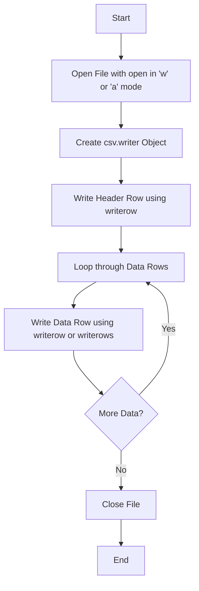

# Writing CSV Files with Python

As a DevOps engineer, you will often need to gather logs, metrics, or server information and present them to other teams. Writing this information to a CSV file is the easiest way to share it. Non-technical teams can open your CSV reports directly in Excel or Google Sheets, while other scripts can parse them easily.

In this guide, we will learn how to write data to CSV files using Python's built-in tools.

---

## Why Write CSV Reports?

Generating CSV files is useful in many automation scenarios:
* Creating weekly reports of disk space usage across all virtual machines.
* Listing all users who have not logged in for 90 days.
* Saving the results of a network vulnerability scan.
* Creating audit logs for compliance checks.

---

## How CSV Writing Works

Python's built-in `csv` module provides a `writer` object. This object helps you write lists of strings directly into a formatted file. The module automatically adds quotes when a field contains a comma or space, ensuring your CSV file does not get corrupted.

Here is the general workflow for writing a CSV file:



---

## The Basic CSV Writer

Let us start with a simple script that writes a list of server locations to a file named `datacenter_locations.csv`.

We open the file in write mode (`"w"`), pass it to [csv.writer](https://docs.python.org/3/library/csv.html#csv.writer), and then use `writerow` to write each row.

```python
import csv

# Prepare the data we want to write
header = ["datacenter_id", "city", "country", "status"]
rows = [
    ["us-east-1", "Ashburn", "USA", "active"],
    ["eu-west-1", "Dublin", "Ireland", "active"],
    ["ap-southeast-1", "Singapore", "Singapore", "active"],
    ["us-west-2", "Portland", "USA", "maintenance"]
]

# Open the file. Always use newline='' to prevent blank lines between rows
with open("datacenter_locations.csv", mode="w", encoding="utf-8", newline="") as file:
    writer = csv.writer(file)
    
    # Write the header first
    writer.writerow(header)
    
    # Write the remaining rows of data
    for row in rows:
        writer.writerow(row)

print("CSV file created successfully!")
```

### Expected Output File (`datacenter_locations.csv`)

If you open the created file in a text editor, you will see this content:

```text
datacenter_id,city,country,status
us-east-1,Ashburn,USA,active
eu-west-1,Dublin,Ireland,active
ap-southeast-1,Singapore,Singapore,active
us-west-2,Portland,USA,maintenance
```

---

## Writing Multiple Rows at Once

If you already have all your data stored in a list of lists, you do not need to loop through them one by one. You can use the `writerows` method to write everything in a single step.

```python
import csv

header = ["job_name", "status", "duration_seconds"]
jobs = [
    ["deploy-web", "success", 120],
    ["run-tests", "failed", 450],
    ["notify-slack", "success", 5]
]

with open("build_jobs.csv", mode="w", encoding="utf-8", newline="") as file:
    writer = csv.writer(file)
    
    # Write the header row
    writer.writerow(header)
    
    # Write all data rows in one call
    writer.writerows(jobs)

print("Build jobs file created!")
```

### Expected Output File (`build_jobs.csv`)

```text
job_name,status,duration_seconds
deploy-web,success,120
run-tests,failed,450
notify-slack,success,5
```

---

## Custom Quoting Modes

Sometimes you need to write CSV files that require quotes around every single text block, or only when there are special characters. You can control this behavior using the `quoting` parameter.

Here is a table showing the options you can pass to the writer:

| Quoting Parameter | Behavior | Output Example |
| :--- | :--- | :--- |
| `csv.QUOTE_MINIMAL` | Only quotes fields containing delimiters or quotes (Default). | `us-east-1,Ashburn,"USA, East Coast"` |
| `csv.QUOTE_ALL` | Quotes every single field regardless of content type. | `"us-east-1","Ashburn","USA"` |
| `csv.QUOTE_NONNUMERIC` | Quotes all text fields. Leaves integers and floats unquoted. | `"us-east-1","Ashburn",120` |
| `csv.QUOTE_NONE` | Never quotes fields. Delimiters inside values must be escaped manually. | `us-east-1,Ashburn,USA` |

Here is how you use `QUOTE_ALL` in code:

```python
import csv

data = [
    ["service", "port", "protocol"],
    ["ssh", 22, "tcp"],
    ["http", 80, "tcp"]
]

with open("services.csv", mode="w", encoding="utf-8", newline="") as file:
    # Set quoting to csv.QUOTE_ALL
    writer = csv.writer(file, quoting=csv.QUOTE_ALL)
    writer.writerows(data)
```

### Expected Output File (`services.csv`)

```text
"service","port","protocol"
"ssh","22","tcp"
"http","80","tcp"
```

---

## Real-World DevOps Scenario: Disk Space Reporter

Let us write a script that checks directory sizes and saves the results to a CSV report. This simulates an automated cron job report.

```python
import csv
import os
import shutil

# Directories to check
directories = {
    "system_root": "C:\\" if os.name == "nt" else "/",
    "user_home": os.path.expanduser("~")
}

report_data = []

for name, path in directories.items():
    if os.path.exists(path):
        total, used, free = shutil.disk_usage(path)
        # Convert bytes to Gigabytes for better readability
        used_gb = round(used / (1024 ** 3), 2)
        free_gb = round(free / (1024 ** 3), 2)
        report_data.append([name, path, used_gb, free_gb])

# Write the report
report_file = "disk_report.csv"
header = ["directory_name", "path", "used_gb", "free_gb"]

with open(report_file, mode="w", encoding="utf-8", newline="") as file:
    writer = csv.writer(file)
    writer.writerow(header)
    writer.writerows(report_data)

print(f"Report written to {report_file}")
```

### Expected Output File (`disk_report.csv` - values will vary depending on your system)

```text
directory_name,path,used_gb,free_gb
system_root,C:\,150.45,320.12
user_home,C:\Users\username,45.21,320.12
```

---

## Common Mistakes

Here are some typical mistakes people make when writing CSV files:

### 1. Forgetting `newline=""` on Windows
If you do not specify `newline=""` when calling [open](https://docs.python.org/3/library/functions.html#open), Windows systems will write an extra carriage return (`\r`) at the end of every row. This results in an empty blank line between every row of data in your CSV.

### 2. Overwriting existing data by accident
Opening a file in `"w"` mode wipes out all existing data. If you want to append new rows to an existing log file, use append mode (`"a"`):

```python
# Append a new log line to an existing file
with open("daily_logs.csv", mode="a", encoding="utf-8", newline="") as file:
    writer = csv.writer(file)
    writer.writerow(["2026-06-25", "INFO", "Backup completed"])
```

### 3. Writing non-iterable variables to `writerow`
The `writerow` method expects a list or sequence. If you pass a single string, Python will treat that string as an iterable and put a comma after every single character.

For example, `writer.writerow("hello")` will output:
`h,e,l,l,o` instead of writing the single word `hello` in one cell. Always wrap single elements in a list: `writer.writerow(["hello"])`.

---

## Summary

* CSV writing lets you generate logs and report files that are readable by non-technical teams.
* Use Python's built-in `csv` module to handle row formatting and automatic quoting.
* Always set `newline=""` when opening the file to prevent blank lines on Windows.
* Use `"w"` mode to create or overwrite a file, and `"a"` mode to append new rows.
* Use `writer.writerow(row)` for single lists, and `writer.writerows(all_rows)` to write a collection of rows.
* Select different quoting options like `csv.QUOTE_ALL` or `csv.QUOTE_NONNUMERIC` to match target systems.
* Convert number values or bytes to reader-friendly numbers (like Gigabytes) before writing reports.
* Wrap single values in a list when using `writerow` to avoid splitting text into single characters.
