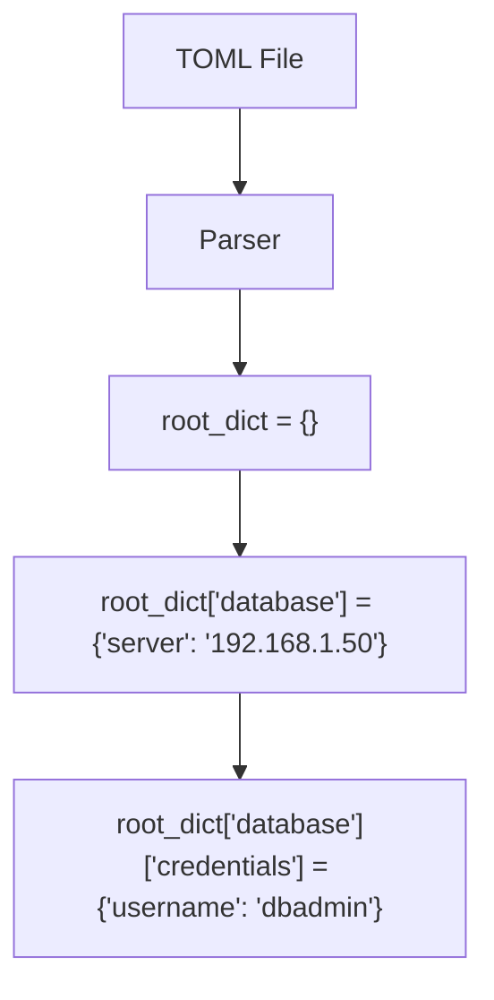

# Introduction to TOML

When building tools and managing configuration files, you need a format that is easy for humans to write and edit, but also easy for machines to read. For a long time, we used INI files, JSON, or YAML. Today, a format called TOML is becoming one of the most popular choices for configuration.

TOML stands for **Tom's Obvious, Minimal Language**. It was created by Tom Preston-Werner (one of the founders of GitHub) to be a simple config format that maps directly to hash tables (dictionaries) in programming languages.

In this guide, we will look at what TOML is, its syntax rules, and why it is widely used in modern DevOps and Python development.

---

## Why Choose TOML?

In the Python world, you will see TOML used in `pyproject.toml`, which is the standard file used to configure Python packaging, dependencies, and testing tools. Other DevOps tools like GitLab Runner, Hugo, and influxDB also use TOML for configuration.

Let us look at how TOML compares to other common configuration formats:

| Format | Readability | Data Types | Comments Supported | Best For |
| :--- | :--- | :--- | :--- | :--- |
| **TOML** | High | Yes (dates, floats, lists) | Yes (`#`) | Application configuration, project settings |
| **YAML** | Medium (indentation issues) | Yes | Yes (`#`) | Complex infrastructure deployments, CI/CD |
| **JSON** | Low (lots of braces/commas) | Yes | No | API data exchange, machine-to-machine |
| **INI** | High | No (everything is a string) | Yes (`;` or `#`) | Very simple key-value settings |

---

## TOML Syntax Basics

A TOML file is case-sensitive and must be a valid UTF-8 text file. Let us explore the basic building blocks of TOML.

### 1. Key-Value Pairs

The most basic element is a key-value pair. Keys are on the left, values are on the right, separated by an equal sign (`=`).

```toml
# This is a comment
app_name = "deployer"
port = 8080
enable_ssl = true
pi = 3.1415
```

### 2. Supported Data Types

TOML supports a variety of data types out of the box:
* **Strings**: Wrapped in double quotes (e.g., `"hello"`).
* **Integers**: Whole numbers (e.g., `42` or `1_000` using underscores for readability).
* **Floats**: Fractional numbers (e.g., `99.9` or `1e6`).
* **Booleans**: Only lowercase `true` or `false`.
* **Date and Time**: ISO 8601 formatted timestamps (e.g., `2026-06-25T08:30:00Z`).
* **Arrays**: Lists of values wrapped in brackets (e.g., `[ 80, 443, 8080 ]`).

### 3. Tables (Sections)

Tables are used to group keys together. You define a table by putting its name inside square brackets. Everything below that header belongs to that table until another table starts.

```toml
[database]
server = "192.168.1.50"
ports = [ 3306, 3307 ]
connection_max = 5000
```

### 4. Nested Tables

You can nest tables inside other tables using dot notation. For example, `[database.credentials]` creates a table inside the `[database]` table.

```toml
[database]
server = "192.168.1.50"

[database.credentials]
username = "dbadmin"
password = "supersecretpassword"
```

---

## Visualizing TOML Mapping

Here is how a nested TOML structure gets parsed into a Python dictionary:



---

## Real-World Example: Tool Configuration File

Here is what a complete TOML configuration file looks like for a DevOps backup script. Let us call this `backup_config.toml`:

```toml
# backup_config.toml
title = "Daily Server Backup Config"

[owner]
name = "DevOps Team"
email = "devops@company.com"

[backup]
source_directories = [ "/var/www/html", "/etc/nginx" ]
destination_bucket = "s3://company-backups-2026"
interval_hours = 24
compression_level = 9

[database]
enabled = true
host = "db-prod.internal"
port = 5432
databases = [ "users", "inventory" ]

[database.limits]
timeout_seconds = 120
max_retries = 3
```

---

## Common Mistakes

Here are some syntax mistakes that will prevent your TOML file from loading:

### 1. Re-defining a Key or Table
You cannot define the same key or table more than once. The following is invalid and will crash the parser:

```toml
# INVALID TOML
[server]
port = 80

[server] # Error: Table [server] already defined
host = "127.0.0.1"
```

### 2. Using Single Quotes for Strings incorrectly
TOML supports literal strings using single quotes (e.g., `'C:\Users'`), which is great for file paths because you do not have to escape backslashes. However, literal strings do not support escape sequences like `\n` or `\t`. If you need escape sequences, you must use double quotes.

```toml
# Path using literal string (no escape needed)
path = 'C:\Users\admin'

# Path using standard string (must double escape)
path_escaped = "C:\\Users\\admin"
```

### 3. Mixing Data Types in Arrays (Pre-TOML v1.0.0)
Older TOML parsers required arrays to contain only one data type (e.g., only strings, or only integers). While the modern TOML specification allows mixed arrays (like `[1, 2, "three"]`), it is still best practice to keep arrays homogeneous (same data type) to prevent parsing errors in older toolchains.

---

## Summary

* TOML is designed to be easy for humans to read and write, and it maps cleanly to dictionaries.
* It is the standard format for Python package configuration via `pyproject.toml`.
* Comments start with `#` and can be placed anywhere.
* Keys are separated from values by an equal sign (`=`).
* Values can be strings, integers, floats, booleans, dates, arrays, or tables.
* Tables are defined with brackets (e.g., `[database]`) and are used to group configurations.
* Nested tables use dot notation (e.g., `[database.credentials]`).
* Underscores can be used in numbers to make them easier to read (e.g., `100_000` instead of `100000`).
* String values must use double quotes, unless you are writing a literal string (like file paths) using single quotes.
* Avoid duplicating keys or table names, as this makes the file invalid.
