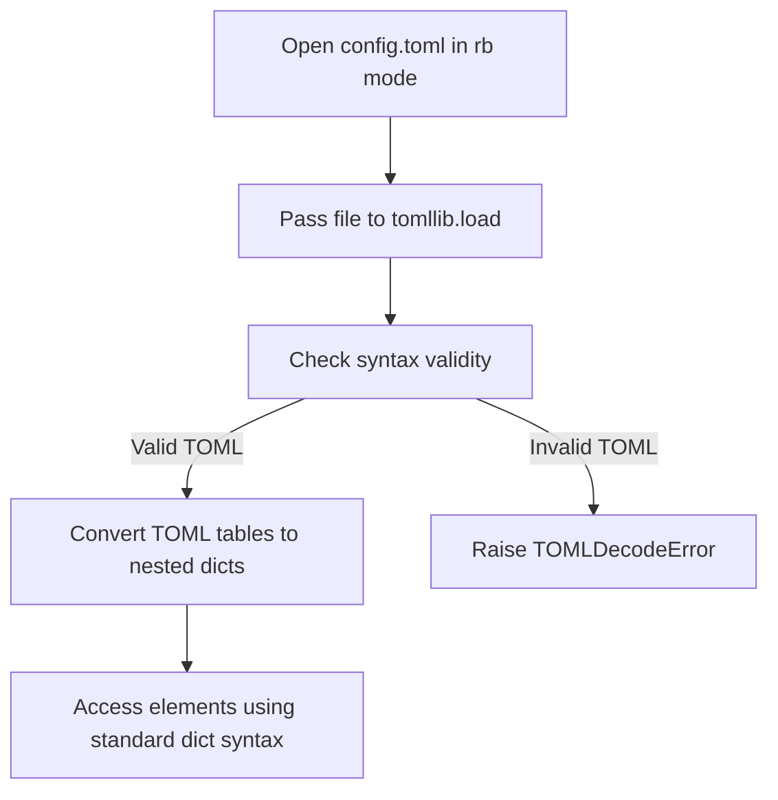

# Reading TOML Files with Python

In Python 3.11, the standard library added support for reading TOML files via a built-in module called [tomllib](https://docs.python.org/3/library/tomllib.html). This means you no longer need to install external packages like `pip` libraries just to read configuration settings.

In this guide, we will look at how to read and parse TOML configuration files using Python.

---

## Python's TOML Ecosystem

Depending on the Python version you are running on your servers, you have a few choices for parsing TOML:

| Library | Included in Standard Library? | Read/Write Support | Best For |
| :--- | :--- | :--- | :--- |
| **`tomllib`** | Yes (Python 3.11+) | Read-Only | Modern Python scripts running on Python 3.11 or newer. |
| **`tomli`** | No (install via pip) | Read-Only | Legacy Python codebases (Python 3.7 to 3.10). |
| **`toml`** | No (install via pip) | Read and Write | Scripts that need to modify and output TOML files. |

> [!NOTE]
> Python's built-in `tomllib` is strictly read-only. It does not contain any code for writing or updating TOML files.

---

## Reading a TOML Configuration File

Let us create a configuration file named `config.toml` that contains settings for our deployment tool:

```toml
# config.toml
app_name = "uptime-monitor"
debug_mode = true

[database]
host = "10.0.0.12"
port = 5432
timeout = 30.5
```

To read this file, we use `tomllib.load()`. Note a key rule: **`tomllib` requires you to open the file in binary mode (`"rb"`)**.

Here is the Python script:

```python
import tomllib

# Open the file in read-binary mode ('rb')
with open("config.toml", mode="rb") as file:
    config = tomllib.load(file)

# The result is a standard Python dictionary
print("Config Loaded:")
print(config)

# Accessing values
print("\nAccessing Values:")
print(f"Application Name: {config['app_name']}")
print(f"Database Server: {config['database']['host']}")
print(f"Database Port: {config['database']['port']}")
```

### Expected Output

```text
Config Loaded:
{'app_name': 'uptime-monitor', 'debug_mode': True, 'database': {'host': '10.0.0.12', 'port': 5432, 'timeout': 30.5}}

Accessing Values:
Application Name: uptime-monitor
Database Server: 10.0.0.12
Database Port: 5432
```

---

## Parsing TOML Strings

If you already have a TOML block loaded as a string (for example, downloaded from an API or read from a environment variable), you can parse it using `tomllib.loads()`.

```python
import tomllib

toml_string = """
[monitoring]
enabled = false
frequency_seconds = 60
targets = ["google.com", "github.com"]
"""

# Parse string directly
settings = tomllib.loads(toml_string)

print(f"Monitoring enabled? {settings['monitoring']['enabled']}")
print(f"Target list: {settings['monitoring']['targets']}")
```

### Expected Output

```text
Monitoring enabled? False
Target list: ['google.com', 'github.com']
```

---

## Processing Flow

Here is how Python opens, parses, and resolves TOML config keys:



---

## Real-World DevOps Scenario: Backing Up Configurations with Version Checks

In production environments, you might run scripts on different systems with different Python versions. Here is a script that safely attempts to load `tomllib` if available, and falls back to `tomli` on older Python versions, while validating our application credentials.

```python
import sys

# Safe import wrapper for older Python environments
try:
    import tomllib as toml_parser
except ImportError:
    try:
        import tomi as toml_parser  # type: ignore
    except ImportError:
        print("Error: Please install the 'tomli' package or upgrade to Python 3.11+")
        sys.exit(1)

# Sample config file parsing with validation
config_content = """
[server]
address = "192.168.10.25"
port = 8080
allowed_methods = ["GET", "POST"]
"""

try:
    config = toml_parser.loads(config_content)
    
    # Simple validation rules
    server = config.get("server", {})
    address = server.get("address")
    port = server.get("port")
    
    if not address or not port:
        raise ValueError("Missing address or port in config")
        
    print(f"Configuration OK. Target set to: {address}:{port}")
    
except Exception as err:
    print(f"Configuration loading failed: {err}")
```

### Expected Output

```text
Configuration OK. Target set to: 192.168.10.25:8080
```

---

## Common Mistakes

Here are some typical issues you will encounter when loading TOML files:

### 1. Opening the file in text mode `"r"`
Unlike JSON and YAML loading methods which read standard text files, `tomllib.load` expects a binary stream. If you open the file with `mode="r"`, you will get a `TypeError`.

```python
# WRONG - raises TypeError: Expected binary file
with open("config.toml", "r") as f:
    tomllib.load(f)

# CORRECT - open in binary mode
with open("config.toml", "rb") as f:
    tomllib.load(f)
```

### 2. Missing handling for `TOMLDecodeError`
If your TOML file has a typo (like a missing quote or trailing comma in an older parser), the loading method will raise `tomllib.TOMLDecodeError`. Always wrap your load logic in a `try-except` block:

```python
try:
    with open("broken_config.toml", "rb") as f:
        config = tomllib.load(f)
except tomllib.TOMLDecodeError as err:
    print(f"Failed to parse TOML config file: {err}")
```

### 3. Attempting to save files using `tomllib`
Remember that `tomllib` does not support serialization (writing). Attempting to find a `dump` or `dumps` function in `tomllib` will raise an `AttributeError`. If you need to write configuration files, you must use a library like `tomli_w` or `toml`.

---

## Summary

* Python 3.11+ includes the [tomllib](https://docs.python.org/3/library/tomllib.html) module for built-in TOML reading.
* Use `tomllib.load(file)` to load from a file, and `tomllib.loads(string)` to parse a string.
* You must open TOML files in binary mode (`"rb"`) when using `tomllib`.
* `tomllib` is read-only; it does not write or dump TOML files.
* For older Python versions (3.7 to 3.10), use the external `tomli` library as a replacement.
* Wrap parsing code in `try-except` statements to catch `tomllib.TOMLDecodeError` when files have syntax errors.
* Use standard dictionary get methods or keys to access nested values, lists, and booleans.
* Booleans are parsed directly into Python's `True` and `False` types.
* Numeric values with underscores (e.g. `1_000`) are correctly parsed as integers.
