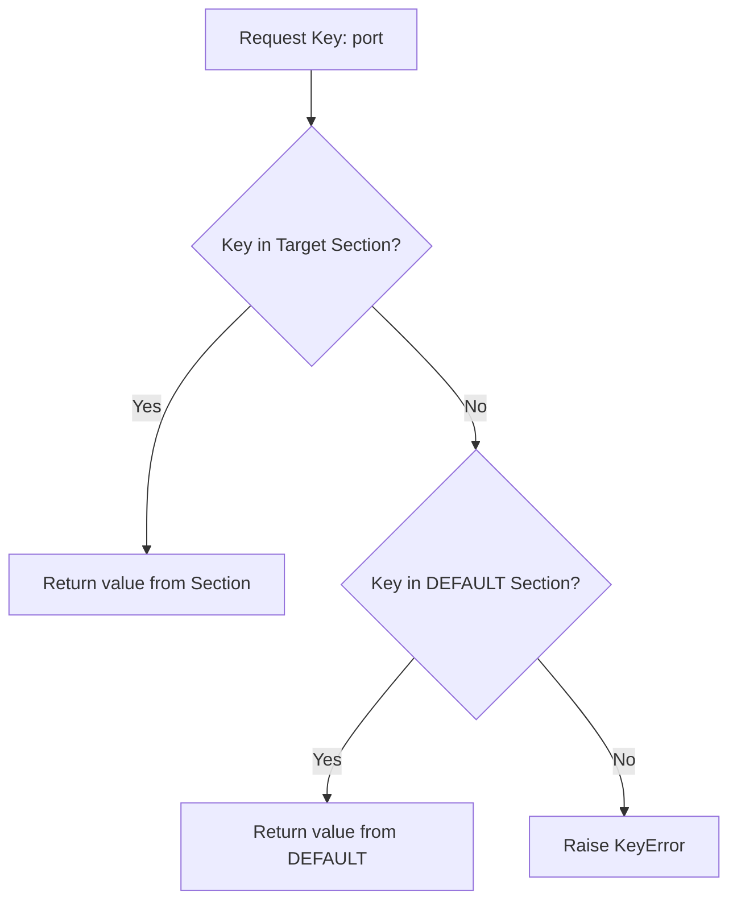

# Reading and Writing INI Files with configparser

To work with INI files in Python, we use the built-in [configparser](https://docs.python.org/3/library/configparser.html) module. This library lets you read, modify, and write INI configurations easily. It also handles value conversions for you so you do not have to write manual conversion code.

In this guide, we will learn how to parse existing INI files, access values, convert data types, and write updates back to files.

---

## Why Use configparser?

The `configparser` module parses sections and keys into dictionary-like structures. It also provides helper methods to fetch numbers and booleans automatically. 

Here is a quick summary of the helper getter methods:

| Method Name | Return Type | Description |
| :--- | :--- | :--- |
| `config.get('sec', 'key')` | `str` | Returns the raw string value (Default). |
| `config.getint('sec', 'key')` | `int` | Converts the string to an integer. |
| `config.getfloat('sec', 'key')` | `float` | Converts the string to a float. |
| `config.getboolean('sec', 'key')` | `bool` | Converts truthy strings (like `"yes"`, `"true"`, `"1"`) to `True`, and falsy to `False`. |

---

## Reading an INI File

Let us create an INI configuration named `app_settings.ini`:

```ini
[DEFAULT]
app_version = 1.2.0
environment = staging

[server]
host = 127.0.0.1
port = 8000
enable_ssl = yes

[cache]
timeout = 300.5
```

Now, let us use Python to read this file and print the values:

```python
import configparser

# Create a config parser object
config = configparser.ConfigParser()

# Read the INI file
config.read("app_settings.ini")

# Access sections and values
host = config["server"]["host"]
port = config.getint("server", "port")
ssl = config.getboolean("server", "enable_ssl")
timeout = config.getfloat("cache", "timeout")

# Default values are fallback fields
version = config["server"]["app_version"]

print(f"Host: {host}")
print(f"Port: {port} (Type: {type(port)})")
print(f"SSL Enabled: {ssl} (Type: {type(ssl)})")
print(f"Timeout: {timeout} (Type: {type(timeout)})")
print(f"App Version: {version} (Loaded from DEFAULT section)")
```

### Expected Output

```text
Host: 127.0.0.1
Port: 8000 (Type: <class 'int'>)
SSL Enabled: True (Type: <class 'bool'>)
Timeout: 300.5 (Type: <class 'float'>)
App Version: 1.2.0 (Loaded from DEFAULT section)
```

---

## Modifying and Writing INI Files

You can modify configurations and write them back to an INI file by opening a file in write mode (`"w"`) and calling the `write()` method.

Here is a script that modifies our server settings and saves them:

```python
import configparser

config = configparser.ConfigParser()
config.read("app_settings.ini")

# 1. Modify an existing value
config["server"]["port"] = "8080" # All values set manually must be strings

# 2. Add a new section and keys
config["database"] = {
    "db_host": "db.local",
    "db_port": "5432"
}

# 3. Write updates back to a file
with open("app_settings_updated.ini", mode="w", encoding="utf-8") as file:
    config.write(file)

print("Updates saved to app_settings_updated.ini")
```

### Expected Output File (`app_settings_updated.ini`)

```ini
[DEFAULT]
app_version = 1.2.0
environment = staging

[server]
host = 127.0.0.1
port = 8080
enable_ssl = yes

[cache]
timeout = 300.5

[database]
db_host = db.local
db_port = 5432
```

---

## Data Lookup Flow

Here is the hierarchy `configparser` uses to find a key:



---

## Real-World DevOps Scenario: Configuration Validations

In automated deployment environments, you want to make sure your scripts fail quickly if keys are missing from configuration files. Here is how you can read and validate an INI file.

```python
import configparser
import os
import sys

def load_deployment_settings(config_path):
    if not os.path.exists(config_path):
        print(f"Error: Config file not found at {config_path}")
        sys.exit(1)
        
    config = configparser.ConfigParser()
    config.read(config_path)
    
    # Validation block
    try:
        settings = {
            "host": config.get("server", "host"),
            "port": config.getint("server", "port"),
            "ssl": config.getboolean("server", "enable_ssl"),
            "env": config.get("server", "environment") # fallback to DEFAULT
        }
        return settings
    except configparser.NoSectionError as err:
        print(f"Configuration Error: Missing Section - {err}")
        sys.exit(1)
    except configparser.NoOptionError as err:
        print(f"Configuration Error: Missing Key - {err}")
        sys.exit(1)
    except ValueError as err:
        print(f"Configuration Error: Invalid value type - {err}")
        sys.exit(1)

# Write demo configuration
demo_content = """
[server]
host = web-server.local
port = invalid_port
enable_ssl = yes
"""
with open("demo_broken.ini", "w") as f:
    f.write(demo_content)

# Attempt to load and trigger the type validation error
load_deployment_settings("demo_broken.ini")
```

### Expected Output

```text
Configuration Error: Invalid value type - invalid literal for int() with base 10: 'invalid_port'
```

---

## Common Mistakes

Here are some errors to keep in mind when working with `configparser`:

### 1. Setting non-string values
When updating configurations in code, you must pass values as strings. If you set a boolean or integer directly (like `config['server']['port'] = 80`), the writer will throw a `TypeError` when calling `write()`.

```python
# WRONG - raises TypeError
config["server"]["port"] = 80

# CORRECT - convert to string first
config["server"]["port"] = str(80)
```

### 2. Forgetting that section names are case-sensitive
Section and key lookups are case-sensitive by default. If you search for `config['Server']` but the INI contains `[server]`, it will raise a `KeyError`.

### 3. Using incorrect values for Booleans
The `getboolean` helper reads specific string patterns:
* **Truthy values**: `1`, `yes`, `true`, `on`.
* **Falsy values**: `0`, `no`, `false`, `off`.
If you write anything else (like `enable_ssl = positive`), calling `getboolean` will raise a `ValueError`.

---

## Summary

* Use Python's built-in [configparser](https://docs.python.org/3/library/configparser.html) module to parse INI files.
* Initialize the parser using `configparser.ConfigParser()`.
* Access values using dictionary brackets or helper getters.
* Use `getint()`, `getfloat()`, and `getboolean()` to convert strings to Python data types.
* `getboolean()` converts words like `"yes"`, `"no"`, `"on"`, and `"off"` directly into boolean types.
* Define fallback variables in the `[DEFAULT]` section.
* All values modified or added in code must be converted to strings before writing.
* Use `config.write(file_object)` to save configuration updates back to the disk.
* Wrap code in `try-except` blocks to catch parsing errors like `NoSectionError`, `NoOptionError`, or `ValueError`.
* Keep in mind that sections and keys are case-sensitive.
