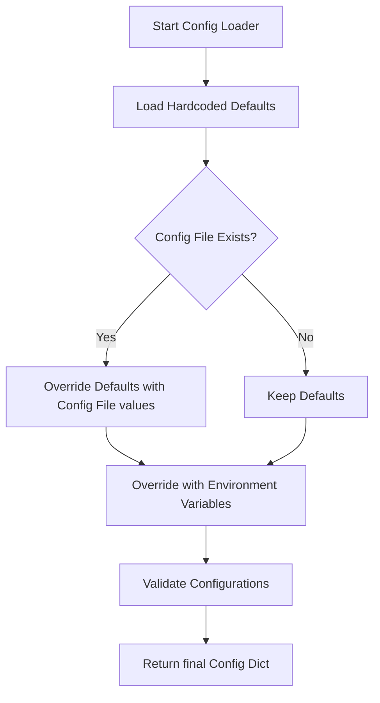

# Configuration Management Patterns

When you write scripts to automate system tasks, you will run them on different environments: your local laptop for development, a staging server for testing, and the live production servers. Managing configuration values across these environments can quickly become messy if you do not follow solid patterns.

In this guide, we will look at professional patterns for configuring your Python automation tools, how to override settings safely, and how to handle secrets.

---

## The Configuration Hierarchy Pattern

A standard pattern in software automation is the configuration hierarchy. Instead of hardcoding settings, you load configurations from multiple sources in a specific order. 

Here is the recommended order of overrides (from lowest priority to highest):

1. **Default values**: Hardcoded values in your Python script.
2. **Configuration file**: System-level or repository-level config files (like TOML or INI).
3. **Environment variables**: System-level values that override both defaults and files.

This layout allows you to change settings on the fly without modifying files or code.



---

## Comparison of Configuration Sources

Let us compare different places to store settings:

| Source | Ease of Editing | Security Level | Best For |
| :--- | :--- | :--- | :--- |
| **Hardcoded Defaults** | Very low (requires code changes) | Low | Default ports, default timeouts |
| **TOML/INI Config File** | Medium (requires editing a file) | Medium (safe if stored outside git) | Region names, static file paths, hostnames |
| **Environment Variables** | High (easy to change in CI/CD or CLI) | High (never saved in codebase) | Passwords, API tokens, encryption keys |

---

## Implementing an Override Configuration Loader

Let us write a configuration class that implements this override pattern. We will use a TOML configuration file and environment variables to configure our database connection details.

Here is the local `settings.toml` file:

```toml
# settings.toml
[database]
host = "db-dev.local"
port = 5432
username = "dev_user"
```

Here is our Python script, which implements the [os.environ](https://docs.python.org/3/library/os.html#os.environ) module to search for overrides:

```python
import os
import tomllib

class ConfigLoader:
    def __init__(self, config_path="settings.toml"):
        self.config_path = config_path
        # 1. Start with hardcoded defaults
        self.config = {
            "db_host": "localhost",
            "db_port": 3306,
            "db_user": "root",
            "db_password": ""
        }
        
        # Load from sources
        self._load_file()
        self._load_env_overrides()
        
    def _load_file(self):
        # 2. Override with settings from the TOML file if it exists
        if os.path.exists(self.config_path):
            try:
                with open(self.config_path, "rb") as file:
                    file_data = tomllib.load(file)
                    db_settings = file_data.get("database", {})
                    
                    if "host" in db_settings:
                        self.config["db_host"] = db_settings["host"]
                    if "port" in db_settings:
                        self.config["db_port"] = int(db_settings["port"])
                    if "username" in db_settings:
                        self.config["db_user"] = db_settings["username"]
            except Exception as err:
                print(f"Warning: Failed to load config file: {err}")

    def _load_env_overrides(self):
        # 3. Override with environment variables (highest priority)
        # We look for specific prefixes to avoid matching unrelated variables
        env_host = os.environ.get("APP_DB_HOST")
        env_port = os.environ.get("APP_DB_PORT")
        env_user = os.environ.get("APP_DB_USER")
        env_pass = os.environ.get("APP_DB_PASSWORD")
        
        if env_host:
            self.config["db_host"] = env_host
        if env_port:
            self.config["db_port"] = int(env_port)
        if env_user:
            self.config["db_user"] = env_user
        if env_pass:
            self.config["db_password"] = env_pass

    def get(self, key):
        return self.config.get(key)

# --- Verification ---

# Let us set an environment override for testing
os.environ["APP_DB_PASSWORD"] = "SuperSecurePassword123"
os.environ["APP_DB_PORT"] = "9999"

# Initialize our loader
loader = ConfigLoader()

# Print out resolved configuration
print("Resolved settings:")
print(f"Host: {loader.get('db_host')}")       # Should load from settings.toml
print(f"Port: {loader.get('db_port')}")       # Should load from Environment variable
print(f"User: {loader.get('db_user')}")       # Should load from settings.toml
print(f"Password: {loader.get('db_password')}") # Should load from Environment variable
```

### Expected Output

```text
Resolved settings:
Host: db-dev.local
Port: 9999
User: dev_user
Password: SuperSecurePassword123
```

---

## Secret Management Best Practices

One of the most common security mistakes in DevOps is committing passwords, API keys, or access tokens into git repositories. 

Follow these rules to manage secrets:

### 1. Create a `.gitignore` Rule
If your configuration file contains local parameters or credentials, add it to your `.gitignore` file immediately. Commit a template file instead, like `settings.toml.example`, which lists the keys but leaves the values empty.

### 2. Never Save Credentials in Source Code
If your Python script has `api_token = "abc123xyz"`, it is a security risk. If you upload it to Github, anyone can steal your credentials.

### 3. Load Secrets via Environment Variables
In container runtimes (like Docker or Kubernetes) or CI/CD pipelines (like GitLab CI or GitHub Actions), pass secrets as environment variables. Your script can load them at runtime using [os.environ.get](https://docs.python.org/3/library/os.html#os.environ).

---

## Common Mistakes

Here are some errors to watch out for:

### 1. Failing to parse environment variable types
All environment variables read via `os.environ` are returned as strings. If you try to compare a port string to an integer, it will fail:

```python
# WRONG - comparing string to int
if os.environ.get("DB_PORT") == 5432:
    print("Default port used")

# CORRECT - cast value first
db_port = int(os.environ.get("DB_PORT", 5432))
if db_port == 5432:
    print("Default port used")
```

### 2. Failing to validate critical variables
Do not assume that all configuration values exist. Always validate that required keys are present before starting any automation jobs:

```python
required_keys = ["db_host", "db_user", "db_password"]
for key in required_keys:
    if not loader.get(key):
        raise ValueError(f"Configuration validation failed: {key} is empty!")
```

---

## Summary

* Follow the Configuration Hierarchy pattern: Defaults -> Config Files -> Environment variables.
* Use environment variables to override static file configurations on target servers.
* Use environment variables to handle secrets like passwords, tokens, and keys.
* Always add configuration files containing real secrets to your `.gitignore` file.
* Provide a template file (e.g. `settings.toml.example`) in your codebase instead.
* Convert environment variables to their target types (like integers or booleans) inside your loader.
* Validate that all required configuration keys exist before running operations.
* Keep configuration keys uniform between different configurations files and environment mappings.
* Use prefixes on environment variables (like `APP_DB_PORT`) to prevent key collisions with other programs.
