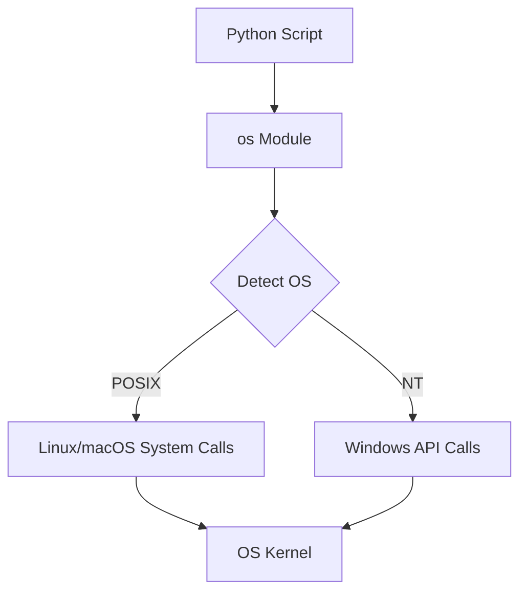

# OS Module Overview

When writing scripts for automation, your code needs to talk to the operating system. You might need to find out where a script is running, read environment settings, create folders, or list files. In Python, the built-in tool for this is the [os](https://docs.python.org/3/library/os.html) module.

The `os` module is Python's way of offering portable system commands. Portable means that a script you write on your Windows laptop should be able to run on a Linux server without modification.

In this guide, we will explore what the `os` module does, why it matters, and how it translates shell commands you already know into Python code.

---

## Why Use the `os` Module?

In DevOps, you are constantly writing scripts to automate manual tasks. Instead of writing shell scripts (like Bash for Linux or PowerShell for Windows) which only work on one operating system, you can write Python scripts that work on both. The `os` module acts as a translator between Python and the underlying operating system.

Here is the general architecture of how Python communicates with the operating system:



---

## Command Reference: Shell vs. Python

If you are already familiar with the command-line terminal, here is a table mapping common terminal commands to their `os` module equivalents:

| Linux Command | Windows Command | Python `os` Module Equivalent | Purpose |
| :--- | :--- | :--- | :--- |
| `pwd` | `cd` | `os.getcwd()` | Get the current working directory path. |
| `ls` | `dir` | `os.listdir(path)` | List files and directories in a path. |
| `mkdir` | `mkdir` | `os.mkdir(path)` | Create a new directory. |
| `rm` | `del` | `os.remove(path)` | Delete a file. |
| `rmdir` | `rmdir` | `os.rmdir(path)` | Delete an empty directory. |
| `env` | `set` | `os.environ` | Read or write environment variables. |

---

## Basic OS Module Example

Let us write a simple script that acts like a system discovery tool. This script gathers information about the environment it is running in and prints it out.

```python
import os
import platform

# 1. Identify the operating system type
# 'posix' means Linux/macOS, 'nt' means Windows
os_type = os.name

# 2. Get the current directory we are running in
current_dir = os.getcwd()

# 3. Get the login name of the user running this script
user_login = os.getlogin() if os_type != 'nt' else os.environ.get("USERNAME", "Unknown")

# 4. Count the number of CPU cores available on this system
cpu_count = os.cpu_count()

print("System Discovery Report")
print("=======================")
print(f"OS Family: {os_type} ({platform.system()})")
print(f"Running in Directory: {current_dir}")
print(f"Executed By User: {user_login}")
print(f"CPU Cores Available: {cpu_count}")
```

### Expected Output (Linux environment example)

```text
System Discovery Report
=======================
OS Family: posix (Linux)
Running in Directory: /home/deployer/scripts
Executed By User: deployer
CPU Cores Available: 4
```

---

## Real-World Scenario: Basic Directory Inspector

Let us write a small tool that checks if a directory exists, prints its contents, and reports the current script path. This is a very common task when scanning logs or checking upload folders.

```python
import os

# We will check the current directory
target_path = os.getcwd()

print(f"Inspecting directory: {target_path}")
print("---------------------------------")

if os.path.exists(target_path):
    # Get all items in the folder
    items = os.listdir(target_path)
    
    file_count = 0
    dir_count = 0
    
    for item in items:
        # Construct the full path to check
        full_item_path = os.path.join(target_path, item)
        
        if os.path.isdir(full_item_path):
            dir_count += 1
            print(f"[DIR]  {item}")
        else:
            file_count += 1
            print(f"[FILE] {item}")
            
    print("---------------------------------")
    print(f"Summary: Found {dir_count} directories and {file_count} files.")
else:
    print("Error: Target directory does not exist.")
```

### Expected Output

```text
Inspecting directory: /home/deployer/scripts
---------------------------------
[DIR]  logs
[DIR]  backups
[FILE] deploy.py
[FILE] config.ini
---------------------------------
Summary: Found 2 directories and 2 files.
```

---

## Common Mistakes

Here are some errors to watch out for when using the `os` module:

### 1. Hardcoding Path Separators
Linux uses forward slashes (`/`) for paths, while Windows uses backslashes (`\`). If you write code like `path = "logs/" + filename`, it will break on Windows. Always use `os.path.join` or the `pathlib` module to build file paths automatically.

### 2. Using `os.system` to run shell commands
The `os.system()` function is an old way of running commands (like `os.system("ls -la")`). It is insecure and does not let you capture the command's output or handle errors cleanly. For running system commands, you should always use the `subprocess` module instead (which we will cover in a later chapter).

### 3. Assuming `os.getlogin()` always works
The `os.getlogin()` function reads the control terminal to find the username. If you run your script inside an automated task runner (like a cron job, systemd service, or CI/CD runner), there is no terminal attached, and `os.getlogin()` will fail with an error. To avoid this, read the user from environment variables instead:

```python
# Safer way to get user name in background tasks
user = os.environ.get("USER") or os.environ.get("USERNAME") or "system"
```

---

## Summary

* The [os](https://docs.python.org/3/library/os.html) module is Python's built-in system interface library.
* Use it to write system tasks that work across different operating systems.
* Use `os.name` to identify if the current platform is Windows (`nt`) or Linux/macOS (`posix`).
* Use `os.getcwd()` to find the current directory path.
* Use `os.listdir(path)` to inspect folder contents.
* Avoid using string splits or slashes to connect paths; use `os.path.join()` instead.
* Avoid `os.system()` for running CLI commands; use the newer `subprocess` module.
* Use `os.environ` to safely query environment variables on target machines.
* Check for item types using `os.path.isdir()` and `os.path.isfile()`.
* Be careful with `os.getlogin()` in background jobs, and fall back to environment variables.
