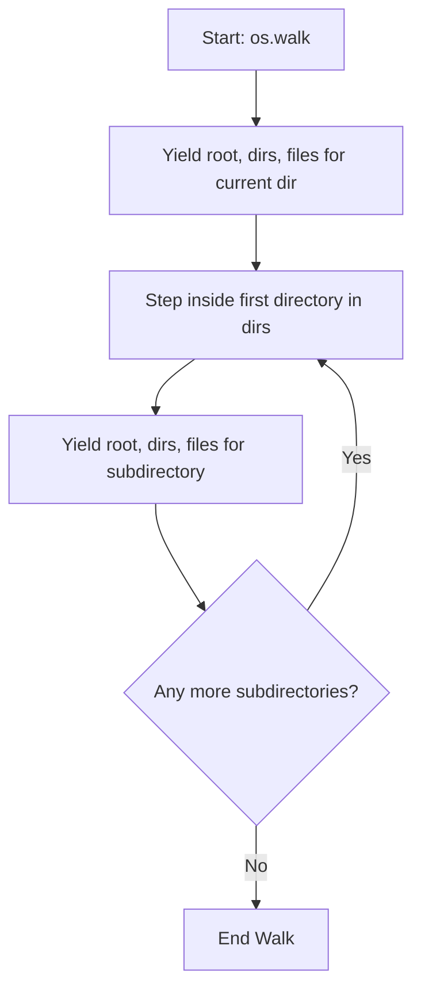

# Working with Directories

When automating system management, folder manipulation is one of the tasks you will perform most often. Whether you need to set up directory structures for new deployments, clear out old logs, or search for files recursively, Python's `os` module has the functions you need.

In this guide, we will learn how to create, remove, change, and traverse directories using Python.

---

## Directory Management Functions

Here is a summary of the primary functions in the `os` module used for directory operations:

| Function Name | Equivalent Shell Command | Description |
| :--- | :--- | :--- |
| `os.getcwd()` | `pwd` | Returns the current working directory path. |
| `os.chdir(path)` | `cd path` | Changes the current working directory to `path`. |
| `os.mkdir(path)` | `mkdir path` | Creates a single directory. Fails if parent folders do not exist. |
| `os.makedirs(path)` | `mkdir -p path` | Creates nested directories. Creates all missing parent directories. |
| `os.rmdir(path)` | `rmdir path` | Deletes an empty directory. Fails if the directory is not empty. |
| `os.walk(path)` | `find path` | Generates file names in a directory tree by walking either top-down or bottom-up. |

---

## Creating and Removing Directories

Let us see how these functions work in practice. When creating directories, you should use `os.makedirs()` if you need to create nested directories (like `logs/2026/june/`). If you use `os.mkdir()`, Python will throw an error if the parent folders do not already exist.

```python
import os

# 1. Create a single directory
dir_name = "test_reports"
if not os.path.exists(dir_name):
    os.mkdir(dir_name)
    print(f"Created directory: {dir_name}")
else:
    print(f"Directory {dir_name} already exists.")

# 2. Create nested directories (mkdir -p)
nested_path = "backups/database/daily"
if not os.path.exists(nested_path):
    os.makedirs(nested_path)
    print(f"Created nested path: {nested_path}")
else:
    print(f"Nested path {nested_path} already exists.")

# 3. Remove directories
# Note: rmdir only works if the target directory is empty!
empty_dir = "test_reports"
if os.path.exists(empty_dir):
    os.rmdir(empty_dir)
    print(f"Removed empty directory: {empty_dir}")
```

### Expected Output

```text
Created directory: test_reports
Created nested path: backups/database/daily
Removed empty directory: test_reports
```

---

## Walking Through Directories Recursively

If you need to search a folder tree for specific files (like `.log` or `.tmp` files), the most powerful tool is `os.walk()`. 

`os.walk()` walks through a directory and for each subdirectory, it yields a tuple containing:
1. The path to the current directory (`root`).
2. A list of subdirectories in that directory (`dirs`).
3. A list of files in that directory (`files`).

Here is how the recursion flow looks:



Let us look at a code example of `os.walk()` scanning a mock directory tree:

```python
import os

# Create dummy folders and files for testing
os.makedirs("project/src", exist_ok=True)
os.makedirs("project/tests", exist_ok=True)

with open("project/src/main.py", "w") as f:
    f.write("# Main code")
with open("project/tests/test_main.py", "w") as f:
    f.write("# Test code")
with open("project/README.md", "w") as f:
    f.write("# Project documentation")

# Now, walk the project folder structure
print("Walking directory tree:")
print("=======================")

for root, dirs, files in os.walk("project"):
    print(f"Current Directory (root): {root}")
    print(f"Subdirectories inside: {dirs}")
    print(f"Files inside: {files}")
    print("-" * 30)
```

### Expected Output

```text
Walking directory tree:
=======================
Current Directory (root): project
Subdirectories inside: ['src', 'tests']
Files inside: ['README.md']
------------------------------
Current Directory (root): project/src
Subdirectories inside: []
Files inside: ['main.py']
------------------------------
Current Directory (root): project/tests
Subdirectories inside: []
Files inside: ['test_main.py']
------------------------------
```

---

## Real-World DevOps Scenario: Log and Temp Cleanup Script

DevOps engineers must keep server storage clean. Here is a script that searches a directory tree and deletes any file ending with `.tmp` or `.log` that has been created.

```python
import os

target_folder = "project"

print(f"Starting temp and log cleanup in: {target_folder}")
print("=======================================")

cleanup_count = 0

# Walk the folder structure
for root, dirs, files in os.walk(target_folder):
    for filename in files:
        if filename.endswith(".tmp") or filename.endswith(".log"):
            file_path = os.path.join(root, filename)
            try:
                # Remove file from disk
                os.remove(file_path)
                print(f"[DELETED] {file_path}")
                cleanup_count += 1
            except Exception as err:
                print(f"[ERROR] Failed to delete {file_path}: {err}")

print("=======================================")
print(f"Cleanup finished. Removed {cleanup_count} files.")
```

### Expected Output (if target files exist)

```text
Starting temp and log cleanup in: project
=======================================
[DELETED] project/src/debug.log
[DELETED] project/tests/run.tmp
=======================================
Cleanup finished. Removed 2 files.
```

---

## Common Mistakes

Here are some typical issues when dealing with directory commands:

### 1. Changing directory inside scripts (`os.chdir`)
Using `os.chdir()` inside a script changes the directory for the entire Python process. If you run a script that calls `os.chdir()`, all relative file paths you use later in the script will be evaluated from the new folder. This easily leads to "file not found" bugs. 
Instead of changing directories to read files, it is best practice to keep the working directory unchanged and build absolute paths using `os.path.join()`.

### 2. Assuming `os.rmdir()` works on non-empty folders
If you try to call `os.rmdir("project")` on a folder that contains files or subdirectories, Python will raise an `OSError: [Errno 39] Directory not empty`. If you need to delete a folder and all of its contents recursively, you must use `shutil.rmtree()` (which we will cover in a later chapter).

### 3. Modifying `dirs` during `os.walk` in-place incorrectly
If you want to skip walking certain directories (like skipping `.git` or `node_modules` folders to speed up execution), you can modify the `dirs` list *in-place*. You must use slice assignment `dirs[:] = ...` or remove items using `.remove()`. Re-assigning `dirs = []` does not work because it creates a new local variable rather than modifying the list that `os.walk` is reading.

```python
# CORRECT way to skip a directory during os.walk
for root, dirs, files in os.walk("project"):
    if ".git" in dirs:
        dirs.remove(".git") # os.walk will not enter .git folders
```

---

## Summary

* Use `os.getcwd()` to find the current directory path.
* Use `os.chdir(path)` to change the folder directory of the running script.
* Use `os.mkdir(path)` to create a single directory.
* Use `os.makedirs(path, exist_ok=True)` to create nested paths without crashing if folders exist.
* Delete empty folders using `os.rmdir(path)`.
* Use `os.walk(path)` to recursively inspect all folders, subdirectories, and files.
* Build paths inside `os.walk` loops by joining the `root` variable and `filename`.
* Do not use `os.chdir` repeatedly; use absolute paths to prevent file references from breaking.
* Modifying the `dirs` list in-place during `os.walk` lets you skip scanning specific directories.
* Use the external `shutil` module if you need to delete folders that contain files.
