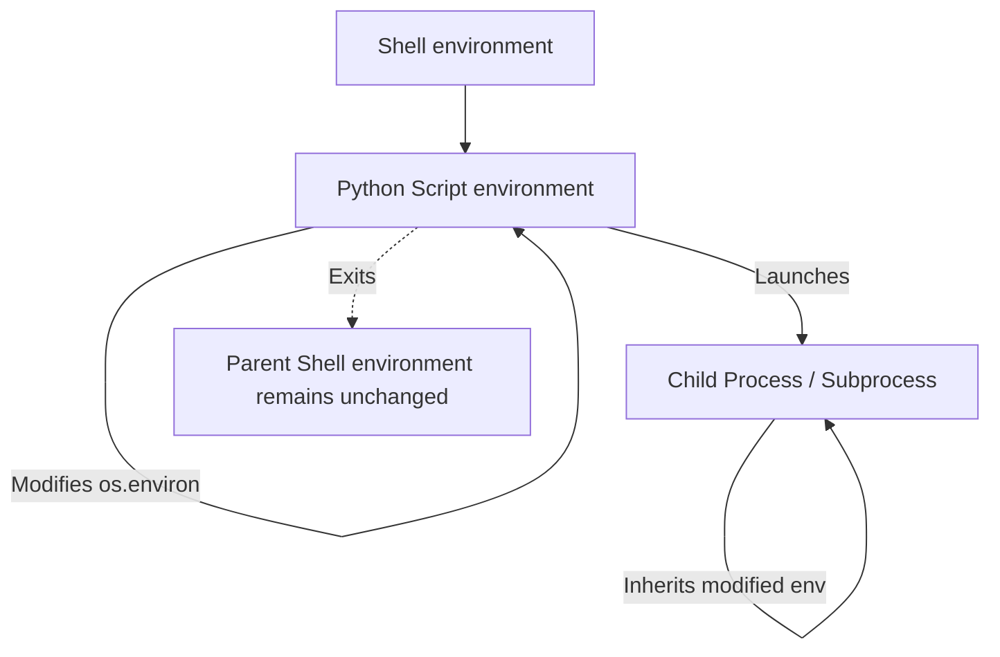

# Environment Variables

In DevOps, environment variables are everywhere. They are used to pass configurations to Docker containers, inject passwords and secrets from CI/CD systems, change log levels, and point scripts to correct target databases. 

In Python, the standard way to read, write, and manage environment variables is through the `os` module, specifically using [os.environ](https://docs.python.org/3/library/os.html#os.environ).

In this guide, we will learn how to interact with environment variables in your scripts safely.

---

## What is `os.environ`?

In Python, `os.environ` is not a standard dictionary, but a special mapping object that represents the environment variables of the running shell process. When you modify `os.environ`, it updates the environment variables for your script and any child processes that your script starts.

Let us compare the different ways you can access values from `os.environ`:

| Method | Syntax Example | Behavior if Key is Missing | Best For |
| :--- | :--- | :--- | :--- |
| **Direct Access** | `os.environ['KEY']` | Raises `KeyError` | Critical variables that *must* exist. |
| **Get Method** | `os.environ.get('KEY')` | Returns `None` | Optional variables. |
| **Get with Default** | `os.environ.get('KEY', 'default')` | Returns `'default'` | Variables with sane default fallbacks. |

---

## Reading Environment Variables

Let us write a simple script that reads basic system environment variables and checks for custom deployment settings.

```python
import os

# 1. Read default system variables
# On Linux/macOS, USER holds username. On Windows, it is USERNAME.
username = os.environ.get("USER") or os.environ.get("USERNAME") or "unknown"
system_path = os.environ.get("PATH", "Not Found")

# 2. Read custom application variables
# We use default fallbacks for optional configurations
log_level = os.environ.get("APP_LOG_LEVEL", "INFO")
db_port = os.environ.get("APP_DB_PORT", "5432")

print("Environment Variables Check")
print("===========================")
print(f"Current System User: {username}")
print(f"Log Level Configured: {log_level}")
print(f"Database Port: {db_port}")
print(f"Path Variable Length: {len(system_path)} characters")
```

### Expected Output

```text
Environment Variables Check
===========================
Current System User: deployer
Log Level Configured: INFO
Database Port: 5432
Path Variable Length: 450 characters
```

---

## Setting and Modifying Environment Variables

You can assign values to `os.environ` just like a dictionary. Note that **both the key and the value must be strings**. 

If you try to assign an integer or boolean, Python will throw a `TypeError`.

```python
import os
import subprocess

# 1. Set values in the environment dictionary
# Remember to convert integers or booleans to strings!
os.environ["API_TIMEOUT"] = "30"
os.environ["DEBUG_ENABLED"] = "true"

# 2. Check if a variable exists in the environment
if "API_TIMEOUT" in os.environ:
    print(f"API timeout is set to {os.environ['API_TIMEOUT']} seconds.")

# 3. Delete an environment variable if needed
# Use pop to avoid KeyError if the variable was not set
removed_val = os.environ.pop("DEBUG_ENABLED", None)
print(f"Removed variable. Previous value was: {removed_val}")
```

### Expected Output

```text
API timeout is set to 30 seconds.
Removed variable. Previous value was: true
```

---

## Environment Scope and Child Processes

It is critical to understand how environment variables flow. When a Python script starts, it copies the environment variables of its parent process (the shell you launched it from).



Any changes you make inside the Python script to `os.environ` only affect that Python script and any child subprocesses it spawns. Once the Python script exits, your changes disappear. They **never** write back to the parent shell that started the script.

---

## Real-World DevOps Scenario: Web App Startup Check

Here is a script that represents a typical startup wrapper for a containerized application. It verifies that database credentials exist, sets up port settings, and logs the configuration state.

```python
import os
import sys

def check_startup_requirements():
    print("Verifying environment settings...")
    
    # Required secrets - script exits if these are missing
    required_secrets = ["DB_PASSWORD", "API_KEY"]
    missing = []
    
    for secret in required_secrets:
        if secret not in os.environ or not os.environ[secret].strip():
            missing.append(secret)
            
    if missing:
        print(f"CRITICAL ERROR: The following secrets are missing: {', '.join(missing)}")
        print("Application startup aborted.")
        sys.exit(1)
        
    # Optional parameters with default fallbacks
    host = os.environ.get("APP_HOST", "0.0.0.0")
    port = os.environ.get("APP_PORT", "8080")
    
    print("---------------------------------------")
    print(f"Database connection verified.")
    print(f"Starting server on http://{host}:{port}")
    print("---------------------------------------")

# Let us run it with a simulated API key and password
os.environ["DB_PASSWORD"] = "my_vault_password"
os.environ["API_KEY"] = "prod_api_token_abc"

check_startup_requirements()
```

### Expected Output

```text
Verifying environment settings...
---------------------------------------
Database connection verified.
Starting server on http://0.0.0.0:8080
---------------------------------------
```

---

## Common Mistakes

Here are some typical mistakes people make with environment variables:

### 1. Expecting changes to persist in the shell
If you run a Python script that sets `os.environ['MY_VAR'] = 'test'`, and then run `echo $MY_VAR` in your terminal after the script finishes, the variable will not be set. A child process cannot change the environment of its parent process.

### 2. Passing non-string values
`os.environ` only accepts strings. If you pass an integer or boolean, the script will crash:

```python
# WRONG - raises TypeError: str expected, not int
os.environ["TIMEOUT"] = 60

# CORRECT - cast to string
os.environ["TIMEOUT"] = str(60)
```

### 3. Using `os.environ.get` for critical variables without checking for None
If you write `db_pass = os.environ.get("DB_PASSWORD")`, and the variable is missing, `db_pass` becomes `None`. If you pass `None` to a database connection function, it might crash with a cryptic error or try to connect with no password. Always check if critical variables are present:

```python
db_pass = os.environ.get("DB_PASSWORD")
if db_pass is None:
    raise KeyError("DB_PASSWORD environment variable is required")
```

---

## Summary

* Use [os.environ](https://docs.python.org/3/library/os.html#os.environ) to read, set, and delete environment variables.
* Access optional environment variables using `.get()` with fallback values (e.g. `os.environ.get('PORT', '80')`).
* Access critical environment variables using direct brackets (`os.environ['KEY']`) to raise a `KeyError` if they are missing.
* Remember that environment variables are case-sensitive on most systems.
* All keys and values assigned to `os.environ` must be strings.
* Changes made to `os.environ` do not persist in the parent shell after your Python script exits.
* Child processes started by Python automatically inherit all environment modifications you made in `os.environ`.
* Use `os.environ.pop('KEY', None)` to safely delete keys without raising errors if they do not exist.
* Always validate that required secrets are not empty strings before initiating system tasks.
