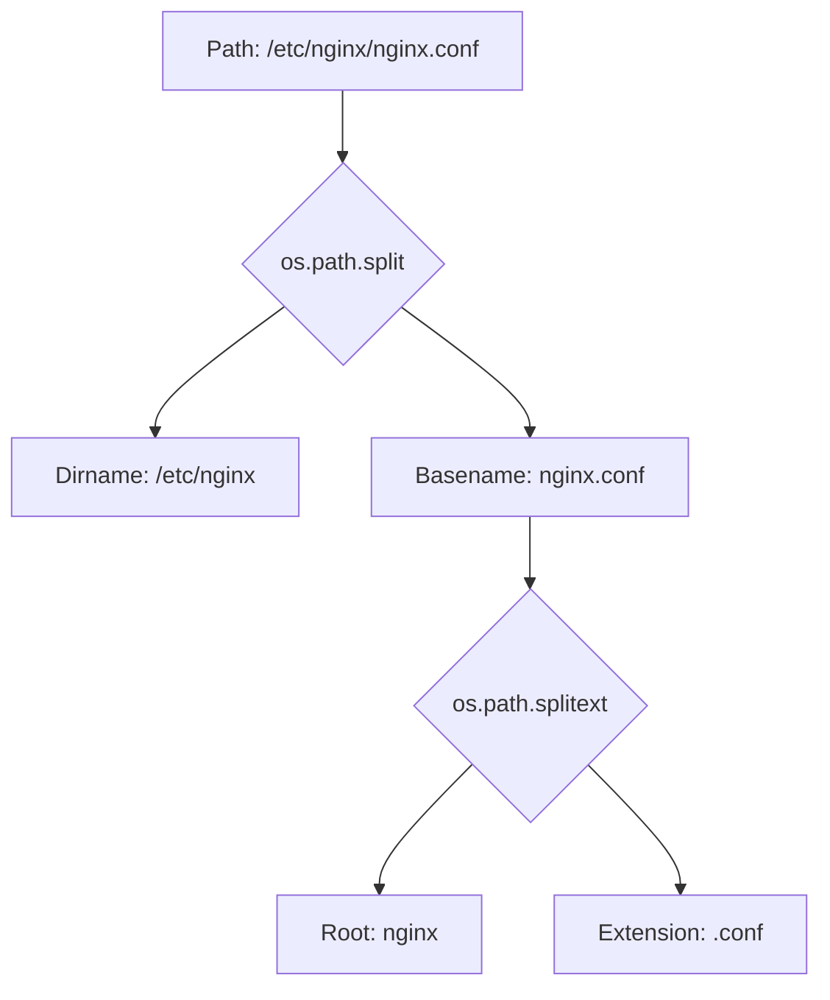

# File Path Operations with os.path

When you write scripts that deal with files and folders, you have to build, split, check, and clean up file paths. Because Windows uses backslashes (`\`) and Linux/macOS use forward slashes (`/`), hardcoding path separators will make your scripts fail when moved to another platform.

To solve this, Python provides the [os.path](https://docs.python.org/3/library/os.path.html) module. This library handles all the platform differences behind the scenes so your path manipulations work everywhere.

In this guide, we will learn how to handle file paths using the `os.path` module.

---

## Key Functions in os.path

Here is a summary of the most useful functions in `os.path`:

| Function Name | Return Type | Description |
| :--- | :--- | :--- |
| `os.path.join(path, *paths)` | `str` | Combines path segments using the correct operating system separator. |
| `os.path.abspath(path)` | `str` | Returns the absolute (full) path of a file or folder. |
| `os.path.basename(path)` | `str` | Returns the file name or last directory name (the tail of the path). |
| `os.path.dirname(path)` | `str` | Returns the directory portion of the path (the head of the path). |
| `os.path.split(path)` | `tuple` | Splits a path into a `(dirname, basename)` tuple. |
| `os.path.splitext(path)` | `tuple` | Splits a path into `(root_path, file_extension)`. |
| `os.path.exists(path)` | `bool` | Checks if a file or directory exists at the given path. |

---

## Joining and Normalizing Paths

The most important rule when working with paths in Python is: **never use string concatenation (like `folder + "/" + file`) to join paths**. Always use `os.path.join`.

Here is a code example demonstrating how to build and normalize paths:

```python
import os

base_dir = "backups"
sub_dir = "logs"
filename = "server_status.txt"

# 1. Join paths safely
# On Windows, this creates: backups\logs\server_status.txt
# On Linux, this creates: backups/logs/server_status.txt
full_path = os.path.join(base_dir, sub_dir, filename)
print(f"Joined Path: {full_path}")

# 2. Get absolute path
absolute_path = os.path.abspath(full_path)
print(f"Absolute Path: {absolute_path}")

# 3. Clean up messy paths (remove duplicate slashes or dots)
messy_path = "backups/../backups/logs/./server_status.txt"
clean_path = os.path.normpath(messy_path)
print(f"Normalized Path: {clean_path}")
```

### Expected Output (Linux example)

```text
Joined Path: backups/logs/server_status.txt
Absolute Path: /home/deployer/scripts/backups/logs/server_status.txt
Normalized Path: backups/logs/server_status.txt
```

---

## Splitting Paths and Extracting Details

Sometimes you need to inspect a path to extract the file name, the parent folder, or the file extension (for instance, checking if a log file has a `.log` extension).

Here is how you parse a path:



Let us look at a script that splits paths:

```python
import os

file_path = "/var/log/nginx/access.log"

# Extract filename
filename = os.path.basename(file_path)

# Extract parent directory
parent_dir = os.path.dirname(file_path)

# Split into (parent, filename) tuple in one call
directory, name = os.path.split(file_path)

# Extract file extension
file_root, extension = os.path.splitext(file_path)

print(f"Filename: {filename}")
print(f"Parent Directory: {parent_dir}")
print(f"Split Result: Dir -> '{directory}', File -> '{name}'")
print(f"File Root: {file_root} | Extension: {extension}")
```

### Expected Output

```text
Filename: access.log
Parent Directory: /var/log/nginx
Split Result: Dir -> '/var/log/nginx', File -> 'access.log'
File Root: /var/log/nginx/access | Extension: .log
```

---

## Real-World DevOps Scenario: Log File Archiver

Let us write a script that checks a folder, verifies if a log file exists, splits the extension, and renames it with a timestamp for archiving.

```python
import datetime
import os

def archive_log_file(filepath):
    # Check if the file exists and is indeed a file
    if not os.path.exists(filepath):
        print(f"Error: File '{filepath}' does not exist.")
        return
        
    if not os.path.isfile(filepath):
        print(f"Error: '{filepath}' is not a valid file.")
        return
        
    # Split the path to isolate extension
    root, extension = os.path.splitext(filepath)
    
    # Get current timestamp
    timestamp = datetime.datetime.now().strftime("%Y%m%d_%H%M%S")
    
    # Construct the new archived filename
    archived_name = f"{root}_{timestamp}{extension}"
    
    print(f"Archiving log file:")
    print(f"Source: {filepath}")
    print(f"Target: {archived_name}")
    
    # Rename file
    os.rename(filepath, archived_name)
    print("Archive completed successfully.")

# Let us create a dummy log file to test
dummy_log = "app_run.log"
with open(dummy_log, "w") as f:
    f.write("Log entries...")

# Run the archiving function
archive_log_file(dummy_log)
```

### Expected Output

```text
Archiving log file:
Source: app_run.log
Target: app_run_20260625_083000.log
Archive completed successfully.
```

---

## Common Mistakes

Here are some typical errors to avoid when parsing paths:

### 1. Hardcoding the path slash
Never write code like this:
`config_path = base_dir + "/" + "config.ini"`
If you run this on Windows, Python will try to search using forward slashes. While Windows APIs often accept forward slashes, mixing slash orientations inside paths can cause validation errors in other modules. Always use `os.path.join()`.

### 2. Confusing `os.path.split()` with `string.split()`
`os.path.split(path)` only splits a path into two components: the head (everything before the last slash) and the tail (everything after). If you want to split a path into all of its directory parts, you can split using the directory separator:

```python
path = "/var/log/nginx"
# Split path using the OS-specific directory separator
parts = path.strip(os.sep).split(os.sep)
print(parts) # Output: ['var', 'log', 'nginx']
```

### 3. Forgetting that `os.path.splitext` keeps the dot in the extension
When using `os.path.splitext()`, the returned file extension includes the leading period (e.g. `".log"`, not `"log"`). If you are checking extensions, you must include the dot in your checks:

```python
# WRONG - will evaluate to False
if ext == "log":
    pass

# CORRECT
if ext == ".log":
    pass
```

---

## Summary

* The [os.path](https://docs.python.org/3/library/os.path.html) module provides portable, platform-independent path operations.
* Always join path segments using `os.path.join()` instead of string concatenation.
* Convert relative paths to absolute system paths using `os.path.abspath()`.
* Clean up messy path formatting (like `../` and `./`) using `os.path.normpath()`.
* Use `os.path.basename()` to retrieve only the file or folder name.
* Use `os.path.dirname()` to retrieve the parent folder path.
* Use `os.path.split()` to split a path into its directory and filename components.
* Extract extensions from filenames using `os.path.splitext()`.
* Remember that the extension returned by `splitext()` includes the leading dot.
* Use `os.path.exists()` to check if a file or directory is present before attempting operations.
