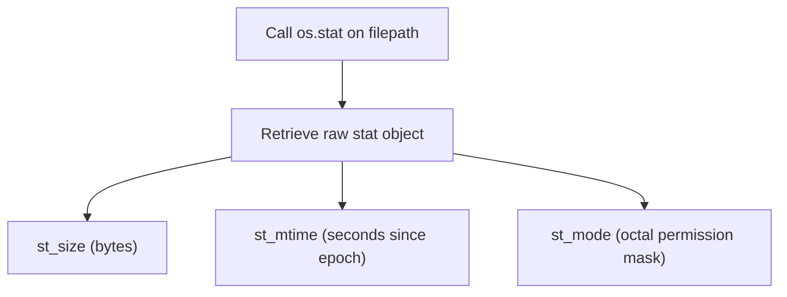

# File and Directory Operations

Managing files on a server requires more than just reading and writing their content. You will often need to rename log files, delete temporary files, change file permissions, and check file metadata (like size or the last time a file was modified).

In this guide, we will learn how to perform system-level file operations using Python's built-in `os` module.

---

## File and Directory Manipulation Functions

Here is a summary of the primary functions in the `os` module for managing files and directory entries:

| Function Name | Equivalent Shell Command | Description |
| :--- | :--- | :--- |
| `os.remove(path)` | `rm file` | Deletes a file from the system. Fails if the path is a directory. |
| `os.rename(src, dst)` | `mv src dst` | Renames or moves a file or directory. |
| `os.replace(src, dst)` | `mv src dst` | Atomic rename/move. Overwrites destination if it exists (on POSIX systems). |
| `os.stat(path)` | `stat file` | Retrieves metadata like file size, permissions, and creation timestamps. |
| `os.chmod(path, mode)` | `chmod mode file` | Changes file permissions (e.g., read, write, execute permissions). |

---

## Renaming and Deleting Files Safely

Let us see how to rename and delete files in Python. We will create a temporary file, check its existence, rename it, and then delete it.

```python
import os

filename = "temp_metrics.csv"
archived_name = "archive_metrics.csv"

# 1. Create a dummy file
with open(filename, "w") as file:
    file.write("timestamp,metric\n2026-06-25,95\n")

# 2. Rename the file
if os.path.exists(filename):
    os.rename(filename, archived_name)
    print(f"Renamed file: {filename} -> {archived_name}")

# 3. Delete the file
if os.path.exists(archived_name):
    os.remove(archived_name)
    print(f"Deleted file: {archived_name}")
```

### Expected Output

```text
Renamed file: temp_metrics.csv -> archive_metrics.csv
Deleted file: archive_metrics.csv
```

---

## Reading File Metadata with os.stat

To inspect a file's size, owner, or modification time, we use `os.stat()`. This function returns a special object containing system statistics. 

Here are the key properties of the returned object:
* `st_size`: File size in bytes.
* `st_mtime`: Time of last modification (Unix epoch timestamp).
* `st_mode`: File mode/permissions.

Here is the flow of reading metadata:



Let us look at a code example:

```python
import datetime
import os

# Create a temporary file
with open("test.txt", "w") as f:
    f.write("A short sentence.")

# Get file statistics
file_info = os.stat("test.txt")

# Extract properties
size_in_bytes = file_info.st_size
mod_timestamp = file_info.st_mtime

# Convert Unix epoch timestamp to a readable datetime
readable_time = datetime.datetime.fromtimestamp(mod_timestamp)

print(f"File Size: {size_in_bytes} bytes")
print(f"Last Modified Timestamp: {mod_timestamp}")
print(f"Readable Modification Time: {readable_time}")

# Clean up
os.remove("test.txt")
```

### Expected Output

```text
File Size: 17 bytes
Last Modified Timestamp: 1782376200.1245
Readable Modification Time: 2026-06-25 08:30:00.124500
```

---

## Changing Permissions with chmod

On Linux and macOS servers, managing file permissions (read, write, execute) is crucial for security. You can change file permissions using `os.chmod()` and passing octal numbers (like `0o755` for public read/execute or `0o600` for owner-only read/write).

```python
import os

# Create a shell script to run
script_name = "run_backup.sh"
with open(script_name, "w") as f:
    f.write("#!/bin/bash\necho 'Running backup...'\n")

# Set permissions to owner read/write/execute, others read/execute (755)
# Note: 0o prefix is required in Python to write an octal number!
os.chmod(script_name, 0o755)
print(f"Permissions for {script_name} updated to 755")

# Set permissions to owner-only read and write (600)
os.chmod(script_name, 0o600)
print(f"Permissions for {script_name} restricted to 600")

# Clean up
os.remove(script_name)
```

### Expected Output

```text
Permissions for run_backup.sh updated to 755
Permissions for run_backup.sh restricted to 600
```

---

## Real-World DevOps Scenario: Log Rotation and Cleanup Inspector

Let us build a small log rotation script. This script scans a folder, finds log files that exceed 1 Megabyte in size, and moves them to an archive folder.

```python
import os
import shutil

# Setup test directories and a mock large log file
os.makedirs("app/logs", exist_ok=True)
os.makedirs("app/archive", exist_ok=True)

large_log = "app/logs/server.log"
with open(large_log, "w") as f:
    # Write 1.2 Megabytes of dummy text
    f.write("LOG ENTRY DETAIL INFORMATION\n" * 45000)

print("Starting log rotation check...")
print("=============================")

# Define threshold: 1 Megabyte in bytes
LIMIT = 1 * 1024 * 1024

if os.path.exists(large_log):
    # Check size
    stats = os.stat(large_log)
    print(f"Log file size is: {stats.st_size} bytes")
    
    if stats.st_size > LIMIT:
        target_path = "app/archive/server.log.old"
        # Move and replace atomically
        os.replace(large_log, target_path)
        print(f"[ROTATED] Log moved to {target_path}")
    else:
        print("[OK] Log file size is within limits.")

# Clean up folders
shutil.rmtree("app")
print("Cleanup finished.")
```

### Expected Output

```text
Starting log rotation check...
=============================
Log file size is: 1305000 bytes
[ROTATED] Log moved to app/archive/server.log.old
Cleanup finished.
```

---

## Common Mistakes

Here are some typical mistakes you will run into:

### 1. Using `os.rename()` across different mount points/filesystems
`os.rename()` can fail if you try to move a file from one disk partition to another (for example, moving a file from a temporary RAM disk `/tmp` to an NFS mount `/mnt/shared`). It will throw an `OSError: [Errno 18] Invalid cross-device link`. 
To safely move files between different filesystems, use `shutil.move()` instead.

### 2. Forgetting the `0o` prefix in chmod octals
In Python, octal numbers (which specify Unix file permissions) must start with `0o`. If you pass `os.chmod('file.txt', 755)`, Python will treat `755` as a base-10 integer (which is `0o1363` in octal), corrupting your file permissions. Always write permissions like `0o755`, `0o644`, or `0o600`.

### 3. Attempting to delete folders with `os.remove()`
`os.remove()` is strictly for files. If you pass a directory path to `os.remove()`, Python will raise an `IsADirectoryError`. Use `os.rmdir()` or `shutil.rmtree()` instead.

---

## Summary

* Use `os.remove(path)` to delete files from the system.
* Use `os.rename(src, dst)` to rename or move a file or folder within the same filesystem.
* Use `os.replace(src, dst)` for an atomic move that replaces the destination file if it already exists.
* Retrieve file metadata (size, timestamps, modes) using `os.stat(path)`.
* Convert Unix timestamps from `st_mtime` to human-readable times using the `datetime` module.
* Change Unix permissions of files and folders using `os.chmod(path, mode)`.
* Always write file permission masks using the Python octal prefix `0o` (e.g. `0o755`).
* Avoid using `os.rename()` for moves between different disks or filesystems; use `shutil.move()` instead.
* Avoid passing folder paths to `os.remove()`; it only handles files.
