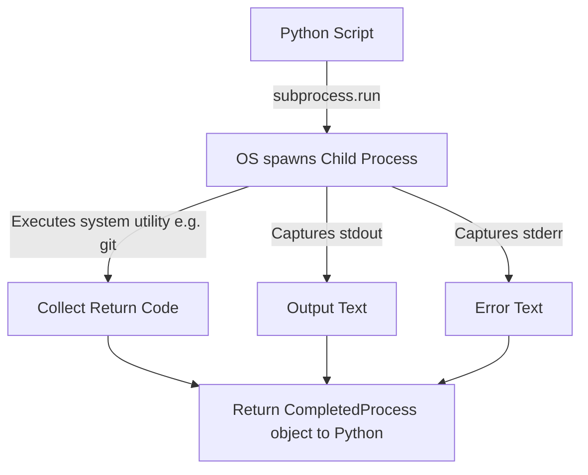

# Subprocess Module Overview

As a DevOps engineer, you will write scripts that need to interact with external command-line utilities. You might need to run git commands (`git pull`), check system disk usage (`df -h`), run Docker containers (`docker ps`), or check network status (`ping`).

Python provides the built-in [subprocess](https://docs.python.org/3/library/subprocess.html) module to deal with this. This module lets you spawn new system processes, connect to their input/output pipes, and obtain their return status codes.

In this guide, we will explore the core concepts of the `subprocess` module and why it is the standard way to run shell commands in Python.

---

## Why Use the `subprocess` Module?

In the early days of Python, developers used `os.system()` or the `commands` module to run shell commands. These old tools had major security flaws and offered little control over input and output. 

The `subprocess` module was created to replace all of them, grouping multiple utilities into a single, cohesive interface.

Here is a comparison of ways to run system commands in Python:

| Method | Can Capture Output? | Safety Level | Recommended Use? |
| :--- | :--- | :--- | :--- |
| **`os.system()`** | No (only returns exit code) | Low (prone to shell injection) | No (Legacy) |
| **`os.popen()`** | Yes (via file-like pipe) | Low | No (Legacy) |
| **`subprocess.run()`** | Yes (via capture_output) | High (when shell=False) | Yes (Standard for simple tasks) |
| **`subprocess.Popen()`** | Yes (interactive/realtime) | High (when shell=False) | Yes (For advanced, streaming tasks) |

---

## Core Concept: How Subprocess Works

When you run a command using `subprocess`, Python starts a child process on your operating system. The python script blocks (waits) until the command finishes, and then receives the exit status code and any text written to standard output (`stdout`) or standard error (`stderr`).



---

## Basic Subprocess Command Example

Let us run a simple command to check our local Python version using `subprocess.run()`.

```python
import subprocess
import sys

# 1. We define the command as a list of strings
# The first element is the utility name, followed by arguments
command = [sys.executable, "--version"]

# 2. Run the command
print(f"Running command: {' '.join(command)}")
result = subprocess.run(command, capture_output=True, text=True)

# 3. Inspect results
print(f"Exit Code: {result.returncode}")
print(f"Captured stdout: {result.stdout.strip()}")
```

### Expected Output

```text
Running command: C:\Users\username\AppData\Local\Programs\Python\Python311\python.exe --version
Exit Code: 0
Captured stdout: Python 3.11.2
```

---

## Real-World DevOps Scenario: System Dependency Checker

In automation setups, you should always check if required system utilities are installed before you try to use them. Let us write a script that checks if `git` is installed and ready.

```python
import subprocess
import shutil

def check_utility_installed(utility_name):
    # Quick check if it is in the system PATH environment
    path_check = shutil.which(utility_name)
    if not path_check:
        print(f"Error: {utility_name} is not installed or not in system PATH.")
        return False
        
    try:
        # Run the tool's version command to verify it runs
        result = subprocess.run(
            [utility_name, "--version"],
            capture_output=True,
            text=True,
            check=True # Raises an exception if exit code is not 0
        )
        print(f"[OK] {utility_name} is installed. Output: {result.stdout.strip()}")
        return True
    except (subprocess.CalledProcessError, FileNotFoundError) as err:
        print(f"[ERROR] Failed to run {utility_name}: {err}")
        return False

# Check system tools
check_utility_installed("git")
```

### Expected Output (if git is installed)

```text
[OK] git is installed. Output: git version 2.39.1.windows.1
```

---

## Common Mistakes

Here are some typical gotchas to watch out for:

### 1. Passing the command as a single string
Unless you explicitly specify `shell=True`, you must pass your command as a list of strings. Writing `subprocess.run("git --version")` will crash with a `FileNotFoundError` because Python tries to find a single program named `git --version` (spaces included).

```python
# WRONG - raises FileNotFoundError
subprocess.run("git --version")

# CORRECT - pass as list
subprocess.run(["git", "--version"])
```

### 2. Using `shell=True` without thinking
Setting `shell=True` runs your command inside a shell process (like `/bin/sh` or `cmd.exe`). This is dangerous if you include variables in your command that come from user inputs, because users can inject arbitrary shell commands (known as shell injection vulnerabilities). Always keep `shell=False` (the default) and pass arguments as a list.

### 3. Missing `text=True` (or `universal_newlines=True`)
By default, the `subprocess` module captures stdout and stderr as raw byte sequences (`bytes`). If you forget `text=True`, trying to clean or print the output will show byte prefixes (like `b'Python version\n'`). Using `text=True` automatically decodes the bytes to strings using the system default encoding.

---

## Summary

* The [subprocess](https://docs.python.org/3/library/subprocess.html) module is the standard way to run system commands in Python.
* Avoid using old functions like `os.system()` and `os.popen()`.
* Pass commands as a list of strings (e.g. `['git', 'status']`) instead of a single string.
* Keep `shell=False` (default) to protect your code from shell injection security risks.
* Set `capture_output=True` to record the command's terminal outputs.
* Set `text=True` to parse byte outputs into readable Python strings automatically.
* Check the exit status of commands using `result.returncode` (0 means success).
* Use `check=True` if you want Python to automatically raise an exception when a command fails.
* Use `shutil.which('utility')` to verify a utility is in the system's path before running subprocess commands.
