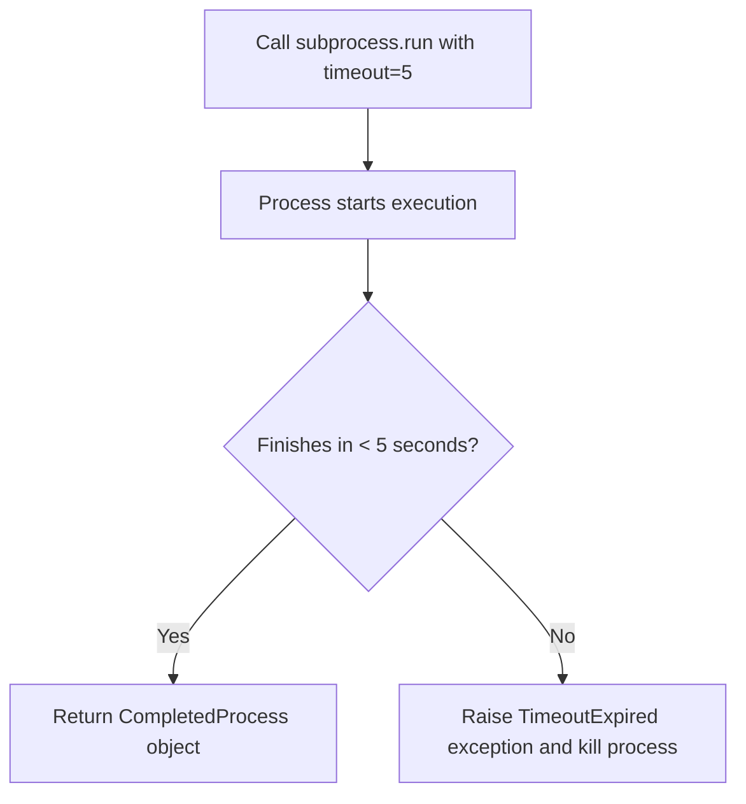

# Running Commands with subprocess.run

The most common entry point for executing commands in Python is the [subprocess.run](https://docs.python.org/3/library/subprocess.html#subprocess.run) function. Introduced in Python 3.5, it is the recommended way to handle most system commands. It blocks your script, waits for the command to finish, and returns a `CompletedProcess` object.

In this guide, we will learn how to use `subprocess.run` to execute commands, pass arguments, set timeouts, and control running environments.

---

## The subprocess.run Signature

When you call `subprocess.run`, you can configure its behavior using different options. Here is a summary of the most common options:

| Option | Type | Default Value | Description |
| :--- | :--- | :--- | :--- |
| **`args`** | `list` or `str` | *Required* | The command to run (a list of strings is recommended). |
| **`timeout`** | `float` / `int` | `None` | Time limit in seconds before the command is killed. |
| **`cwd`** | `str` | `None` | Directory to switch to before running the command. |
| **`env`** | `dict` | `None` | Custom environment variables dictionary for the child process. |
| **`check`** | `bool` | `False` | If `True`, raises `CalledProcessError` if the exit code is not 0. |

---

## Basic Command Execution

Let us look at a simple example. We will run a command that prints directories. On Linux we will run `ls`, and on Windows we will run `cmd.exe /c dir`.

```python
import os
import subprocess

# 1. Choose command based on system
if os.name == "nt":
    command = ["cmd.exe", "/c", "dir"]
else:
    command = ["ls"]

# 2. Run the command. The output will print directly to the terminal
print("Running system command...")
result = subprocess.run(command)

# 3. Check the exit status code
print(f"Process ended with status code: {result.returncode}")
```

### Expected Output

```text
Running system command...
[Standard directory file listing prints here]
Process ended with status code: 0
```

---

## Using Timeout Safeguards

When automating deployments or background jobs, you must make sure your scripts do not hang forever if an external command blocks. You can prevent this by setting a `timeout` value in seconds. If the command takes longer than this limit, Python raises a `TimeoutExpired` exception.



Here is how you handle timeouts in code:

```python
import subprocess

# We will run a ping command that runs continuously on Linux, 
# or runs multiple times. We set timeout to stop it early.
command = ["ping", "8.8.8.8"]

try:
    print("Pinging target with a 3-second timeout limit...")
    subprocess.run(command, timeout=3)
except subprocess.TimeoutExpired as err:
    print(f"Command was stopped because it timed out: {err}")
```

### Expected Output

```text
Pinging target with a 3-second timeout limit...
[Ping details output prints here until limit is hit]
Command was stopped because it timed out: Command '['ping', '8.8.8.8']' timed out after 3 seconds
```

---

## Changing the Working Directory

If you need a command to run inside a specific folder (like running `git status` inside a repository folder), do not use `os.chdir()` to change your script's folder. Instead, pass the path to the `cwd` (Current Working Directory) parameter in `subprocess.run()`.

```python
import os
import subprocess

# Create a temporary directory to test
test_folder = "temp_git_repo"
os.makedirs(test_folder, exist_ok=True)

try:
    # Run git init inside the temp directory
    subprocess.run(["git", "init"], cwd=test_folder)
    
    # Run git status inside that directory
    subprocess.run(["git", "status"], cwd=test_folder)
finally:
    # Clean up local folders manually or via shutil
    if os.path.exists(test_folder):
        import shutil
        shutil.rmtree(test_folder)
```

### Expected Output

```text
Initialized empty Git repository in C:/Users/username/temp_git_repo/.git/
On branch main

No commits yet

nothing to commit (create/copy files and use "git add" to track)
```

---

## Real-World DevOps Scenario: Running Package Updates

Here is a script that checks and updates a package manager (pip, in this example) within a specific folder location, setting custom environment variables for the installer child process.

```python
import os
import subprocess

def update_pip_packages():
    print("Checking and upgrading pip packages...")
    
    # Prepare custom env variables for the subprocess
    # Copy existing env first
    process_env = os.environ.copy()
    process_env["PYTHONWARNINGS"] = "ignore"  # Suppress warning outputs
    
    command = ["pip", "install", "--upgrade", "pip"]
    
    try:
        result = subprocess.run(
            command,
            env=process_env,
            check=True, # Will raise CalledProcessError if it fails
            timeout=30  # Stop if it hangs for more than 30s
        )
        print(f"Update completed successfully. Return code: {result.returncode}")
    except subprocess.CalledProcessError as err:
        print(f"Error: Command failed with code {err.returncode}")
    except subprocess.TimeoutExpired:
        print("Error: The update took too long and was aborted.")

update_pip_packages()
```

### Expected Output (if pip is already up to date)

```text
Checking and upgrading pip packages...
Requirement already satisfied: pip in c:\users\username\appdata\local\programs\python\python311\lib\site-packages (23.0.1)
Update completed successfully. Return code: 0
```

---

## Common Mistakes

Here are some typical gotchas with `subprocess.run`:

### 1. Modifying environment dictionary directly
When using the `env` parameter, do not write `env=os.environ`. If you do that and add a key, you are modifying your Python process environment. Always make a copy using `env = os.environ.copy()`, modify the copy, and pass that copy to the subprocess.

### 2. Forgetting that commands block by default
`subprocess.run()` is synchronous. If your command takes 10 minutes to run, your Python script will stop and wait for 10 minutes. If you need to run background processes that execute concurrently, you should use `subprocess.Popen` instead.

### 3. Assuming child directory changes persist
If you run `subprocess.run(['cd', 'new_folder'])` (assuming shell=True), that folder change only exists for that shell session. The next call to `subprocess.run()` will execute from the original folder. Use the `cwd` parameter to make persistent directory choices.

---

## Summary

* [subprocess.run](https://docs.python.org/3/library/subprocess.html#subprocess.run) is the standard tool for executing external CLI commands.
* By default, it runs synchronously and blocks execution until the command completes.
* Set a safety limit using the `timeout` parameter to stop hanging tasks.
* Change the running directory for the command using the `cwd` parameter.
* Copy the environment dictionary using `os.environ.copy()` before making custom environment variables.
* Set `check=True` if you want Python to raise a `CalledProcessError` on command failure automatically.
* Remember that changing directory inside a subprocess shell does not affect subsequent commands.
* Handle exceptions like `TimeoutExpired` and `CalledProcessError` using standard try-except blocks.
* Keep commands split into arrays of strings rather than single strings to avoid command injection issues.
