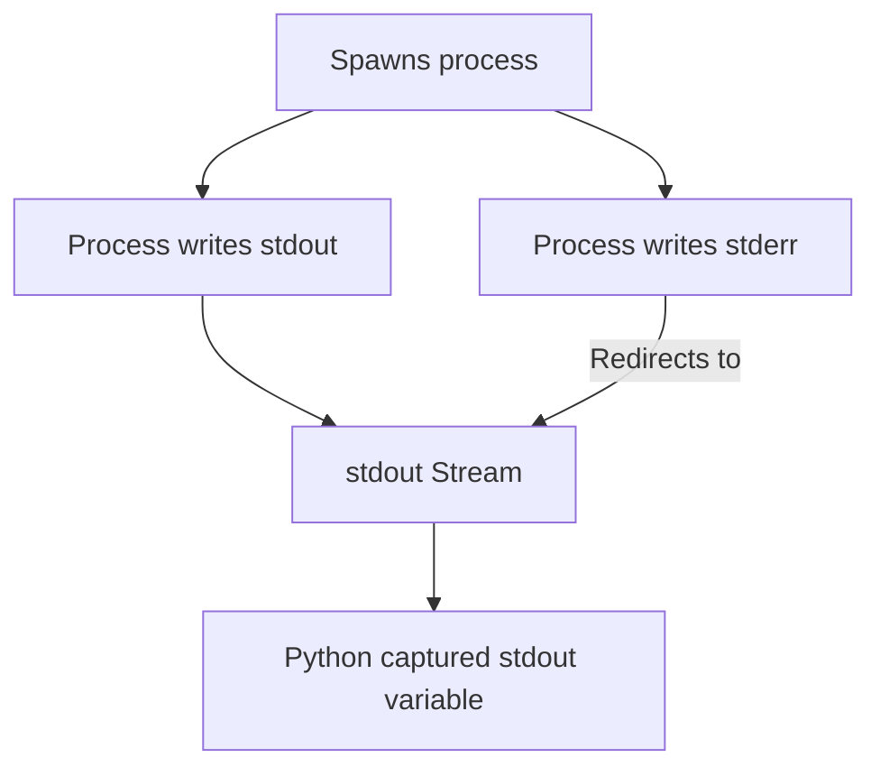

# Capturing Command Output

When you run system utilities, running them is only half the battle. You usually need to inspect their output to take action. For example, you might want to run `git log` and inspect the commit hashes, read a list of running containers from `docker ps`, or parse output from system configuration files.

By default, `subprocess.run` prints the command output directly to your terminal. If you want to keep the output private and parse it inside your code, you must capture it.

In this guide, we will learn how to capture, decode, and redirect standard output (`stdout`) and standard error (`stderr`) using Python.

---

## Capturing Parameters

To redirect command outputs into Python memory, use the following parameters inside `subprocess.run`:

| Parameter | Type | Purpose |
| :--- | :--- | :--- |
| **`capture_output=True`** | `bool` | Captures both `stdout` and `stderr` streams. |
| **`text=True`** | `bool` | Decodes output bytes into strings. |
| **`stdout=subprocess.PIPE`** | stream redirect | Redirects standard output stream to Python. |
| **`stderr=subprocess.PIPE`** | stream redirect | Redirects standard error stream to Python. |
| **`stderr=subprocess.STDOUT`** | stream redirect | Merges `stderr` output stream directly into `stdout`. |

---

## Basic Output Capture

Let us write a script that runs a basic command and captures the output. We will run `echo` or equivalent to print a message, then capture and inspect it.

```python
import subprocess

# We run a command to echo a message
command = ["echo", "DevOps Automation"]

# 1. Run the command and capture output as text
result = subprocess.run(command, capture_output=True, text=True)

# 2. Extract stdout and stderr from CompletedProcess object
output = result.stdout
errors = result.stderr

print("Capture Results:")
print("----------------")
print(f"Captured stdout: '{output}'")
# Note that echo adds a newline at the end. We can clean it using strip()
print(f"Cleaned stdout:  '{output.strip()}'")
print(f"Captured stderr: '{errors}'")
```

### Expected Output

```text
Capture Results:
----------------
Captured stdout: 'DevOps Automation
'
Cleaned stdout:  'DevOps Automation'
Captured stderr: ''
```

---

## Output Stream Redirection

Sometimes you want to capture standard output but merge standard error into the same string. This makes it easy to read logs in the exact chronological order they were produced. 

You can accomplish this by setting `stderr=subprocess.STDOUT`.



Here is a code example:

```python
import subprocess

# We run a command that outputs to stderr by trying to list a file that does not exist
command = ["ls", "nonexistent_file_name_123.txt"]

# Redirect stderr into stdout
result = subprocess.run(
    command, 
    stdout=subprocess.PIPE, 
    stderr=subprocess.STDOUT, 
    text=True
)

print(f"Exit Code: {result.returncode}")
print(f"Combined Output: '{result.stdout.strip()}'")
```

### Expected Output

```text
Exit Code: 2
Combined Output: 'ls: cannot access 'nonexistent_file_name_123.txt': No such file or directory'
```

---

## Real-World DevOps Scenario: Disk Usage Warning System

Let us build a script that runs the system command `df -h` (disk free space) on Linux, parses the output, and highlights any disk partition that is more than 80% full.

If running on Windows, we will simulate the output of a disk utility for validation.

```python
import os
import subprocess

def check_disk_space():
    # If on Windows, we use a mock output to demonstrate parsing
    if os.name == "nt":
        output = """Filesystem      Size  Used Avail Use% Mounted on
C:/             450G  410G   40G  91% /
D:/             100G   20G   80G  20% /data
"""
    else:
        # Run real df command on Linux/macOS
        result = subprocess.run(["df", "-h"], capture_output=True, text=True)
        output = result.stdout
        
    lines = output.strip().split("\n")
    header = lines[0]
    data_lines = lines[1:]
    
    print("Checking Disk Usage...")
    print("=====================")
    
    for line in data_lines:
        parts = line.split()
        if len(parts) < 5:
            continue
            
        filesystem = parts[0]
        use_percentage_str = parts[4] # e.g. '91%'
        mounted_on = parts[5] if len(parts) > 5 else parts[3]
        
        # Convert "91%" to integer 91
        percentage = int(use_percentage_str.replace("%", ""))
        
        if percentage > 80:
            print(f"[WARNING] {filesystem} ({mounted_on}) is {percentage}% full!")
        else:
            print(f"[OK] {filesystem} ({mounted_on}) is {percentage}% full.")

check_disk_space()
```

### Expected Output

```text
Checking Disk Usage...
=====================
[WARNING] C:/ (/) is 91% full!
[OK] D:/ (/data) is 20% full.
```

---

## Common Mistakes

Here are some typical mistakes people make when capturing output:

### 1. Forgetting `text=True`
If you omit `text=True` or `universal_newlines=True`, Python reads output streams as raw byte arrays. Trying to split or check strings on bytes will fail with type errors.

```python
# WRONG - raises AttributeError: 'bytes' object has no attribute 'split'
result = subprocess.run(["echo", "hello"], capture_output=True)
result.stdout.split()

# CORRECT
result = subprocess.run(["echo", "hello"], capture_output=True, text=True)
result.stdout.split()
```

### 2. Accessing stdout when command failed
If a subprocess fails, its `stdout` might be empty, and all the error details might be inside `stderr`. If you only print or parse `stdout`, you might miss the actual error messages. Always log or inspect `stderr` if the return code is not 0:

```python
result = subprocess.run(["ls", "/root"], capture_output=True, text=True)
if result.returncode != 0:
    print(f"Error occurred: {result.stderr}")
```

### 3. Mixing `capture_output=True` and manual stream piping
You cannot set `capture_output=True` if you are already manually defining `stdout` or `stderr` redirects (like `stdout=subprocess.PIPE`). If you mix these parameters, Python will raise a `ValueError`.

---

## Summary

* By default, `subprocess.run` sends command outputs directly to the system terminal.
* Set `capture_output=True` to redirect standard output and standard error into memory.
* Always set `text=True` to decode byte outputs into Python string objects automatically.
* Extract captured data from the `result.stdout` and `result.stderr` properties.
* Redirect standard error into standard output using `stderr=subprocess.STDOUT`.
* Remember to strip trailing newlines (`\n`) from output strings using `.strip()`.
* Check `result.returncode` before parsing stdout to verify the command succeeded.
* Handle command bytes using manual decoding if you need to support custom encoding formats.
* Do not combine `capture_output=True` with manual `stdout` or `stderr` parameters.
