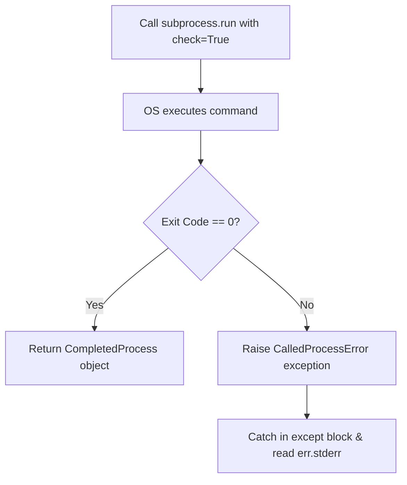

# Error Handling in Subprocess

In DevOps scripting, commands fail all the time. A remote host might be offline, a disk might be full, or a utility might not be installed. If your Python script ignores these failures, it will continue running and potentially cause corruption or deployment issues downstream.

To write reliable automation scripts, you must handle errors raised by the [subprocess](https://docs.python.org/3/library/subprocess.html) module.

In this guide, we will learn how to handle command failures, catch specific exceptions, and extract error logs.

---

## Types of Errors in Subprocess

When executing commands, you will primarily deal with three types of errors:

| Exception Class | Cause | Key Properties to Inspect |
| :--- | :--- | :--- |
| **`FileNotFoundError`** | The command executable itself does not exist in the system path. | `filename` (e.g. name of missing tool) |
| **`subprocess.CalledProcessError`** | The command executed, but returned a non-zero exit status code. | `returncode`, `cmd`, `stdout`, `stderr` |
| **`subprocess.TimeoutExpired`** | The command exceeded the set timeout duration and was terminated. | `cmd`, `timeout`, `stdout`, `stderr` |

---

## Catching CalledProcessError with check=True

By default, if a command fails (for example, returning exit code `1`), `subprocess.run` does not raise an exception. It simply returns the status code inside the `returncode` attribute. 

To force Python to raise an exception automatically on failures, pass `check=True`.

Here is the error handling flow:



Let us look at a code example:

```python
import subprocess

# We try to run a git command inside a folder that is not a git repository
command = ["git", "commit", "-m", "Initial commit"]

try:
    print("Attempting to commit...")
    # Using check=True raises an exception if the git command fails
    subprocess.run(command, check=True, capture_output=True, text=True)
except subprocess.CalledProcessError as err:
    print("\n[COMMAND FAILED]")
    print(f"Command run: {err.cmd}")
    print(f"Exit Status Code: {err.returncode}")
    print(f"Error Message: {err.stderr.strip()}")
```

### Expected Output

```text
Attempting to commit...

[COMMAND FAILED]
Command run: ['git', 'commit', '-m', 'Initial commit']
Exit Status Code: 128
Error Message: fatal: not a git repository (or any of the parent directories): .git
```

---

## Catching Missing Command Utilities

If you try to run a utility that is not installed on the server (like `kubectl` or `terraform`), Python raises a `FileNotFoundError`. You should catch this exception to provide friendly tips to your users.

```python
import subprocess

# Try to run a non-existent utility
command = ["aws-cli-fake-tool", "s3", "ls"]

try:
    subprocess.run(command, capture_output=True, text=True)
except FileNotFoundError as err:
    print("[UTILITY ERROR]")
    print(f"The program '{command[0]}' was not found on this system.")
    print("Please install the tool or verify your system PATH environment variable.")
```

### Expected Output

```text
[UTILITY ERROR]
The program 'aws-cli-fake-tool' was not found on this system.
Please install the tool or verify your system PATH environment variable.
```

---

## Real-World DevOps Scenario: Robust Backup Deployer

Here is a complete backup script that runs an external compression command, handles system missing utility errors, timeouts, and command execution failures cleanly.

```python
import subprocess
import os

def run_backup_archive(source_dir, output_archive):
    # We will use tar to compress a folder
    # On Windows, we simulate it by raising FileNotFoundError or running tar if available
    command = ["tar", "-czf", output_archive, source_dir]
    
    print(f"Creating archive for: {source_dir}")
    
    try:
        result = subprocess.run(
            command,
            capture_output=True,
            text=True,
            check=True,
            timeout=10 # Set a short timeout
        )
        print("Archive created successfully.")
        
    except FileNotFoundError:
        print("CRITICAL ERROR: 'tar' command utility is not installed on this server.")
        
    except subprocess.TimeoutExpired as err:
        print(f"CRITICAL ERROR: Backup command timed out after {err.timeout} seconds.")
        # Print output captured so far before the timeout occurred
        if err.stderr:
            print(f"Last stderr details: {err.stderr}")
            
    except subprocess.CalledProcessError as err:
        print(f"CRITICAL ERROR: Archive failed with exit code {err.returncode}")
        print(f"Error details: {err.stderr.strip()}")

# Run the validation test on a fake folder
run_backup_archive("/invalid/source/path/123", "backup.tar.gz")
```

### Expected Output (on Linux if source folder is missing)

```text
Creating archive for: /invalid/source/path/123
CRITICAL ERROR: Archive failed with exit code 2
Error details: tar: /invalid/source/path/123: Cannot stat: No such file or directory
tar: Exiting with failure status due to previous errors
```

---

## Common Mistakes

Here are some typical errors to avoid:

### 1. Catching `CalledProcessError` without setting `check=True`
If you do not pass `check=True` (or check the return code manually in an `if` condition), `subprocess.run` will succeed from Python's perspective even if the shell command failed. The `except subprocess.CalledProcessError` block will never execute.

```python
# WRONG - exception is never caught because check=True is missing
try:
    subprocess.run(["ls", "/invalid_dir"])
except subprocess.CalledProcessError:
    print("Handled!") # Will never run
```

### 2. Forgetting to import the module
This is basic but common: `CalledProcessError` and `TimeoutExpired` are namespaces under `subprocess`. You must write `subprocess.CalledProcessError`, not just `CalledProcessError`, unless you imported it explicitly.

### 3. Ignoring the system PATH
If a program runs perfectly when you type it in your shell terminal, but raises a `FileNotFoundError` inside your Python script, it means the directory containing the utility is not in the system environment PATH variables that Python has loaded. Verify the environment or use absolute paths to the executable.

---

## Summary

* Handle system commands errors to build reliable automation scripts.
* Use `check=True` in `subprocess.run` to raise a `CalledProcessError` automatically on command failures.
* Inspect `err.returncode` to see the exit status code of the failed command.
* Inspect `err.stderr` to read the error messages returned by the system utility.
* Catch `FileNotFoundError` to handle situations where the command program is missing.
* Catch `subprocess.TimeoutExpired` to handle tasks that hang or take too long to complete.
* Always check standard error outputs if the return code is not 0.
* Verify the system's PATH variable if Python throws a `FileNotFoundError` for a tool that runs in your terminal.
* Wrap all subprocess calls inside `try-except` blocks to prevent unexpected script crashes.
