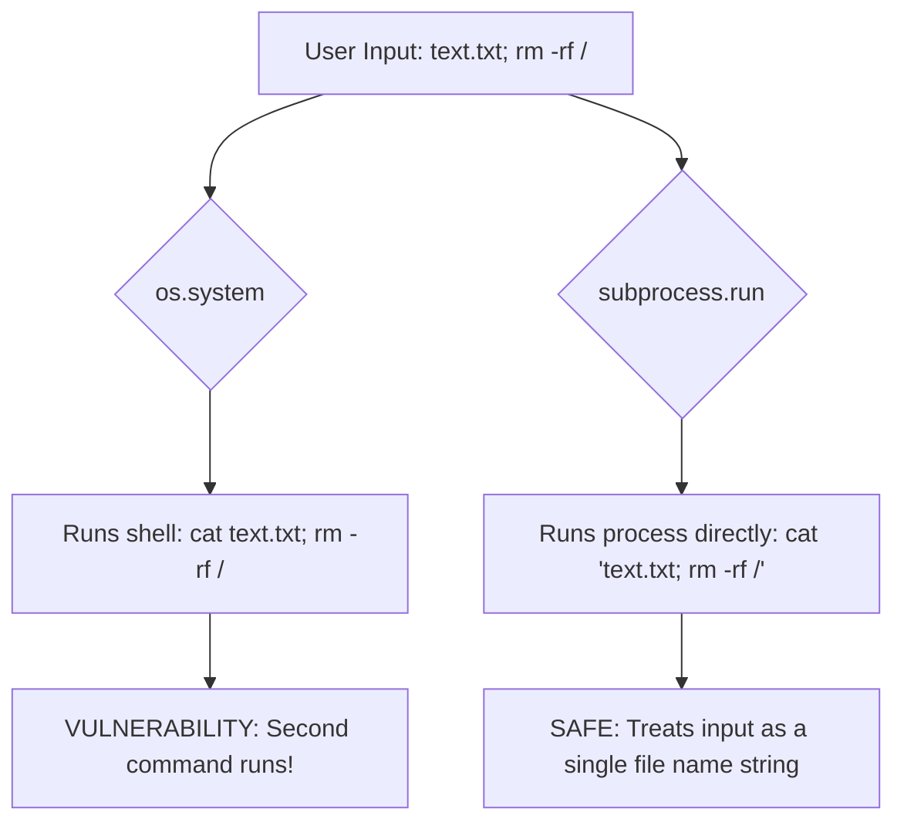

# Subprocess vs. os.system

When looking at legacy Python code or reading older tutorials, you will often see commands executed using `os.system("some_command")`. While this looks simple, it is an obsolete way to run commands. In modern Python scripting, you should always prefer the [subprocess](https://docs.python.org/3/library/subprocess.html) module.

In this guide, we will compare `os.system` with `subprocess.run`, looking at their key differences, security profiles, and why the older method is dangerous.

---

## Direct Comparison

Here is a quick summary of how these two approaches stack up against each other:

| Feature | `os.system()` | `subprocess.run()` |
| :--- | :--- | :--- |
| **Output Capturing** | Impossible (prints straight to screen, returns only the exit code) | Easy (redirects `stdout` and `stderr` streams directly to variables) |
| **Input Escaping** | None (vulnerable to spaces and special characters in paths) | Safe (handles list of arguments, escaping strings automatically) |
| **Shell Dependency** | Requires shell environment (`/bin/sh` or `cmd.exe`) | Can run executables directly without launching a shell |
| **Error Control** | Low (does not raise Python exceptions) | High (supports `check=True` and timeouts out of the box) |
| **Security Profile** | High risk (vulnerable to Command Injection) | Low risk (when using lists of arguments) |

---

## Why os.system is Dangerous: Command Injection

The biggest drawback of `os.system` is that it runs your commands inside a system shell. If your script takes arguments (like a username or filename) from an external source, a malicious user can inject shell control characters (like `;`, `&&`, or `|`) to execute unwanted code.



Let us look at a code example demonstrating this vulnerability.

```python
import os
import subprocess

# Imagine this filename input was retrieved from a web form or API parameter
user_input = "notes.txt; echo 'SYSTEM COMPROMISED!'"

print("--- Testing os.system (Insecure) ---")
# os.system will evaluate the semicolon and run the second command!
os.system(f"echo Reading file: {user_input}")

print("\n--- Testing subprocess.run (Secure) ---")
# subprocess.run with arguments in a list treats the entire input as a single string argument.
# It does not launch a shell, so the semicolon is not evaluated as a shell command separator.
subprocess.run(["echo", "Reading file:", user_input])
```

### Expected Output

```text
--- Testing os.system (Insecure) ---
Reading file: notes.txt
SYSTEM COMPROMISED!

--- Testing subprocess.run (Secure) ---
Reading file: notes.txt; echo 'SYSTEM COMPROMISED!'
```

Notice how `os.system` actually executed the injected `echo` command, whereas `subprocess.run` safely printed the raw input as text.

---

## Capturing Output Comparison

If you want to read a command's output to use it inside your Python script (like reading a configuration parameter or checking if a service is active), `os.system` cannot help you. It only returns the exit status code.

Here is the difference:

```python
import os
import subprocess

# 1. Attempting to capture output with os.system
# This prints the output to your terminal, but the variable only gets the exit status (0)
os_result = os.system("echo 'System Status: OK'")
print(f"os.system stored value: {os_result} (Type: {type(os_result)})")

print("-" * 40)

# 2. Capturing output with subprocess.run
sub_result = subprocess.run(["echo", "System Status: OK"], capture_output=True, text=True)
print(f"subprocess stored value: '{sub_result.stdout.strip()}' (Type: {type(sub_result.stdout)})")
```

### Expected Output

```text
System Status: OK
os.system stored value: 0 (Type: <class 'int'>)
----------------------------------------
subprocess stored value: 'System Status: OK' (Type: <class 'str'>)
```

---

## Common Mistakes

Here are some typical mistakes you will run into:

### 1. Thinking `subprocess.run(..., shell=True)` is safer than `os.system`
If you use `subprocess.run("echo " + user_input, shell=True)`, you are introducing the exact same command injection vulnerabilities as `os.system`. The security benefits of `subprocess` only apply when you keep `shell=False` (the default) and pass arguments as a list of strings.

### 2. Confusing exit codes between POSIX and Windows in `os.system`
The value returned by `os.system()` is system-dependent. On Unix systems, the exit status is returned in the format of a 16-bit number, where the low byte contains the signal number that killed the process and the high byte contains the exit code. This requires you to bit-shift the result (`status >> 8`) to get the actual exit code. `subprocess` handles this cleanup automatically, always returning standard integer codes in `result.returncode`.

---

## Summary

* Avoid `os.system()` in all new Python code.
* Use the modern [subprocess](https://docs.python.org/3/library/subprocess.html) module instead.
* `os.system` only returns exit status codes and cannot capture command output.
* `subprocess.run` lets you capture `stdout` and `stderr` streams directly into strings.
* `os.system` runs commands through a system shell, exposing your script to command injection security risks.
* `subprocess.run` bypasses the shell by default, running commands as direct system calls.
* Passing arguments as a list of strings ensures special characters (like `;`, `&`, or `|`) are escaped automatically.
* Avoid using `shell=True` in `subprocess.run` unless absolutely necessary, as it reintroduces shell safety risks.
* `subprocess` normalizes exit codes across different systems, making status checks uniform and simple.
