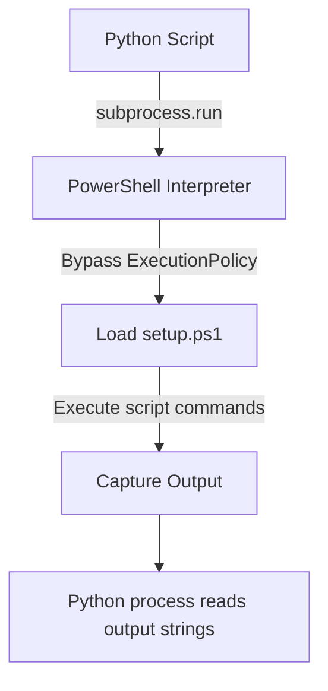

# Running Shell Scripts with Subprocess

Sometimes, you cannot write everything in Python. You might have legacy Bash scripts (`.sh`) or Windows batch scripts (`.bat` / `.ps1`) that perform system setups, install packages, or mount network drives. Instead of rewriting them from scratch, you can run them directly from Python using the `subprocess` module.

In this guide, we will learn how to execute shell scripts, pass parameters to them, and capture their output streams securely.

---

## Executing Scripts Across Platforms

When you run a shell script, you cannot execute the script file directly (like `subprocess.run(["script.sh"])`) because the operating system does not know which interpreter to use. You must pass the interpreter as the first argument in your command list.

Here is a summary of interpreters to use for different script files:

| Script Extension | Platform | Interpreter Command | Executable Example |
| :--- | :--- | :--- | :--- |
| **`.sh`** | Linux / macOS | `bash` or `sh` | `['bash', 'deploy.sh', 'arg1']` |
| **`.bat` / `.cmd`** | Windows | `cmd.exe` (with `/c`) | `['cmd.exe', '/c', 'setup.bat']` |
| **`.ps1`** | Windows | `powershell.exe` | `['powershell.exe', '-File', 'run.ps1']` |

---

## Running a Bash Script on Linux

Let us write a simple Bash script named `backup.sh` in Python, execute it using Bash, and capture the results.

```python
import os
import subprocess

# 1. Create a dummy bash script for testing
script_name = "backup.sh"
script_content = """#!/bin/bash
echo "Starting backup process..."
echo "Target directory: $1"
echo "Backup file: $2"
# Exit with success code
exit 0
"""

with open(script_name, "w", newline="\n") as file:
    file.write(script_content)

# 2. Configure target script call arguments
source_folder = "/var/www/html"
target_file = "/tmp/backup.tar.gz"

command = ["bash", script_name, source_folder, target_file]

# 3. Execute the script
try:
    print(f"Executing shell script: {script_name}...")
    result = subprocess.run(command, capture_output=True, text=True, check=True)
    
    print("\n--- Script Output ---")
    print(result.stdout.strip())
finally:
    # Clean up script file
    if os.path.exists(script_name):
        os.remove(script_name)
```

### Expected Output

```text
Executing shell script: backup.sh...

--- Script Output ---
Starting backup process...
Target directory: /var/www/html
Backup file: /tmp/backup.tar.gz
```

---

## Running a PowerShell Script on Windows

If your servers run Windows, you will likely interact with PowerShell scripts. To run a PowerShell script, you must tell PowerShell to bypass the default execution policy so it does not block your script execution.

Here is the process tree for launching a script:



Let us look at a code example:

```python
import os
import subprocess

# 1. Create a dummy PowerShell script
script_name = "setup.ps1"
script_content = """
Write-Output "PowerShell setup started"
Write-Output "Configuring environment: $args"
"""

with open(script_name, "w") as file:
    file.write(script_content)

# 2. Build the powershell command
# -ExecutionPolicy Bypass ensures Windows doesn't block the script
command = ["powershell.exe", "-ExecutionPolicy", "Bypass", "-File", script_name, "production"]

try:
    print(f"Executing Windows PowerShell script: {script_name}...")
    result = subprocess.run(command, capture_output=True, text=True, check=True)
    
    print("\n--- Script Output ---")
    print(result.stdout.strip())
finally:
    # Clean up script file
    if os.path.exists(script_name):
        os.remove(script_name)
```

### Expected Output

```text
Executing Windows PowerShell script: setup.ps1...

--- Script Output ---
PowerShell setup started
Configuring environment: production
```

---

## Real-World DevOps Scenario: Executing Deployments with logs

In deployment pipelines, you want to run a setup shell script and capture both stdout and stderr, saving the output logs to a file so that developers can troubleshoot issues if the deployment fails.

```python
import os
import subprocess

# Create setup script that writes an error
script_name = "install.sh"
script_content = """#!/bin/bash
echo "Installing software packages..."
echo "Error: Database connection failed!" >&2
exit 1
"""

with open(script_name, "w", newline="\n") as f:
    f.write(script_content)

log_file = "deployment.log"

try:
    # Run the script, redirecting stderr to stdout to keep logs in order
    result = subprocess.run(
        ["bash", script_name],
        stdout=subprocess.PIPE,
        stderr=subprocess.STDOUT,
        text=True
    )
    
    # Save the log output
    with open(log_file, "w", encoding="utf-8") as f:
        f.write(result.stdout)
        
    print(f"Script run completed with exit code: {result.returncode}")
    print(f"Log report saved to: {log_file}")
    
    if result.returncode != 0:
        print("\n[ALERT] Script failed! Log contents:")
        print(result.stdout.strip())
        
finally:
    # Clean up
    if os.path.exists(script_name):
        os.remove(script_name)
    if os.path.exists(log_file):
        os.remove(log_file)
```

### Expected Output

```text
Script run completed with exit code: 1
Log report saved to: deployment.log

[ALERT] Script failed! Log contents:
Installing software packages...
Error: Database connection failed!
```

---

## Common Mistakes

Here are some typical mistakes when running shell scripts:

### 1. Forgetting to set execution permissions on Linux
If you try to run `./script.sh` directly (instead of using `bash script.sh`), the script file must have execute permissions. If it does not, Python will raise a `PermissionError`. Always run using the interpreter prefix `['bash', 'script.sh']` or run `os.chmod` on the file to give it `0o755` permissions first.

### 2. Line ending conflicts between Windows and Linux
If you write a Bash script file on a Windows system using Windows line endings (`\r\n`), Linux systems will fail to run the script, complaining about `\r: command not found` or corrupted headers. Always use `newline='\n'` when writing shell scripts from Python that will run on Linux.

### 3. Ignoring PowerShell's execution policy
Windows blocks execution of downloaded PowerShell scripts by default. If you do not pass `-ExecutionPolicy Bypass` when calling `powershell.exe`, your command will silently fail or hang, and the captured error will state that script execution is disabled on this system.

---

## Summary

* Do not call script files directly; prefix commands with the correct interpreter (`bash`, `powershell.exe`, or `cmd.exe`).
* Run Bash scripts on Linux using `['bash', 'script.sh']`.
* Run PowerShell scripts on Windows using `['powershell.exe', '-ExecutionPolicy', 'Bypass', '-File', 'script.ps1']`.
* Bypass execution policy on Windows to prevent scripts from being blocked by default settings.
* Save combined command logs by setting `stderr=subprocess.STDOUT` when executing scripts.
* Write script outputs to a log file to help debug automated pipeline failures.
* Set `newline='\n'` when creating Bash script files on Windows to avoid line ending bugs on Linux.
* Verify script files have execution permissions if calling them directly without an interpreter.
* Always check the subprocess return code to confirm if the shell script completed successfully.
