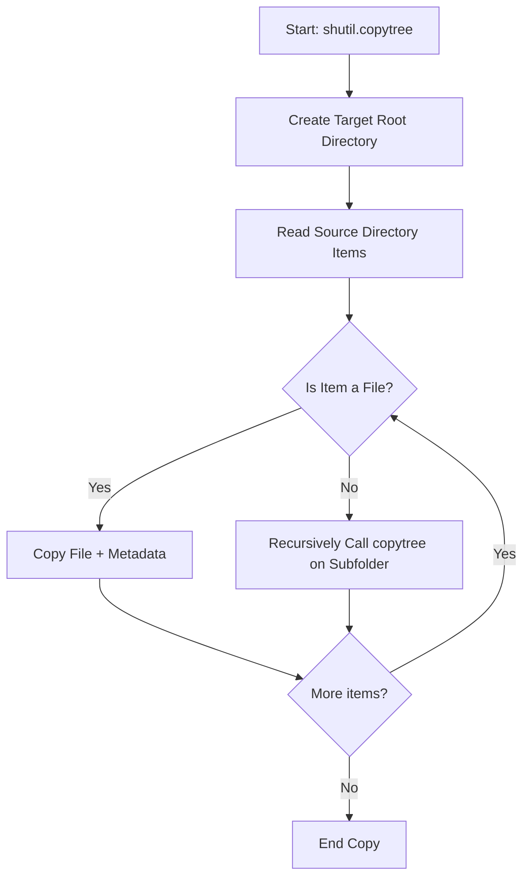

# Shutil Module Overview

While the `os` module is perfect for working with directory names, environment settings, and basic file status metadata, it lacks high-level file operations. For example, if you want to copy a file, rename a folder containing thousands of files, or compress logs into a `.zip` archive, the `os` module does not have simple tools for this.

To handle these high-level tasks, Python provides the built-in [shutil](https://docs.python.org/3/library/shutil.html) module. The name stands for **Shell Utilities**. It offers functions to support file copying, archiving, directory removal, and space checking.

In this guide, we will learn what the `shutil` module is, when to use it, and how it compares to the `os` module.

---

## Why Use the `shutil` Module?

In your automation scripts, you will write copy operations, directory cleanups, and backup archives. Trying to write recursive directory-copying code using low-level `os` primitives is complex and prone to bugs. `shutil` lets you perform these tasks in a single line of code.

Let us compare the capabilities of `os` and `shutil` modules:

| Task | Using `os` Module | Using `shutil` Module | Recommendation |
| :--- | :--- | :--- | :--- |
| **Check file existence** | `os.path.exists()` | None | Use `os` or `pathlib` |
| **Delete empty directory** | `os.rmdir()` | None | Use `os` |
| **Delete non-empty directory** | Impossible directly | `shutil.rmtree()` | Use `shutil` |
| **Copy file** | Impossible directly (requires reading/writing chunks) | `shutil.copy()` / `shutil.copy2()` | Use `shutil` |
| **Copy directory recursively** | Requires custom recursion | `shutil.copytree()` | Use `shutil` |
| **Create a zip archive** | Requires `zipfile` module | `shutil.make_archive()` | Use `shutil` |
| **Check disk storage space** | Impossible directly | `shutil.disk_usage()` | Use `shutil` |

---

## Processing Directory Trees

Here is how `shutil` handles recursive directory operations like `copytree` and `rmtree`:



---

## Basic Shutil Module Example

Let us write a simple script that checks our disk partition size, creates a directory, copies a file into it, and then archives it.

```python
import os
import shutil

# 1. Check storage space of current partition
total, used, free = shutil.disk_usage(".")
free_gb = round(free / (1024 ** 3), 2)
print(f"Free space available: {free_gb} GB")

# 2. Create a test directory and file
src_dir = "shutil_demo"
os.makedirs(src_dir, exist_ok=True)
demo_file = os.path.join(src_dir, "test.txt")

with open(demo_file, "w") as f:
    f.write("Temporary demo content for shutil.")

# 3. Create a zip archive of the directory
archive_name = shutil.make_archive(
    base_name="shutil_backup", # Name of the zip file
    format="zip",              # Format of the archive
    root_dir=src_dir           # Source folder to zip
)
print(f"Archive created: {archive_name}")

# 4. Clean up directories recursively
shutil.rmtree(src_dir)
if os.path.exists("shutil_backup.zip"):
    os.remove("shutil_backup.zip")
print("Demo folders and archives cleaned up successfully.")
```

### Expected Output

```text
Free space available: 320.12 GB
Archive created: C:\Users\username\shutil_backup.zip
Demo folders and archives cleaned up successfully.
```

---

## Real-World DevOps Scenario: Server Space Guard

In DevOps, we write cron scripts that monitor disk partitions. If the storage partition runs low, we want to look for temporary log folders, archive them to save space, and delete the originals.

```python
import os
import shutil

def archive_and_cleanup_logs(log_dir, archive_output):
    # Check partition storage details
    total, used, free = shutil.disk_usage(log_dir)
    used_percentage = (used / total) * 100
    
    print(f"Disk space usage on partition: {used_percentage:.2f}%")
    
    # If usage is high (simulated as > 1% for test purposes)
    if used_percentage > 1.0:
        if os.path.exists(log_dir):
            print(f"Archiving folder '{log_dir}' to '{archive_output}.zip'...")
            shutil.make_archive(archive_output, "zip", log_dir)
            
            print(f"Removing source directory: {log_dir}...")
            shutil.rmtree(log_dir)
            print("Cleanup completed successfully.")
        else:
            print("Log folder does not exist.")
    else:
        print("Storage is healthy. No cleanup needed.")

# Create test folder
os.makedirs("app_logs", exist_ok=True)
with open("app_logs/old_run.log", "w") as f:
    f.write("Old log entry info.")

# Run monitoring check
archive_and_cleanup_logs("app_logs", "archived_logs")

# Clean up archive zip
if os.path.exists("archived_logs.zip"):
    os.remove("archived_logs.zip")
```

### Expected Output

```text
Disk space usage on partition: 45.23%
Archiving folder 'app_logs' to 'archived_logs.zip'...
Removing source directory: app_logs...
Cleanup completed successfully.
```

---

## Common Mistakes

Here are some typical errors when working with `shutil`:

### 1. Using `shutil.rmtree()` on a single file
`shutil.rmtree()` expects a directory. If you try to delete a file path using `rmtree()`, Python will raise an `NotADirectoryError`. Use standard `os.remove()` to delete individual files.

### 2. Modifying files during `copytree` operations
If other processes are modifying files inside the source folder while `shutil.copytree()` is running, the copy operation might read incomplete states or raise `FileNotFoundError` if a file is deleted mid-run. Always pause application writing before archiving or copying folders recursively.

### 3. Assuming `shutil.disk_usage()` shows container limits
When running inside container environments (like Docker), `shutil.disk_usage()` reads the storage space of the host machine partition, not the resource limits set on the Docker container. Keep this in mind when writing monitoring checks for containers.

---

## Summary

* Use [shutil](https://docs.python.org/3/library/shutil.html) for high-level file actions like copy, move, recursive delete, and archive.
* Do not write custom loop logic to copy folders; use `shutil.copytree()`.
* Delete directories and all of their nested files recursively using `shutil.rmtree()`.
* Get disk partition metadata (total, used, free bytes) using `shutil.disk_usage(path)`.
* Create compressed archives (zip, tar, gztar) using `shutil.make_archive()`.
* Keep in mind that `os` is for low-level metadata, whereas `shutil` targets bulk file manipulations.
* Use `shutil.copy2()` if you want to preserve file metadata like timestamps and permissions during copying.
* Verify targets are folders before running `rmtree()` to prevent type errors.
* Remember that parent directories of copy destinations must exist or be created beforehand unless using `copytree`.
