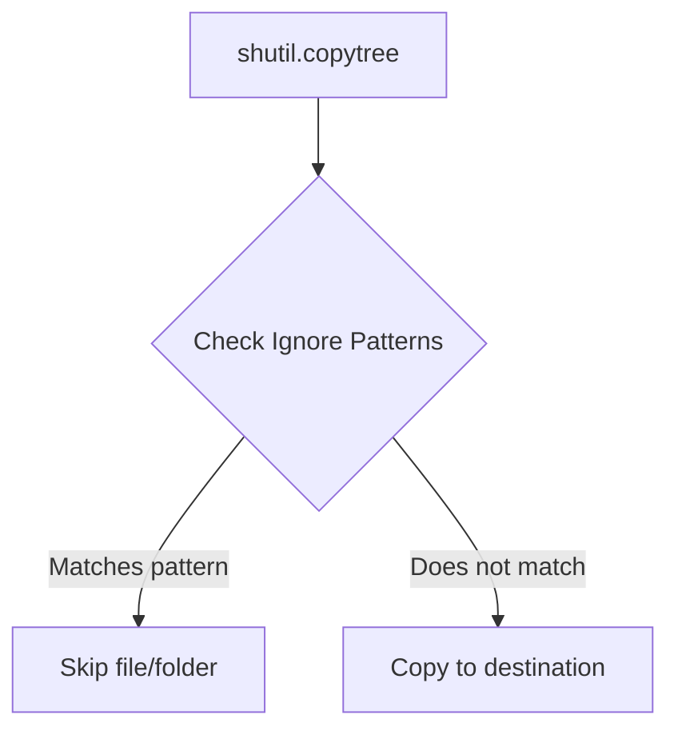

# Copying Files and Directories

When writing automation scripts, you will frequently need to copy files. You might copy a configuration template into an active directory, duplicate database logs before checking them, or back up entire system directories.

Python's built-in `shutil` module offers several copy functions. Choosing the right function depends on whether you want to copy file contents only, preserve file permissions, or duplicate entire directory trees recursively.

In this guide, we will explore the different copy methods in the `shutil` module and when to use each one.

---

## File Copy Functions Comparison

Here is a summary of how the file copying functions behave:

| Function | Destination Type | Copies File Data? | Copies Permissions? | Preserves Timestamps? |
| :--- | :--- | :--- | :--- | :--- |
| **`shutil.copyfile(src, dst)`** | Must be a file name. | Yes | No | No |
| **`shutil.copy(src, dst)`** | Can be a folder or a file name. | Yes | Yes | No |
| **`shutil.copy2(src, dst)`** | Can be a folder or a file name. | Yes | Yes | Yes (Preserves full metadata) |

---

## Copying Individual Files

Let us write a script to check how the different copy functions behave. We will create a file, wait a moment, copy it using each function, and compare the resulting file properties.

```python
import os
import shutil
import time

# Create a source file
src = "original.txt"
with open(src, "w") as f:
    f.write("System config data...")

# Set specific permissions on source file (user read/write/execute)
os.chmod(src, 0o755)

# Wait a brief moment to make timestamps differ
time.sleep(1)

# 1. copyfile: Destination must be a new filename
shutil.copyfile(src, "copy_file.txt")

# 2. copy: Destination can be a folder, permissions are copied
shutil.copy(src, "copy_normal.txt")

# 3. copy2: Preserves metadata/timestamps
shutil.copy2(src, "copy_metadata.txt")

# Verify modification times
original_time = os.stat(src).st_mtime
copy_time = os.stat("copy_normal.txt").st_mtime
copy2_time = os.stat("copy_metadata.txt").st_mtime

print(f"Original file modification time:  {original_time}")
print(f"Normal copy modification time:    {copy_time} (Updated to current time)")
print(f"Metadata copy modification time:  {copy2_time} (Identical to original)")

# Clean up files
for file in [src, "copy_file.txt", "copy_normal.txt", "copy_metadata.txt"]:
    if os.path.exists(file):
        os.remove(file)
```

### Expected Output

```text
Original file modification time:  1782376200.0
Normal copy modification time:    1782376201.0 (Updated to current time)
Original file modification time:  1782376200.0 (Identical to original)
```

---

## Copying Directory Trees Recursively

To copy an entire directory structure (including all of its files and subfolders), use `shutil.copytree()`. 

You can also specify files or folders to skip during copying by passing an ignore pattern (like ignoring `.git` directories or `.tmp` files) using `shutil.ignore_patterns()`.

Here is the directory copying flow:



Let us look at a code example:

```python
import os
import shutil

# Set up a mock folder structure
os.makedirs("app_code/src", exist_ok=True)
os.makedirs("app_code/build", exist_ok=True)

with open("app_code/src/main.py", "w") as f:
    f.write("# Python code")
with open("app_code/build/artifact.o", "w") as f:
    f.write("# Compiled binary object")
with open("app_code/src/debug.log", "w") as f:
    f.write("# Log file")

# Copy directory, ignoring build folders and log files
shutil.copytree(
    src="app_code",
    dst="app_backup",
    ignore=shutil.ignore_patterns("build", "*.log")
)

print("Recursive copy finished. Checking backup contents:")
for root, dirs, files in os.walk("app_backup"):
    print(f"Directory: {root} | Files: {files}")

# Clean up folders
shutil.rmtree("app_code")
shutil.rmtree("app_backup")
```

### Expected Output

```text
Recursive copy finished. Checking backup contents:
Directory: app_backup | Files: []
Directory: app_backup/src | Files: ['main.py']
```

Notice how the `build` directory and the `debug.log` file were excluded from our backup automatically.

---

## Common Mistakes

Here are some typical mistakes people make when copying files and folders:

### 1. Destination directory must NOT exist for `shutil.copytree()`
By default, `shutil.copytree()` creates the destination directory itself. If you try to run `copytree('src', 'dst')` and the folder `dst` already exists, Python will throw a `FileExistsError`. 
If you want to merge files into an existing folder, you must pass the `dirs_exist_ok=True` parameter (available in Python 3.8+):

```python
# Safe merge into existing directory
shutil.copytree("src", "dst", dirs_exist_ok=True)
```

### 2. Confusing `shutil.copyfile` and `shutil.copy` parameters
`shutil.copyfile(src, dst)` only accepts files. If you pass a directory path as the destination (e.g. `shutil.copyfile('app.log', '/var/log/')`), it will raise an `IsADirectoryError` (on Unix) or `PermissionError` (on Windows). If you want to copy a file into a directory without typing the filename again, use `shutil.copy('app.log', '/var/log/')`.

### 3. Permissions errors when copying files owned by other users
If you run copy operations on files that you do not own, `shutil.copy2()` might fail with a `PermissionError` because your user does not have permission to copy or edit the original file's metadata or owner stamps. If preserving timestamps is not critical, fall back to `shutil.copy()`.

---

## Summary

* Use `shutil.copyfile(src, dst)` to copy file contents only; the destination must be a file path.
* Use `shutil.copy(src, dst)` to copy file contents and permission flags; the destination can be a folder.
* Use `shutil.copy2(src, dst)` to copy file contents, permission flags, and metadata (like modification time).
* Copy entire folders recursively using `shutil.copytree(src, dst)`.
* Skip files during directory copies by passing `shutil.ignore_patterns('*.log', 'tmp')` to the `ignore` parameter.
* Set `dirs_exist_ok=True` in `copytree` to merge files into an existing folder without causing crashes.
* Avoid passing folder paths to `copyfile`; use `copy` or `copy2` instead.
* Remember that `copy2` might raise permission errors if your user is unable to write file owner metadata.
