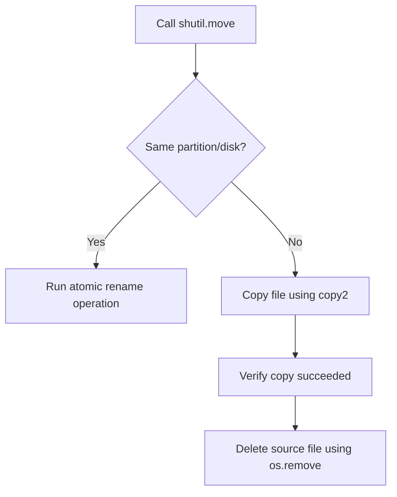

# Moving Files and Directories

During automation routines, you will often need to move files and folders. For example, once a log file is processed, you might move it to an archive folder. During updates, you might swap directories to release a new version of your application.

While the low-level `os.rename()` function can rename files, it fails if you try to move a file across different disk partitions or storage devices. To handle this safely, Python provides the [shutil.move](https://docs.python.org/3/library/shutil.html#shutil.move) function.

In this guide, we will learn how to use `shutil.move` to relocate files and folders, and see how it handles cross-partition operations behind the scenes.

---

## Comparing Move Methods

Let us compare the two main functions available for moving or renaming files:

| Feature | `os.rename(src, dst)` | `shutil.move(src, dst)` |
| :--- | :--- | :--- |
| **Move within same partition** | Yes (Fast, atomic operation) | Yes (Fast, atomic operation) |
| **Move across different partitions** | No (Raises `OSError`) | Yes (Copies data, then deletes source automatically) |
| **Destination is an existing directory** | Fails on Windows, behavior varies | Relocates the file *inside* that directory |
| **Usage Recommendation** | Simple renames inside the same directory | Standard file relocation and moving scripts |

---

## How shutil.move Works Under the Hood

When you ask Python to move a file, `shutil.move` checks if the source and destination are on the same storage partition.



This fallback behavior makes `shutil.move` much safer than `os.rename()`.

---

## Basic Moving Examples

Let us write a script that creates a file, moves it to a new directory, and verifies the move.

```python
import os
import shutil

# 1. Create files and directories for testing
src_file = "app_metrics.log"
target_dir = "metrics_backup"

with open(src_file, "w") as f:
    f.write("CPU=45,Memory=80\n")

os.makedirs(target_dir, exist_ok=True)

# 2. Move file into the target directory
# The destination is a directory, so the file will be placed inside: metrics_backup/app_metrics.log
destination_path = shutil.move(src_file, target_dir)

print(f"File moved successfully.")
print(f"Returned path: {destination_path}")
print(f"Original file exists? {os.path.exists(src_file)}")
print(f"New file exists?      {os.path.exists(os.path.join(target_dir, src_file))}")

# Clean up folders
shutil.rmtree(target_dir)
```

### Expected Output

```text
File moved successfully.
Returned path: metrics_backup/app_metrics.log
Original file exists? False
New file exists?      True
```

---

## Real-World DevOps Scenario: Log Processing Pipeline

Here is a script representing a pipeline. It checks for unprocessed logs in an `incoming` directory, processes them, and then moves them to a `completed` directory. If processing fails, it leaves the log file where it is.

```python
import os
import shutil

# Set up folders
os.makedirs("pipeline/incoming", exist_ok=True)
os.makedirs("pipeline/completed", exist_ok=True)

# Create a sample log
sample_log = "pipeline/incoming/transaction_2026.log"
with open(sample_log, "w") as f:
    f.write("SUCCESS: database backup completed\n")

def process_log(filepath):
    # Simulate processing the file
    print(f"Processing log file: {filepath}")
    with open(filepath, "r") as f:
        content = f.read()
    return "SUCCESS" in content

# Pipeline run
if os.path.exists(sample_log):
    success = process_log(sample_log)
    
    if success:
        # Move the completed file
        target_dest = "pipeline/completed"
        shutil.move(sample_log, target_dest)
        print(f"[PIPELINE] Log processed. Relocated to {target_dest}")
    else:
        print("[PIPELINE] Processing failed. Log left in incoming queue.")

# Clean up directories
shutil.rmtree("pipeline")
```

### Expected Output

```text
Processing log file: pipeline/incoming/transaction_2026.log
[PIPELINE] Log processed. Relocated to pipeline/completed
```

---

## Common Mistakes

Here are some typical errors to avoid:

### 1. Overwriting files by accident
If you move a file to a target file path that already exists (for example, `shutil.move('new.log', 'old.log')` where `old.log` already exists), the destination file will be silently overwritten. Always check if the target path exists using `os.path.exists()` if you want to prevent overrides.

### 2. Confusing destination types
If you run `shutil.move('app.log', 'backup_folder')` and `backup_folder` does not exist as a directory, Python will rename the file `app.log` to a new file named `backup_folder`. Make sure to create the target directory using `os.makedirs()` before calling `shutil.move()` if you want to place the file inside it.

### 3. Permissions errors during delete phase
If you are moving files across different filesystems, `shutil.move()` copies the file first and then attempts to delete the source. If your user has read access to the source file but does not have permission to delete files in the source directory, the copy will succeed, but the script will crash on the deletion phase, leaving duplicate files behind.

---

## Summary

* Use [shutil.move](https://docs.python.org/3/library/shutil.html#shutil.move) to move or rename files and folders.
* Avoid `os.rename()` for moving files across different disks or partitions.
* `shutil.move()` automatically switches to copy-and-delete mode if moving across partitions.
* Moving a file to a directory target places the file inside that directory automatically.
* Ensure the target directory exists before running the move command, otherwise the file is simply renamed.
* Be careful: if the target filename already exists, `shutil.move()` will overwrite it without warning.
* Make sure your script has delete permissions on the source folder when moving files across different disks.
* Check if a file is present using `os.path.exists()` before moving to prevent overwrite bugs.
* `shutil.move` returns the absolute or relative path to the newly relocated file.
