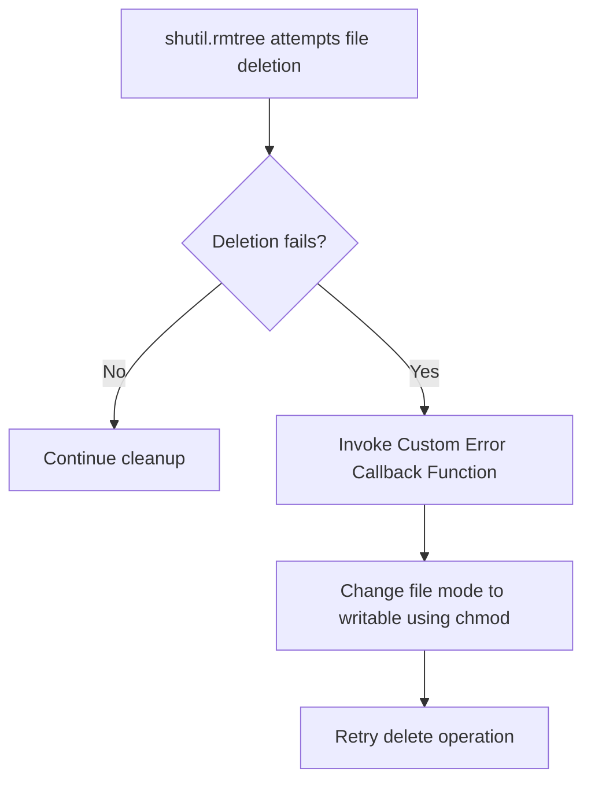

# Removing Directories Recursively

Cleaning up directories is a common step in system automation. You might need to remove old build workspace files, clean up temporary download folders, or wipe old application test directories.

While the `os.rmdir()` function can delete directories, it only works if the directory is completely empty. If a folder contains even a single file, the function will fail. To delete a directory and all of its contents (files, subfolders, and symlinks) recursively, you must use [shutil.rmtree](https://docs.python.org/3/library/shutil.html#shutil.rmtree).

In this guide, we will learn how to delete directory trees, handle permission issues, and configure custom error handlers during cleanups.

---

## Directory Removal Comparison

Here is how Python's folder deletion options compare:

| Function | Delete empty folders? | Delete folders containing files? | Safe from deleting single files? | Custom Error Handling? |
| :--- | :--- | :--- | :--- | :--- |
| **`os.rmdir(path)`** | Yes | No (Raises `OSError`) | Yes | No |
| **`os.remove(path)`** | No (Raises `IsADirectoryError`) | No | No (Deletes files only) | No |
| **`shutil.rmtree(path)`** | Yes | Yes (Recursive delete) | Yes (Raises `NotADirectoryError` if path is a file) | Yes (via `onexc` or `onerror` parameter) |

> [!CAUTION]
> `shutil.rmtree()` is the Python equivalent of running `rm -rf` in Linux or `Remove-Item -Recurse` in PowerShell. It deletes everything in the target path immediately and permanently. There is no "recycle bin" safety net.

---

## Basic rmtree Example

Let us write a script that creates a nested folder structure with files, and then wipes it using `shutil.rmtree()`.

```python
import os
import shutil

# 1. Create a dummy test directory with files
workspace = "build_workspace"
os.makedirs(os.path.join(workspace, "src"), exist_ok=True)
os.makedirs(os.path.join(workspace, "output"), exist_ok=True)

with open(os.path.join(workspace, "src", "config.txt"), "w") as f:
    f.write("test config")
with open(os.path.join(workspace, "output", "build.log"), "w") as f:
    f.write("build finished")

# Verify it exists
print(f"Workspace exists before delete: {os.path.exists(workspace)}")

# 2. Delete the workspace and all its contents
shutil.rmtree(workspace)

# Verify it is gone
print(f"Workspace exists after delete:  {os.path.exists(workspace)}")
```

### Expected Output

```text
Workspace exists before delete: True
Workspace exists after delete:  False
```

---

## Handling Errors and Permissions

On production systems, you will often run into files that are write-protected (like read-only files) or owned by different processes. When `shutil.rmtree()` encounters these files, it will crash midway, leaving your cleanup half-finished.

To prevent this, you can:
1. Ignore all errors using `ignore_errors=True`.
2. Provide a custom callback function to handle issues (like changing file permissions on the fly so they can be deleted).

Here is the error callback pattern:



Let us look at a script that implements a callback function. In Python 3.12+, the parameter is called `onexc`. In older versions, it was called `onerror`. We will write a wrapper that works for both.

```python
import os
import stat
import shutil

def remove_readonly(func, path, excinfo):
    # This callback is called when an error occurs during rmtree.
    # We check if the file is write-protected (read-only)
    # and change permissions to make it writable, then try deleting it again.
    print(f"[RECOVERING] Failed to delete: {path}. Adjusting permissions...")
    os.chmod(path, stat.S_IWRITE)
    # Retry the deletion function (usually os.unlink for files)
    func(path)

# Let us build a folder containing a read-only file
test_dir = "secure_workspace"
os.makedirs(test_dir, exist_ok=True)
readonly_file = os.path.join(test_dir, "locked.txt")

with open(readonly_file, "w") as f:
    f.write("Locked contents")

# Make the file read-only (remove write permission)
os.chmod(readonly_file, stat.S_IREAD)

try:
    # Run rmtree. On Python 3.12+ use onexc. For compatibility, we use onexc here.
    # If using Python version < 3.12, you would pass onerror=remove_readonly
    shutil.rmtree(test_dir, onexc=remove_readonly)
    print("Locked workspace removed successfully.")
except Exception as err:
    print(f"Wipe failed: {err}")
```

### Expected Output

```text
[RECOVERING] Failed to delete: secure_workspace/locked.txt. Adjusting permissions...
Locked workspace removed successfully.
```

---

## Common Mistakes

Here are some typical errors when deleting directory trees:

### 1. Passing a single file path to `shutil.rmtree()`
If you call `shutil.rmtree("logs.txt")` and `logs.txt` is a standard file, Python will raise a `NotADirectoryError`. You must verify the target is a directory before running it, or capture the error:

```python
if os.path.isdir(target_path):
    shutil.rmtree(target_path)
else:
    os.remove(target_path)
```

### 2. Deleting the current working directory
If your script runs `os.chdir("workspace")` and then executes `shutil.rmtree("../workspace")` (deleting the folder the script is currently running inside), subsequent file commands will fail with weird errors because the directory no longer exists on disk. Always change your directory out of the target folder before wiping it.

### 3. Hardcoding `ignore_errors=True` without logging
Setting `shutil.rmtree(path, ignore_errors=True)` makes the script silent. If some files are not deleted due to permission locks, the command will complete without warning, leaving outdated or corrupted folders behind. Only use `ignore_errors=True` if you do not care about leftover files.

---

## Summary

* Use [shutil.rmtree](https://docs.python.org/3/library/shutil.html#shutil.rmtree) to delete directories and their contents recursively.
* Do not use `os.rmdir()` on folders that contain files.
* Be extremely careful: `shutil.rmtree()` deletes folders immediately and permanently.
* Pass `ignore_errors=True` to ignore all directory deletion errors silently.
* Pass a custom callback function to the `onexc` parameter (Python 3.12+) to handle failures dynamically.
* Use `os.chmod` inside error callbacks to remove read-only attributes from files on the fly.
* Check if a path is a directory using `os.path.isdir()` before calling `rmtree()` to prevent type errors.
* Avoid deleting the directory that your Python process is currently running inside.
* Ensure you have parent folder write permissions when attempting folder cleanups.
