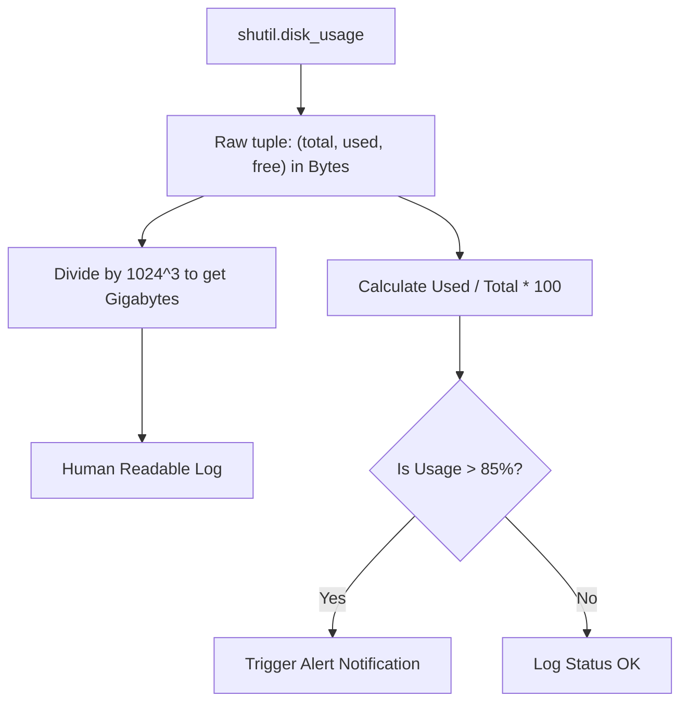

# Checking Disk Storage Space

As a DevOps engineer, you must ensure that your servers do not run out of disk space. When a database disk fills up, databases lock, logs stop writing, and applications crash. Writing scripts that monitor storage space and send alerts is one of the most fundamental infrastructure tasks.

In Python, the easiest way to inspect disk partition storage details is using the [shutil.disk_usage](https://docs.python.org/3/library/shutil.html#shutil.disk_usage) function.

In this guide, we will learn how to check disk usage, convert raw bytes into human-readable sizes (like Gigabytes), and write automated storage alerts.

---

## The `shutil.disk_usage` Function

The `shutil.disk_usage` function takes a directory path as input and queries the partition containing that directory. It returns a named tuple containing three attributes:

* `total`: Total storage space available on the partition (in bytes).
* `used`: Used space on the partition (in bytes).
* `free`: Free space remaining on the partition (in bytes).

Let us look at how `shutil` compares to running native shell queries:

| Monitoring Method | Platform | Can Parse Output Easily? | Returns Exact Bytes? |
| :--- | :--- | :--- | :--- |
| **`shutil.disk_usage()`** | Windows / Linux / macOS | Yes (direct tuple access) | Yes (precise values) |
| **`df -h` Command** | Linux / macOS only | No (requires text splitting/regex) | No (usually rounded strings) |
| **`Get-PSDrive` Cmdlet** | Windows only | No (requires PowerShell execution) | Yes |

---

## Basic Storage Space Check

Let us write a simple script that queries the current directory storage partition, extracts the space info, and prints it out.

```python
import shutil

# 1. Query the disk partition where the current script runs
# Passing "." refers to the current working directory folder
usage = shutil.disk_usage(".")

# Extract raw bytes
total_bytes = usage.total
used_bytes = usage.used
free_bytes = usage.free

# 2. Convert bytes to Gigabytes for better readability
# 1 Gigabyte = 1024 * 1024 * 1024 bytes
total_gb = total_bytes / (1024 ** 3)
used_gb = used_bytes / (1024 ** 3)
free_gb = free_bytes / (1024 ** 3)

# 3. Calculate usage percentage
percentage_used = (used_bytes / total_bytes) * 100

print("Disk Storage Statistics")
print("=======================")
print(f"Total Space: {total_gb:.2f} GB")
print(f"Used Space:  {used_gb:.2f} GB")
print(f"Free Space:  {free_gb:.2f} GB")
print(f"Usage Rate:  {percentage_used:.1f}%")
```

### Expected Output

```text
Disk Storage Statistics
=======================
Total Space: 475.25 GB
Used Space:  150.45 GB
Free Space:  324.80 GB
Usage Rate:  31.7%
```

---

## Storage Space Conversion Flow

Here is how our Python script takes raw partition details and converts them for alerting systems:



---

## Real-World DevOps Scenario: Disk Guard Alerting Script

Let us write an automated monitoring check that checks system partitions (like the system root `/` or Windows drive `C:\`) and alerts us if the free space drops below 15% or if the free space is less than 10 Gigabytes.

```python
import os
import shutil
import sys

def run_storage_audit(target_path, threshold_percent=15.0, min_gb_limit=10.0):
    print(f"Auditing target path: {os.path.abspath(target_path)}")
    print("-------------------------------------------------")
    
    if not os.path.exists(target_path):
        print(f"Error: Target path '{target_path}' does not exist.")
        return
        
    # Get usage stats
    usage = shutil.disk_usage(target_path)
    
    # Calculate sizes
    free_gb = usage.free / (1024 ** 3)
    percentage_free = (usage.free / usage.total) * 100
    percentage_used = (usage.used / usage.total) * 100
    
    print(f"Current Usage: {percentage_used:.2f}% | Free Space: {free_gb:.2f} GB ({percentage_free:.2f}% free)")
    
    # Audit logic
    alert_triggered = False
    reasons = []
    
    if percentage_free < threshold_percent:
        alert_triggered = True
        reasons.append(f"Free percentage ({percentage_free:.1f}%) is below safety threshold ({threshold_percent}%)")
        
    if free_gb < min_gb_limit:
        alert_triggered = True
        reasons.append(f"Free Gigabytes ({free_gb:.1f} GB) is below safety limit ({min_gb_limit} GB)")
        
    # Process audit results
    if alert_triggered:
        print("\n[ALERT] DISK SPACE CRITICAL WARNING!")
        for reason in reasons:
            print(f"- {reason}")
        # In a real script, you would trigger a Slack webhook or email here
    else:
        print("\n[OK] Storage partition health is optimal.")

# Run check on system root
# On Windows, we use C:\. On Linux/macOS, we use /
system_root = "C:\\" if os.name == "nt" else "/"
run_storage_audit(system_root)
```

### Expected Output

```text
Auditing target path: C:\
-------------------------------------------------
Current Usage: 45.23% | Free Space: 320.12 GB (54.77% free)

[OK] Storage partition health is optimal.
```

---

## Common Mistakes

Here are some typical mistakes people make when inspecting disk usage:

### 1. Hardcoding the folder path separator
If you pass paths to `shutil.disk_usage` using hardcoded paths (like `shutil.disk_usage("C:/")` on Windows or `shutil.disk_usage("/var")` on Linux), your scripts will not be portable. Always use `os.sep` or conditional checks (`os.name == 'nt'`) to make sure your scripts target valid directory paths across all host environments.

### 2. Forgetting that containers share host space
If your Python monitor script runs inside a Docker container, calling `shutil.disk_usage("/")` reads the storage space of the host machine partition, not the resource limits set on the Docker container. If you have capped your Docker container disk space, `shutil.disk_usage` will not warn you if your container is hitting its custom storage limit.

### 3. Dividing by 1000 instead of 1024
Computer systems count disk space in binary units (Gibibytes/Gigabytes). 1 Kilobyte is 1024 bytes. If you divide by `1000 * 1000 * 1000` (which is decimal GB), your script will report incorrect space values compared to what the operating system reports. Always use binary factors: `1024 ** 3` for Gigabytes and `1024 ** 4` for Terabytes.

---

## Summary

* Use [shutil.disk_usage](https://docs.python.org/3/library/shutil.html#shutil.disk_usage) to check disk partition storage details.
* The function returns a named tuple containing `total`, `used`, and `free` space in bytes.
* Query the folder your script is running inside by passing `"."` to `shutil.disk_usage()`.
* Convert bytes to Gigabytes by dividing by `1024 ** 3`.
* Calculate usage rates by dividing `used` bytes by `total` bytes and multiplying by 100.
* Monitor partition thresholds to alert teams before disks fill up completely.
* Remember that on Unix-like systems, root directories are specified as `"/"`, and on Windows, they are specified as drive letters (e.g. `"C:\\"`).
* Avoid using `shutil.disk_usage` to monitor Docker-specific storage limits, as it queries the host partition.
* Run audits on critical directories (like database storage folders or log locations) to capture partition-specific limits.
