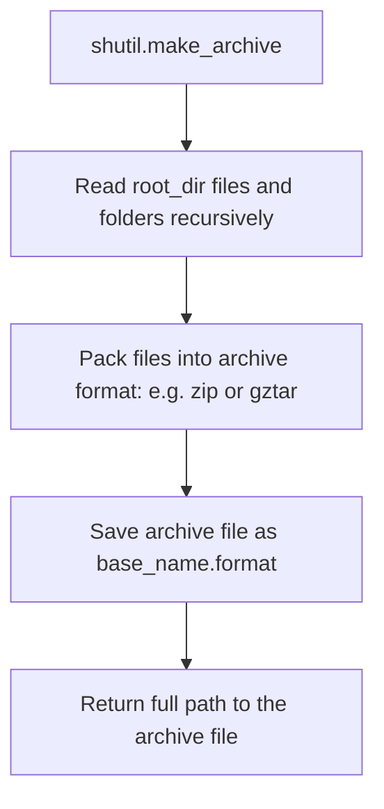

# Archiving and Unpacking with shutil

In DevOps, compression is key. You compress log folders before uploading them to cloud storage, package configuration bundles before sending them to deployment hosts, and unpack zip files containing static website files or application binaries.

While Python has dedicated libraries for handling archives (like `zipfile` or `tarfile`), they require multi-line setups to zip a folder structure recursively. To simplify this, Python's [shutil](https://docs.python.org/3/library/shutil.html) module provides high-level functions to create and unpack compressed archive files.

In this guide, we will learn how to create, inspect, and extract archives using `shutil`.

---

## Supported Archive Formats

The `shutil` module supports several compression formats out of the box. You can query the available formats on your system using `shutil.get_archive_formats()`.

Here is a summary of the most commonly used compression formats:

| Format Name | File Extension | Best For | Description |
| :--- | :--- | :--- | :--- |
| **`zip`** | `.zip` | Cross-platform compatibility | Standard zip compression. Readable on Windows, Linux, and macOS without extra tools. |
| **`gztar`** | `.tar.gz` | Linux/Unix deployments | Gzip compressed tarball. Standard format for Unix software packages. |
| **`bztar`** | `.tar.bz2` | High compression efficiency | Bzip2 compressed tarball. Slower compression but smaller file size. |
| **`xztar`** | `.tar.xz` | Maximum compression ratios | XZ compressed tarball. Slowest compression but yields the smallest files. |

---

## Creating an Archive

To create a zipped folder, use `shutil.make_archive()`. You specify the target output name, the format, and the directory path you want to compress.



Let us look at a code example:

```python
import os
import shutil

# 1. Create a dummy logs directory for zipping
source_dir = "system_logs"
os.makedirs(source_dir, exist_ok=True)

with open(os.path.join(source_dir, "auth.log"), "w") as f:
    f.write("User admin logged in successfully.\n")
with open(os.path.join(source_dir, "error.log"), "w") as f:
    f.write("Database connection timeout.\n")

# 2. Archive the directory
# base_name specifies the output file path (excluding the extension)
output_path = shutil.make_archive(
    base_name="backup_logs",
    format="zip",
    root_dir=source_dir
)

print(f"Archive created at: {output_path}")
print(f"File exists? {os.path.exists('backup_logs.zip')}")

# Clean up source directory and archive
shutil.rmtree(source_dir)
os.remove("backup_logs.zip")
```

### Expected Output

```text
Archive created at: C:\Users\username\backup_logs.zip
File exists? True
```

---

## Unpacking / Extracting an Archive

Extracting an archive is just as simple. Use `shutil.unpack_archive()`, passing the archive path and the target destination folder. If the destination folder does not exist, Python will create it automatically.

```python
import os
import shutil

# Let us set up a zip archive for testing
source_dir = "temp_src"
os.makedirs(source_dir, exist_ok=True)
with open(os.path.join(source_dir, "config.json"), "w") as f:
    f.write('{"status": "ok"}')

archive_file = shutil.make_archive("package", "zip", source_dir)
shutil.rmtree(source_dir) # Delete original folder

# ----------------------------
# Unpack the archive to a new folder
target_folder = "deployment_configs"

print(f"Extracting '{archive_file}' into folder '{target_folder}'...")
shutil.unpack_archive(filename=archive_file, extract_dir=target_folder)

# Verify extraction succeeded
extracted_file = os.path.join(target_folder, "config.json")
print(f"Extracted config.json exists? {os.path.exists(extracted_file)}")

# Clean up files
os.remove(archive_file)
shutil.rmtree(target_folder)
```

### Expected Output

```text
Extracting 'package.zip' into folder 'deployment_configs'...
Extracted config.json exists? True
```

---

## Real-World DevOps Scenario: Log Rolling Backup Utility

Let us write a complete script that checks a folder for logs, bundles them into a timestamped `.tar.gz` archive, and moves the archive to a separate backup directory.

```python
import datetime
import os
import shutil

def run_log_rotation_backup():
    log_dir = "app_server_logs"
    backup_store = "storage_backups"
    
    # Create mock log files
    os.makedirs(log_dir, exist_ok=True)
    os.makedirs(backup_store, exist_ok=True)
    
    with open(os.path.join(log_dir, "connections.log"), "w") as f:
        f.write("Port 443 active\n")
        
    print(f"Starting log backup scan...")
    print("==========================")
    
    # Check if we have logs to archive
    if os.path.exists(log_dir) and os.listdir(log_dir):
        timestamp = datetime.datetime.now().strftime("%Y%m%d_%H%M%S")
        archive_name = f"logs_{timestamp}"
        
        # Save temporary archive locally
        temp_archive = shutil.make_archive(
            base_name=archive_name,
            format="gztar", # tar.gz
            root_dir=log_dir
        )
        print(f"Logs compressed: {temp_archive}")
        
        # Move archive to backup store
        final_dest = shutil.move(temp_archive, backup_store)
        print(f"Backup saved to storage repository: {final_dest}")
        
        # Clean up source directory contents
        shutil.rmtree(log_dir)
        os.makedirs(log_dir, exist_ok=True)
        print("Source logs cleared for next run cycle.")
    else:
        print("No logs found to archive.")
        
    # Clean up test directories
    shutil.rmtree(log_dir)
    shutil.rmtree(backup_store)

run_log_rotation_backup()
```

### Expected Output

```text
Starting log backup scan...
==========================
Logs compressed: C:\Users\username\logs_20260625_083000.tar.gz
Backup saved to storage repository: storage_backups/logs_20260625_083000.tar.gz
Source logs cleared for next run cycle.
```

---

## Common Mistakes

Here are some typical gotchas when zipping and extracting files:

### 1. Including the output file in the zipping scope
If you try to save your archive *inside* the folder you are zipping (for example, saving `logs.zip` inside `logs/` directory and setting `root_dir='logs'`), `shutil.make_archive` will try to compress the archive file itself. This leads to infinite loops, massive file sizes, or permissions crashes. Always save archives outside the source folder.

### 2. Forgetting that `unpack_archive` extracts everything flat or nested depending on packaging
`shutil.unpack_archive` extracts the archive exactly as it was created. If you zipped a folder containing subfolders, it will recreate them. If you zipped a bunch of loose files without placing them inside a folder first, they will extract flat into your target folder. To prevent cluttering, always extract archives into a dedicated, empty folder.

### 3. Using unsupported compression formats
If you specify a format that is not configured on the target operating system (like trying to create an `xztar` archive on a system without the `xz` library installed), Python will raise a `ValueError`. Check formats using `shutil.get_archive_formats()` to make sure your format is supported.

---

## Summary

* Use [shutil.make_archive](https://docs.python.org/3/library/shutil.html#shutil.make_archive) to compress folders recursively.
* Use [shutil.unpack_archive](https://docs.python.org/3/library/shutil.html#shutil.unpack_archive) to extract zipped files.
* Query supported formats using `shutil.get_archive_formats()`.
* Support cross-platform zipping by using the `"zip"` format.
* Support Linux-native zipping by using the `"gztar"` (`.tar.gz`) format.
* Remember that the `base_name` parameter does not include the file extension.
* Ensure your target folder for zipping does not contain the output archive file.
* Always unpack archives into a dedicated target folder to avoid flat file cluttering.
* Keep in mind that `unpack_archive()` will create the destination folder automatically.
