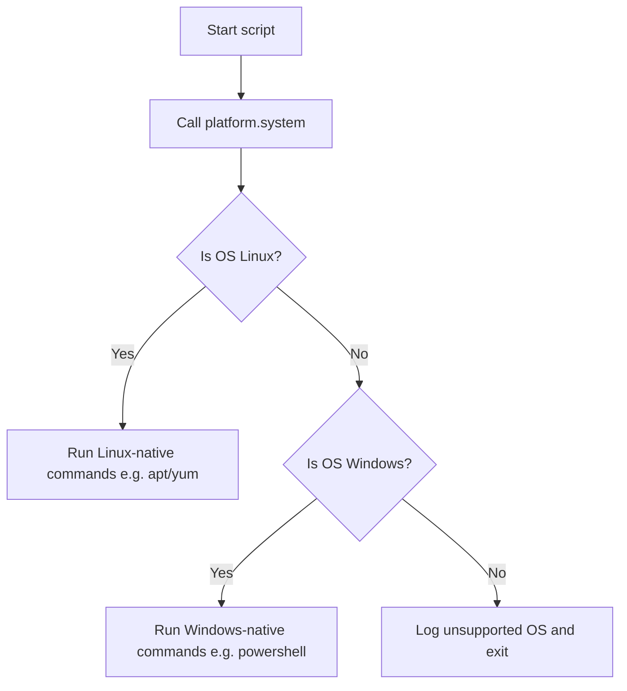

# Platform Module in Python

When writing scripts to automate tasks on different servers, you need to know exactly where your code is running. For instance, a script might need to execute one command on a RedHat Linux server, another on an Ubuntu server, and something completely different on a Windows server.

To help with this, Python provides a built-in module called [platform](https://docs.python.org/3/library/platform.html). It lets you inspect system details like the operating system, machine architecture, hardware processor type, and Python interpreter version.

In this guide, we will learn how to gather system information using the `platform` module.

---

## Core Functions in platform

Here is a summary of the most useful functions inside the `platform` module:

| Function Name | Return Example | Description |
| :--- | :--- | :--- |
| `platform.system()` | `"Linux"`, `"Windows"`, `"Darwin"` | Returns the operating system name. |
| `platform.release()` | `"5.15.0-72-generic"`, `"10"` | Returns the system release version (e.g. kernel version). |
| `platform.version()` | `"#79-Ubuntu SMP"` | Returns the detailed OS build version. |
| `platform.machine()` | `"x86_64"`, `"AMD64"`, `"arm64"` | Returns the hardware architecture of the host CPU. |
| `platform.processor()` | `"Intel64 Family 6"` | Returns the actual hardware processor name. |
| `platform.architecture()` | `('64bit', 'WindowsPE')` | Returns a tuple showing bit length and executable format. |
| `platform.python_version()` | `"3.11.2"` | Returns the running Python interpreter version. |

---

## Basic Platform Inspection

Let us write a simple system inspector script that prints the properties of the host machine.

```python
import platform

print("Host Hardware Inspection")
print("========================")

# 1. Get Operating System details
os_name = platform.system()
os_release = platform.release()
os_version = platform.version()

# 2. Get hardware details
cpu_arch = platform.machine()
processor_spec = platform.processor()

# 3. Get Python information
python_ver = platform.python_version()
python_impl = platform.python_implementation() # e.g. CPython, PyPy

print(f"Operating System: {os_name} (Release: {os_release})")
print(f"OS Build Detail:  {os_version}")
print(f"CPU Architecture: {cpu_arch}")
print(f"Processor Info:   {processor_spec}")
print(f"Python Runtime:   {python_impl} v{python_ver}")
```

### Expected Output (Windows Laptop Example)

```text
Host Hardware Inspection
========================
Operating System: Windows (Release: 10)
OS Build Detail:  10.0.22621
CPU Architecture: AMD64
Processor Info:   Intel64 Family 6 Model 158 Stepping 10, GenuineIntel
Python Runtime:   CPython v3.11.2
```

---

## Directing Execution Based on OS

In DevOps, you often need to route your scripts to run different commands depending on the host operating system. 

Here is how the execution flow looks:



Let us look at a code example:

```python
import platform
import subprocess

def run_dns_flush():
    os_type = platform.system()
    print(f"Detected Operating System: {os_type}")
    
    if os_type == "Windows":
        # Windows flush DNS command
        command = ["ipconfig", "/flushdns"]
    elif os_type == "Linux":
        # Linux flush DNS (using systemd-resolved service)
        command = ["resolvectl", "flush-caches"]
    elif os_type == "Darwin":
        # macOS flush DNS command
        command = ["sudo", "dscacheutil", "-flushcache"]
    else:
        print(f"Error: DNS flush is not configured for OS '{os_type}'.")
        return
        
    try:
        print(f"Running flush command: {' '.join(command)}")
        # In a real run, this runs the command. We set check=True to handle errors.
        # subprocess.run(command, check=True)
        print("DNS cache flushed successfully.")
    except Exception as err:
        print(f"Failed to flush DNS cache: {err}")

run_dns_flush()
```

### Expected Output

```text
Detected Operating System: Windows
Running flush command: ipconfig /flushdns
DNS cache flushed successfully.
```

---

## Detailed Linux Distribution Info (Python 3.8+)

In older Python versions, the `platform` module had a `linux_distribution()` function. This was removed in Python 3.8. 

If you are running on modern Linux servers and need to know the specific distribution (like Ubuntu, CentOS, or Debian), you can read the `/etc/os-release` file manually or use the external `distro` package.

Here is a script that reads the distribution without installing third-party libraries:

```python
import platform

def get_linux_distribution():
    if platform.system() != "Linux":
        return f"Not a Linux system ({platform.system()})"
        
    # Read system OS release details on Linux
    try:
        dist_info = {}
        with open("/etc/os-release", "r") as file:
            for line in file:
                if "=" in line:
                    key, val = line.strip().split("=", 1)
                    # Clean up quotes
                    dist_info[key] = val.replace('"', '')
        name = dist_info.get("NAME", "Linux")
        version = dist_info.get("VERSION_ID", "Unknown")
        return f"{name} {version}"
    except Exception as err:
        return f"Linux distribution info unavailable: {err}"

print(f"Distribution Details: {get_linux_distribution()}")
```

### Expected Output (if run on Ubuntu)

```text
Distribution Details: Ubuntu 22.04
```

---

## Common Mistakes

Here are some typical gotchas when using the `platform` module:

### 1. Hardcoding OS name checks with wrong casing
`platform.system()` returns OS names with capitalized first letters: `"Windows"`, `"Linux"`, or `"Darwin"` (Darwin is the kernel name for macOS). If you write code like `if platform.system() == "linux":`, your check will always evaluate to `False`. Always check with correct casing or convert to lowercase:

```python
# Safer check
if platform.system().lower() == "linux":
    print("Running on Linux")
```

### 2. Assuming macOS is named "macOS"
If you are running your script on Apple hardware, `platform.system()` does not return `"macOS"` or `"mac"`. It returns `"Darwin"`. Keep this in mind when routing commands.

### 3. Relying on deleted features
If you copy code from old tutorials, you might see `platform.linux_distribution()`. Calling this in Python 3.8 or newer will throw an `AttributeError`. Make sure to read `/etc/os-release` or use the `distro` library instead.

---

## Summary

* The [platform](https://docs.python.org/3/library/platform.html) module retrieves detailed information about the host system.
* Use `platform.system()` to identify the OS family (`"Windows"`, `"Linux"`, `"Darwin"`).
* Remember that macOS is identified by the system name `"Darwin"`.
* Use `platform.machine()` to check CPU architecture (`"x86_64"`, `"AMD64"`, `"arm64"`).
* Query the running Python version using `platform.python_version()`.
* Direct script command branches depending on the output of `platform.system()`.
* Keep in mind that `platform.linux_distribution()` was removed in Python 3.8.
* Retrieve specific Linux distro names by reading `/etc/os-release` directly.
* Convert system names to lowercase (`platform.system().lower()`) to prevent casing bugs in check conditions.
