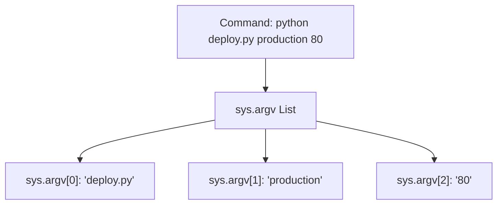

# Sys Module in Python

While the `os` module focuses on the operating system itself, the [sys](https://docs.python.org/3/library/sys.html) module lets you interact directly with the running Python interpreter. It provides variables and functions that control command-line arguments, system path settings, execution termination, and standard input/output streams.

In this guide, we will learn how to parse basic command-line arguments, write status streams to standard error, and exit scripts with proper status codes using the `sys` module.

---

## Core Attributes in sys

Here is a summary of the most common variables and functions inside the `sys` module:

| Attribute / Function | Return Type | Description |
| :--- | :--- | :--- |
| `sys.argv` | `list` | List of command-line arguments passed to the script. |
| `sys.exit(code)` | raises `SystemExit` | Exits the Python interpreter with a status code (0 for success). |
| `sys.path` | `list` | List of folder paths where Python searches for modules to import. |
| `sys.platform` | `str` | Simple identifier of the running operating system platform. |
| `sys.stdin` | stream | Standard Input stream. |
| `sys.stdout` | stream | Standard Output stream. |
| `sys.stderr` | stream | Standard Error stream. |

---

## Parsing Arguments with sys.argv

When you run a script from the terminal, you can pass arguments to it (for example, `python deploy.py production --dry-run`). Python stores these arguments in a list called `sys.argv`.

The first element in the list, `sys.argv[0]`, is always the path to the script itself. The remaining elements are the arguments passed by the user.



Let us look at a script that parses arguments:

```python
import sys

# Count arguments
num_args = len(sys.argv)

print(f"Script Name: {sys.argv[0]}")
print(f"Total arguments passed: {num_args - 1}")

# Print each argument
for idx, arg in enumerate(sys.argv):
    if idx == 0:
        continue # Skip script name
    print(f"Argument {idx}: {arg}")
```

### Expected Output (if run as: `python script.py web-server 10.0.0.15`)

```text
Script Name: script.py
Total arguments passed: 2
Argument 1: web-server
Argument 2: 10.0.0.15
```

---

## Directing Output to Standard Error

By default, Python's `print()` function sends text to standard output (`stdout`). However, when writing command-line tools, you should send logs or warnings to standard error (`stderr`) so users can filter error logs from standard program outputs in their shells.

You can write directly to `sys.stderr` using the `write()` method or by passing `file=sys.stderr` to the `print` function.

```python
import sys

# 1. Writing to stdout (Normal logs)
print("Processing backup...")

# 2. Writing to stderr (Errors and warnings)
print("WARNING: Disk space is running low (82% used)!", file=sys.stderr)

# 3. Direct write method (does not automatically append a newline)
sys.stderr.write("ERROR: Database connection failed.\n")
```

### Expected Output

```text
Processing backup...
WARNING: Disk space is running low (82% used)!
ERROR: Database connection failed.
```

---

## Real-World DevOps Scenario: Configuration deployer tool

Let us write a script that acts as a deployment router. It expects a target environment name as the first argument. If it is missing or invalid, the script writes a warning to `sys.stderr` and exits with an error status code `1`.

```python
import sys

def deploy_application():
    # 1. Verify arguments exist
    # Remember: len(sys.argv) is at least 1 because sys.argv[0] is the script name.
    if len(sys.argv) < 2:
        print("ERROR: Target environment parameter is required.", file=sys.stderr)
        print(f"Usage: python {sys.argv[0]} [development|staging|production]", file=sys.stderr)
        sys.exit(1) # Exit with failure code
        
    environment = sys.argv[1]
    allowed_environments = ["development", "staging", "production"]
    
    # 2. Validate parameters
    if environment not in allowed_environments:
        print(f"ERROR: Environment '{environment}' is invalid.", file=sys.stderr)
        sys.exit(1)
        
    # 3. Execute setup
    print(f"Initiating deployment sequence to environment: {environment}...")
    # Simulate work
    print("Deployment completed successfully.")
    sys.exit(0) # Exit with success code (default)

if __name__ == "__main__":
    deploy_application()
```

### Expected Output (if run with no arguments)

```text
ERROR: Target environment parameter is required.
Usage: python deploy.py [development|staging|production]
```

The shell command-line exit status for this run would be `1`.

---

## Common Mistakes

Here are some typical mistakes people make with the `sys` module:

### 1. Assuming `sys.argv` values are numbers
All arguments read from `sys.argv` are strings. If you pass a port number like `8080`, Python reads it as the string `"8080"`. If you try to pass it to a connection function that expects an integer, it will fail. You must cast it manually:

```python
# WRONG
port = sys.argv[2] # holds '8080'

# CORRECT
port = int(sys.argv[2])
```

### 2. Accessing `sys.argv` indexes without checking the list length
If you write `target_env = sys.argv[1]` without checking if the user passed any arguments, your script will crash with an `IndexError: list index out of range` if run without parameters. Always check `len(sys.argv)` before accessing indexes.

### 3. Using `sys.path.append()` without understanding module resolution
If you append a folder path to `sys.path` (e.g. `sys.path.append('/my/folder')`), Python will find modules in that folder. However, this is temporary and only lasts as long as the script runs. Hardcoding folder paths inside your scripts can break if folders are moved on target servers.

---

## Summary

* The [sys](https://docs.python.org/3/library/sys.html) module lets you interact with the running Python interpreter process.
* Read command-line arguments using `sys.argv`, which returns a list of strings.
* `sys.argv[0]` always holds the path to the running script file.
* Always check the length of `sys.argv` before accessing indexes to avoid index errors.
* Remember that all values parsed from `sys.argv` are strings.
* Exit scripts with proper exit codes using `sys.exit(code)` (0 for success, non-zero for failures).
* Send warnings and logs to standard error using `print('message', file=sys.stderr)`.
* Inspect `sys.platform` to get a quick operating system family tag (e.g. `"win32"`, `"linux"`).
* Avoid appending hardcoded paths to `sys.path` to keep modules portable.
