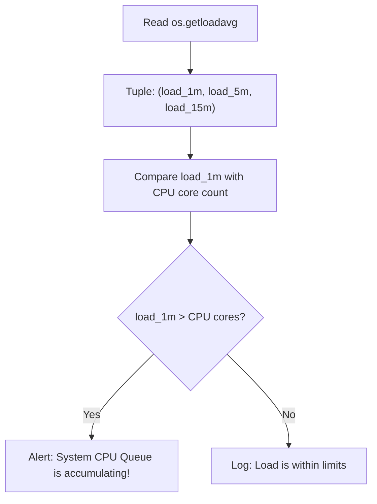

# CPU Monitoring with Python

Monitoring CPU utilization is a key task in system administration. High CPU usage can indicate that a service is stuck in an infinite loop, that database queries are poorly optimized, or that the server is overloaded and needs to be scaled up.

In Python, we use the `psutil` library to collect CPU metrics, and the `os` module to query system load averages.

In this guide, we will learn how to monitor CPU cores, query system load averages, measure utilization per CPU core, and fetch CPU frequencies.

---

## CPU Metric Functions

Here is a summary of the primary functions used to monitor CPU resources:

| Function Name | Return Type | Description |
| :--- | :--- | :--- |
| `psutil.cpu_percent(interval)` | `float` | Returns system-wide CPU utilization percentage. |
| `psutil.cpu_percent(interval, percpu=True)` | `list` of `floats` | Returns utilization percentage individually for each core. |
| `psutil.cpu_count(logical=True)` | `int` | Returns number of logical CPU cores (threads). |
| `psutil.cpu_count(logical=False)` | `int` | Returns number of physical CPU cores. |
| `psutil.cpu_freq()` | named tuple | Returns current, min, and max CPU frequency (in MHz). |
| `os.getloadavg()` | `tuple` (3 values) | Returns system load averages for the last 1, 5, and 15 minutes (Linux/macOS only). |

---

## Basic CPU Monitoring Example

Let us write a script to inspect general CPU details and track real-time utilization.

```python
import psutil

# 1. Get core counts
logical_cores = psutil.cpu_count(logical=True)
physical_cores = psutil.cpu_count(logical=False)

# 2. Get current CPU frequency
freq = psutil.cpu_freq()
current_mhz = freq.current if freq else "Unknown"

# 3. Sample CPU utilization twice
print("Gathering CPU specifications...")
print("------------------------------")
print(f"Physical Cores: {physical_cores}")
print(f"Logical Cores:  {logical_cores}")
if freq:
    print(f"CPU Frequency:  {current_mhz} MHz (Range: {freq.min}MHz - {freq.max}MHz)")

print("\nSampling CPU utilization...")
# Sample over 0.5 seconds
overall_percent = psutil.cpu_percent(interval=0.5)
print(f"Total CPU Utilization: {overall_percent}%")
```

### Expected Output

```text
Gathering CPU specifications...
------------------------------
Physical Cores: 4
Logical Cores:  8
CPU Frequency:  2400.0 MHz (Range: 800.0MHz - 3500.0MHz)

Sampling CPU utilization...
Total CPU Utilization: 8.5%
```

---

## Checking Load Averages (Linux / macOS)

On UNIX-based systems, system load averages indicate the number of active processes waiting for CPU time. A load average of `1.0` on a single-core machine means the CPU is fully utilized. On an 8-core machine, the load average can go up to `8.0` before the system experiences cpu queues.



Here is how to check load averages in Python:

```python
import os
import platform
import psutil

def check_load_averages():
    # os.getloadavg() is only supported on Linux and macOS
    if platform.system() == "Windows":
        print("Load averages are not supported on Windows.")
        return
        
    # Get load averages
    load1, load5, load15 = os.getloadavg()
    cores = psutil.cpu_count(logical=True)
    
    print("Load Averages Report")
    print("--------------------")
    print(f"1-Minute Load:  {load1:.2f} (Cores: {cores})")
    print(f"5-Minute Load:  {load5:.2f}")
    print(f"15-Minute Load: {load15:.2f}")
    
    if load1 > cores:
        print("[WARNING] Overload: 1-minute load average exceeds physical CPU core limit!")

check_load_averages()
```

### Expected Output (Linux example)

```text
Load Averages Report
--------------------
1-Minute Load:  1.20 (Cores: 4)
5-Minute Load:  0.85
15-Minute Load: 0.60
[OK] Load is healthy.
```

---

## Real-World DevOps Scenario: CPU Hotspot Detector

Sometimes, a single thread runs wild and spikes one CPU core to 100%, while the other cores stay idle. In this scenario, the overall CPU usage might look low (e.g. 12.5% on an 8-core system), hiding the performance issue. 

Let us write a script that inspects individual cores and flags any single-core hotspots.

```python
import psutil
import time

def monitor_cpu_hotspots(threshold=80.0):
    print("Monitoring core utilization for hotspots...")
    print("==========================================")
    
    # Sample CPU load on each core individually
    # percpu=True returns a list of utilization percentages
    core_loads = psutil.cpu_percent(interval=1.0, percpu=True)
    
    hotspots = []
    for idx, load in enumerate(core_loads):
        print(f"Core {idx}: {load}%")
        if load > threshold:
            hotspots.append((idx, load))
            
    print("==========================================")
    if hotspots:
        print(f"[ALERT] Found {len(hotspots)} CPU core hotspots!")
        for core, load in hotspots:
            print(f"- Core {core} is running at {load}%!")
    else:
        print("[OK] All cores are operating within normal parameters.")

monitor_cpu_hotspots()
```

### Expected Output

```text
Monitoring core utilization for hotspots...
==========================================
Core 0: 12.4%
Core 1: 95.2%
Core 2: 15.1%
Core 3: 8.0%
Core 4: 10.2%
Core 5: 11.5%
Core 6: 9.8%
Core 7: 14.2%
==========================================
[ALERT] Found 1 CPU core hotspots!
- Core 1 is running at 95.2%!
```

---

## Common Mistakes

Here are some typical issues when monitoring CPUs:

### 1. Running `os.getloadavg()` on Windows
If you run `os.getloadavg()` on a Windows server, your script will crash with an `AttributeError` because the function does not exist in the Windows build of Python's standard library. Always wrap load average checks in system type validations.

### 2. Confusing physical cores with logical cores
`psutil.cpu_count()` defaults to logical cores (which count hyperthreaded virtual threads). If you are budgeting performance limits, keep in mind that logical cores do not represent independent physical execution units. Use `logical=False` to count actual silicon cores.

### 3. Using short sampling intervals for CPU checks
Measuring CPU load over an interval of 0.01 seconds is highly inaccurate, as a brief process context switch can make the load appear to be 100% or 0% block. Use sampling intervals of 0.5 to 1.0 seconds to get representative utilization statistics.

---

## Summary

* Use the `psutil` library to retrieve CPU specifications and real-time utilization statistics.
* Use `psutil.cpu_count(logical=False)` to check the count of physical processor cores.
* Use `psutil.cpu_percent(interval=1)` to sample overall system CPU utilization over a 1-second period.
* Detect single-thread processing bottlenecks by running `psutil.cpu_percent(percpu=True)`.
* Query system load averages on Linux/macOS using `os.getloadavg()`.
* Compare 1-minute load averages to total CPU core counts to identify process queues.
* Avoid calling `os.getloadavg()` on Windows systems to prevent attribute errors.
* Query processor speed specifications using `psutil.cpu_freq()`.
* Wrap CPU core load scans in threshold checks to flag individual core hotspots.
