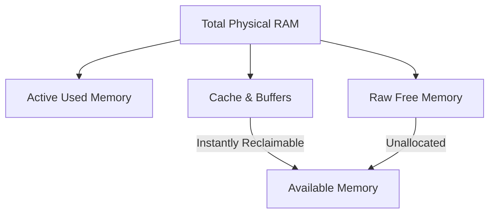

# Memory Monitoring with Python

Memory (RAM) exhaustion is one of the most common causes of server downtime. When an application runs out of memory, the Linux kernel's Out-Of-Memory (OOM) Killer triggers, forcefully terminating processes (often stopping your main database or web server) to keep the operating system from freezing.

To prevent this, you must actively monitor memory metrics.

In this guide, we will learn how to monitor virtual memory (RAM), inspect swap space, understand the difference between free and available memory, and calculate memory metrics using Python.

---

## Memory Metrics Definitions

When you query memory status, you get several parameters back. Here is what they represent:

| Metric Name | Description | Importance |
| :--- | :--- | :--- |
| **`total`** | Total physical RAM installed on the server. | Baseline reference. |
| **`available`** | RAM that can be given to new processes without the system swapping. | **Critical monitoring metric.** |
| **`used`** | Memory currently claimed by running applications. | Resource utilization gauge. |
| **`free`** | Raw, completely unallocated memory. | Often deceptively low because OS uses it for caching. |
| **`percent`** | Calculated usage rate: `(total - available) / total * 100`. | Threshold trigger reference. |
| **`swap`** | Disk storage used as virtual overflow memory when RAM is full. | High swap usage indicates physical RAM is too small. |

---

## Virtual Memory vs. Free vs. Available

A common mistake is looking at the `free` memory metric and panic-alerting because it is close to 0. 

Modern operating systems use empty RAM as a temporary cache (buffers/cache) to speed up disk reads. This cached memory can be reclaimed instantly if an application asks for it.



Therefore, when monitoring RAM availability, **always track the `available` metric**, not the `free` metric.

---

## Basic Memory Query Example

Let us write a script that queries virtual memory and swap details, converting the values to Megabytes and Gigabytes.

```python
import psutil

# 1. Query RAM details
mem = psutil.virtual_memory()

# 2. Query Swap space details
swap = psutil.swap_memory()

print("System Memory Statistics")
print("========================")
# Total physical RAM
print(f"Total physical RAM: {mem.total / (1024 ** 3):.2f} GB")
# Available RAM (what apps can actually use)
print(f"Available RAM:      {mem.available / (1024 ** 3):.2f} GB")
# Used RAM
print(f"Used RAM:           {mem.used / (1024 ** 3):.2f} GB")
# Usage percentage
print(f"Memory Usage Rate:  {mem.percent}%")

print("\nSwap Space Statistics")
print("---------------------")
print(f"Total Swap Space:   {swap.total / (1024 ** 3):.2f} GB")
print(f"Used Swap Space:    {swap.used / (1024 ** 3):.2f} GB")
print(f"Free Swap Space:    {swap.free / (1024 ** 3):.2f} GB")
print(f"Swap Usage Rate:    {swap.percent}%")
```

### Expected Output

```text
System Memory Statistics
========================
Total physical RAM: 16.00 GB
Available RAM:      6.80 GB
Used RAM:           9.20 GB
Memory Usage Rate:  57.5%

Swap Space Statistics
---------------------
Total Swap Space:   2.00 GB
Used Swap Space:    0.50 GB
Free Swap Space:    1.50 GB
Swap Usage Rate:    25.0%
```

---

## Real-World DevOps Scenario: OOM Prevention Daemon

Let us write a script that runs as a resource daemon. It audits memory and swap usage. If available RAM falls below 10% or swap space usage exceeds 80%, it triggers a critical warning alert.

```python
import psutil

def audit_memory_limits(min_percent_available=10.0, max_swap_percent=80.0):
    print("Running memory safety audit...")
    print("==============================")
    
    # Query system stats
    mem = psutil.virtual_memory()
    swap = psutil.swap_memory()
    
    # Calculate available percentage
    # available_percent = (available / total) * 100
    available_percent = (mem.available / mem.total) * 100
    used_percent = mem.percent
    
    print(f"RAM Status:  {used_percent}% used ({available_percent:.1f}% available)")
    print(f"Swap Status: {swap.percent}% used")
    
    alerts = []
    
    # Check RAM threshold
    if available_percent < min_percent_available:
        alerts.append(f"CRITICAL: Available physical RAM ({available_percent:.1f}%) is below safe threshold ({min_percent_available}%)!")
        
    # Check Swap threshold
    if swap.percent > max_swap_percent:
        alerts.append(f"CRITICAL: Swap usage ({swap.percent}%) is dangerously high!")
        
    print("==============================")
    if alerts:
        print("[WARNING] SYSTEM MEMORY ALERT TRIGGERED:")
        for alert in alerts:
            print(f"- {alert}")
        return False
    else:
        print("[OK] System memory allocations are healthy.")
        return True

# Run check
audit_memory_limits()
```

### Expected Output

```text
Running memory safety audit...
==============================
RAM Status:  57.5% used (42.5% available)
Swap Status: 25.0% used
==============================
[OK] System memory allocations are healthy.
```

---

## Common Mistakes

Here are some typical errors when monitoring memory usage:

### 1. Alerting on "Free Memory" instead of "Available Memory"
If you write check logic like `if mem.free < threshold: alert()`, your script will trigger alarms constantly. Linux is designed to utilize unused RAM for buffer cache operations, so raw free memory is usually very low, even when there are gigabytes of available memory ready for use.

### 2. Ignoring Swap usage metrics
If your server's RAM usage is stable at 70%, but your Swap usage is at 99%, the server will run extremely slowly because it is constantly reading and writing memory blocks to the slow disk partition (a problem known as thrashing). Always monitor Swap alongside physical RAM.

### 3. Converting bytes by dividing by 1,000,000
When displaying RAM sizes (which use binary gigabytes), dividing by `1,000 * 1,000 * 1,000` (decimal) will report more memory than the operating system actually shows. Always divide by `1024 ** 3` to get Gigabytes (GB) or `1024 ** 2` for Megabytes (MB).

---

## Summary

* Monitor RAM allocations using the `psutil.virtual_memory()` function.
* Track swap storage status using `psutil.swap_memory()`.
* Focus on the `available` memory parameter, not the raw `free` parameter, when setting alerts.
* Understand that modern operating systems use free RAM as disk buffers and caches.
* Calculate usage percentages using the `percent` attribute on the memory object.
* Convert byte values to Megabytes or Gigabytes using binary factors (`1024` base).
* Set alarms to trigger if available memory drops below 10% of total physical RAM.
* Monitor swap space percentage, as high swap usage can cause severe system slowdowns.
* Combine RAM and Swap audits inside automated cron jobs to detect leak issues early.
