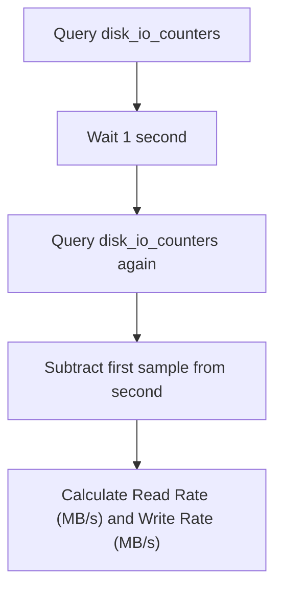

# Disk Monitoring with Python

Monitoring storage systems involves more than just checking if the main hard drive is full. On production servers, you will have multiple storage volumes mounted: root partitions, network-attached drives (like NFS or AWS EBS), and database storage volumes. You also need to track Disk Input/Output (I/O) activity to detect bottlenecks when applications perform heavy read/write operations.

In Python, the `psutil` library provides functions to check disk mounts, calculate space usage, and measure read/write rates.

In this guide, we will learn how to list mounted partitions, check directory capacities, and measure disk read/write throughput (I/O).

---

## Disk Monitoring Functions

Here is a summary of the `psutil` functions used to monitor storage resources:

| Function Name | Return Type | Description |
| :--- | :--- | :--- |
| `psutil.disk_partitions()` | `list` of named tuples | Returns all mounted disk partitions, mount points, and filesystem types. |
| `psutil.disk_usage(path)` | named tuple | Returns total, used, free space, and usage percentage for a path. |
| `psutil.disk_io_counters()` | named tuple | Returns system-wide disk I/O metrics (read/write counts and bytes). |
| `psutil.disk_io_counters(perdisk=True)` | `dict` | Returns individual I/O counters for each physical disk volume. |

---

## Listing Mounted Partitions and Space Usage

Let us write a script that list all active partitions on the system and prints their current usage stats.

```python
import psutil

# 1. Get all mounted disk partitions
# Setting all=False ignores virtual filesystems (like /proc or /sys)
partitions = psutil.disk_partitions(all=False)

print("Mounted Disk Partitions & Usage")
print("===============================")

for part in partitions:
    # On Windows, CD-ROM drives might raise PermissionError if no disc is inserted
    try:
        usage = psutil.disk_usage(part.mountpoint)
        total_gb = usage.total / (1024 ** 3)
        free_gb = usage.free / (1024 ** 3)
        
        print(f"Mount Point: {part.mountpoint} | FileSystem: {part.fstype}")
        print(f"  Capacity: {total_gb:.1f} GB | Free: {free_gb:.1f} GB ({usage.percent}% used)")
        print("-" * 45)
    except PermissionError:
        print(f"Mount Point: {part.mountpoint} | [Device Unready / Locked]")
        print("-" * 45)
```

### Expected Output (Linux example)

```text
Mounted Disk Partitions & Usage
===============================
Mount Point: / | FileSystem: ext4
  Capacity: 98.2 GB | Free: 42.1 GB (57.1% used)
---------------------------------------------
Mount Point: /boot | FileSystem: ext2
  Capacity: 1.0 GB | Free: 0.8 GB (20.0% used)
---------------------------------------------
Mount Point: /mnt/shared | FileSystem: nfs
  Capacity: 500.0 GB | Free: 120.5 GB (75.9% used)
---------------------------------------------
```

---

## Measuring Disk I/O Performance

If your database or web server is running slowly but CPU and RAM usage look fine, the disk I/O limit might be saturated. You can measure read/write rates by sampling `psutil.disk_io_counters()` over time.



Here is a script that measures the real-time disk read/write speeds:

```python
import psutil
import time

def measure_disk_throughput(interval=1.0):
    print(f"Sampling disk activity over {interval} seconds...")
    
    # Take initial sample
    io1 = psutil.disk_io_counters()
    time.sleep(interval)
    # Take second sample
    io2 = psutil.disk_io_counters()
    
    if not io1 or not io2:
        print("Error: Disk I/O counters are unavailable.")
        return
        
    # Calculate bytes read and written during the interval
    bytes_read = io2.read_bytes - io1.read_bytes
    bytes_written = io2.write_bytes - io1.write_bytes
    
    # Convert to Megabytes per second
    mb_read = (bytes_read / (1024 ** 2)) / interval
    mb_written = (bytes_written / (1024 ** 2)) / interval
    
    print("\nDisk Throughput Report")
    print("----------------------")
    print(f"Read Rate:  {mb_read:.2f} MB/s")
    print(f"Write Rate: {mb_written:.2f} MB/s")

measure_disk_throughput()
```

### Expected Output

```text
Sampling disk activity over 1.0 seconds...

Disk Throughput Report
----------------------
Read Rate:  0.05 MB/s
Write Rate: 1.25 MB/s
```

---

## Real-World DevOps Scenario: Disk Monitor Alerting

Let us write a complete monitoring script that inspects all mounted writeable partitions. If any partition exceeds 85% utilization, the script logs a warning, helping us identify disk fills early.

```python
import psutil

def run_partition_check(limit_percentage=85.0):
    print("Auditing disk volume partitions...")
    print("==================================")
    
    partitions = psutil.disk_partitions(all=False)
    issues_found = 0
    
    for part in partitions:
        # Ignore read-only mounts (like CD-ROMs or snap packages)
        if "ro" in part.opts:
            continue
            
        try:
            usage = psutil.disk_usage(part.mountpoint)
            if usage.percent > limit_percentage:
                print(f"[WARNING] Mount '{part.mountpoint}' is {usage.percent}% full!")
                issues_found += 1
            else:
                print(f"[OK] Mount '{part.mountpoint}' is healthy ({usage.percent}% used).")
        except (PermissionError, FileNotFoundError):
            # Skip volumes that are locked or detached
            continue
            
    print("==================================")
    print(f"Audit completed. Found {issues_found} warning states.")

run_partition_check()
```

### Expected Output

```text
Auditing disk volume partitions...
==================================
[OK] Mount '/' is healthy (57.1% used).
[OK] Mount '/boot' is healthy (20.0% used).
[WARNING] Mount '/mnt/shared' is 88.5% full!
==================================
Audit completed. Found 1 warning states.
```

---

## Common Mistakes

Here are some typical mistakes you will run into:

### 1. Checking unmounted partitions or empty card readers
If you iterate over all partitions returned by `psutil.disk_partitions(all=True)`, it will include empty floppy drives, card readers, and special virtual systems. Querying `disk_usage` on these will throw a `PermissionError` or `FileNotFoundError`. Always set `all=False` and wrap checks in `try-except` blocks.

### 2. Confusing global I/O counters with per-disk counters
Calling `psutil.disk_io_counters()` returns the sum of I/O across *all* disks combined. If you want to monitor a specific database disk (like `/dev/sdb`), you must call `psutil.disk_io_counters(perdisk=True)` and look up the specific disk key in the returned dictionary.

### 3. Ignoring read-only mounts
If you try to monitor disk usage on systems with many read-only filesystem mounts (like containers or Ubuntu systems using snap packages), your script will check hundreds of loop devices that are always at 100% usage (since read-only partitions are built packed). Filter out filesystems with `"ro"` in their partition options.

---

## Summary

* List all active system mounts using `psutil.disk_partitions(all=False)`.
* Inspect partition capacity, usage, and remaining space using `psutil.disk_usage(path)`.
* Ignore read-only partitions by checking for the `"ro"` string inside the `partition.opts` list.
* Measure system-wide disk read and write performance using `psutil.disk_io_counters()`.
* Inspect metrics for individual disks by passing `perdisk=True` to the I/O counter query.
* Calculate disk read/write speeds by taking two samples over a timed delay interval.
* Skip empty removable drives (like CD-ROMs) using try-except blocks to catch permissions errors.
* Monitor disk writeable partitions to trigger alarms if usage rate exceeds 85%.
* Convert raw I/O bytes to Megabytes per second to keep status metrics readable.
