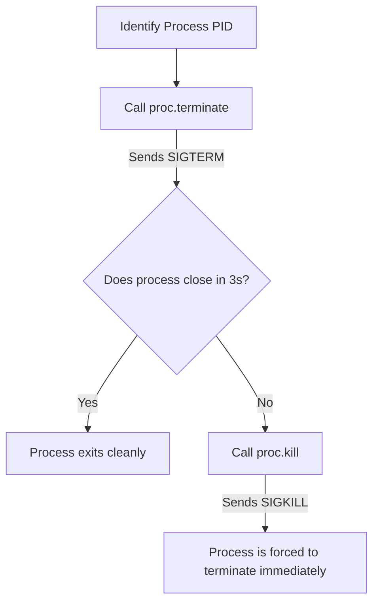

# Process Management with Python

In DevOps automation, managing system processes is a daily task. You might write a script to monitor if a web service (like Nginx) is running, check how much memory your database process is consuming, or automatically find and kill runaway processes that are consuming too much CPU.

In Python, the standard library does not have tools to inspect active system processes. To handle this, we use the third-party [psutil](https://github.com/giampaolo/psutil) library.

In this guide, we will learn how to inspect running processes, query resource usage for individual programs, and terminate or kill processes safely using Python.

---

## Key Process Management Methods

Here is a summary of the primary classes and functions in `psutil` used for process control:

| Function / Method | Return Type | Description |
| :--- | :--- | :--- |
| `psutil.process_iter(attrs)` | Iterator | Yields a `Process` object for every running system process. |
| `psutil.pid_exists(pid)` | `bool` | Checks if a Process ID (PID) is currently active on the host. |
| `psutil.Process(pid)` | `Process` object | Accesses a specific process profile using its PID. |
| `proc.terminate()` | `None` | Sends an exit request (`SIGTERM`) asking the process to close cleanly. |
| `proc.kill()` | `None` | Forces the process to close immediately (`SIGKILL`). |
| `proc.wait(timeout)` | `None` | Blocks until the process closes, or raises `TimeoutExpired`. |

---

## Listing Running Processes

Let us write a script that iterates through all running system processes and prints out their name, PID, and memory usage.

```python
import psutil

print("Scanning active processes...")
print("===========================")

# We ask process_iter to fetch name and memory info in one call for efficiency
for proc in psutil.process_iter(attrs=["pid", "name", "memory_info"]):
    try:
        # Extract attributes from process dictionary representation
        info = proc.info
        pid = info["pid"]
        name = info["name"]
        
        # Convert memory usage bytes to Megabytes
        mem_mb = info["memory_info"].rss / (1024 ** 2)
        
        # Only print processes using significant memory to save console space
        if mem_mb > 50.0:
            print(f"PID: {pid:<6} | Name: {name:<25} | Memory: {mem_mb:.2f} MB")
            
    except (psutil.NoSuchProcess, psutil.AccessDenied, psutil.ZombieProcess):
        # Processes can close mid-iteration or require higher admin privileges to read
        continue
```

### Expected Output

```text
Scanning active processes...
===========================
PID: 1240   | Name: chrome.exe                | Memory: 154.20 MB
PID: 3412   | Name: python.exe                | Memory: 62.50 MB
PID: 8840   | Name: slack.exe                 | Memory: 210.15 MB
```

---

## Process Deletion Lifecycle

When you want to stop a running process, you should always try to close it cleanly first.



Let us look at a code example implementing this cleanup flow:

```python
import psutil

def stop_process_safely(pid):
    try:
        proc = psutil.Process(pid)
        print(f"Found process '{proc.name()}' (PID: {pid})")
        
        # 1. Ask process to exit cleanly (SIGTERM)
        print("Sending terminate signal...")
        proc.terminate()
        
        # 2. Wait up to 3 seconds for it to exit
        try:
            proc.wait(timeout=3)
            print("Process stopped cleanly.")
        except psutil.TimeoutExpired:
            # 3. Force kill if it hangs (SIGKILL)
            print("Process did not respond. Force-killing...")
            proc.kill()
            proc.wait()
            print("Process killed successfully.")
            
    except psutil.NoSuchProcess:
        print(f"Error: No process found with PID: {pid}")
    except psutil.AccessDenied:
        print(f"Error: You do not have permission to close PID: {pid}")

# We check if a fake PID is running to trigger safety checks
stop_process_safely(99999)
```

### Expected Output

```text
Error: No process found with PID: 99999
```

---

## Real-World DevOps Scenario: Runaway Process Guard

In deployment environments, developers might write code that locks up and runs at 100% CPU usage indefinitely. Let us write an automated script that scans all processes. If a process named `python` (or any target service) runs for more than 5 minutes and uses more than 90% CPU, our script will terminate it.

```python
import psutil
import time

def terminate_runaway_tasks(target_name="python", max_cpu=90.0, max_age_seconds=300):
    print("Initiating runaway process scan...")
    print("==================================")
    
    current_time = time.time()
    terminated_count = 0
    
    for proc in psutil.process_iter(attrs=["pid", "name", "create_time"]):
        try:
            name = proc.info["name"]
            
            # Check if name contains our target
            if target_name.lower() in name.lower():
                pid = proc.info["pid"]
                
                # Check how long the process has been running
                age = current_time - proc.info["create_time"]
                
                # Check CPU usage (sampled over a brief window)
                # Note: cpu_percent() on a Process object takes a moment
                cpu = proc.cpu_percent(interval=0.1)
                
                if cpu > max_cpu and age > max_age_seconds:
                    print(f"[ALERT] Runaway process found! PID: {pid} ({name}) | CPU: {cpu}% | Age: {age:.0f}s")
                    proc.terminate()
                    proc.wait(timeout=2)
                    print(f"[CLEANUP] PID {pid} has been terminated.")
                    terminated_count += 1
        except (psutil.NoSuchProcess, psutil.AccessDenied, psutil.TimeoutExpired):
            continue
            
    print("==================================")
    print(f"Scan finished. Terminated {terminated_count} runaway processes.")

# Run scan
terminate_runaway_tasks()
```

### Expected Output

```text
Initiating runaway process scan...
==================================
Scan finished. Terminated 0 runaway processes.
```

---

## Common Mistakes

Here are some typical gotchas when managing processes:

### 1. Missing handling for `NoSuchProcess` and `AccessDenied`
System processes open and close constantly. Between the time your script lists processes and the time it tries to read details (like memory or CPU), the process might close. This will raise a `NoSuchProcess` exception. Similarly, reading system processes (like kernel tasks) will raise `AccessDenied`. **Always** wrap process loops in `try-except` blocks.

### 2. Calling `proc.cpu_percent()` inside loops without small intervals
Calling `proc.cpu_percent(interval=1.0)` inside a loop iterating over hundreds of processes will pause your script for 1 second *per process*, making the script take minutes to run. Instead, call it with a small interval (like `0.1` or `0.05`), or query it once with `interval=None` and sample it again after a delay.

### 3. Killing processes without verifying parent relationships
If you kill a parent process (like a docker daemon or bash wrapper script) without killing its child processes, you can leave behind orphaned processes (known as zombie processes) that continue running in the background. If you need to clean up a process tree, recursively find and terminate all children first:

```python
# Terminate children first
for child in proc.children():
    child.terminate()
proc.terminate()
```

---

## Summary

* The `psutil` library allows you to list, inspect, and terminate system processes.
* Retrieve running system processes using `psutil.process_iter()`.
* Pass specific attribute keys to `process_iter` to optimize search speeds.
* Safely check if a process ID exists on the system using `psutil.pid_exists(pid)`.
* Terminate a process cleanly using `process.terminate()`.
* Force-terminate a frozen process using `process.kill()`.
* Always wrap process detail checks in `try-except` blocks to handle closed or locked tasks.
* Avoid checking CPU percentages inside loop iterations without specifying very short intervals.
* Check child process groups using `proc.children()` to prevent orphan process leaks.
