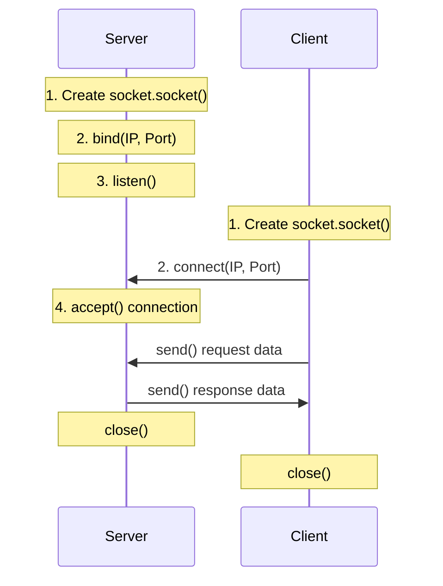

# Introduction to the Socket Module

In DevOps, everything runs on the network. When you trigger a deployment, query a database, curl a web server, or pull a container image, computers are talking to each other. The low-level interface that allows operating systems to open connections across a network is called a **socket**.

Python provides a built-in module named [socket](https://docs.python.org/3/library/socket.html). It lets you write code that talks directly to network interfaces, allowing you to build port scanners, create custom servers, check server availability, and resolve hostnames.

In this guide, we will explore the core concepts of the `socket` module, how network connections are initiated, and how to query socket parameters.

---

## What is a Network Socket?

A socket is one endpoint of a two-way communication link between two programs running on a network. A socket is bound to a combination of an **IP Address** (where the machine is located) and a **Port Number** (which specific program should receive the traffic).

When configuring sockets, you must define their family (how they find hosts) and their type (how they transport packets).

Let us compare the most common families and types:

| Configuration Category | Setting Value | Purpose | Description |
| :--- | :--- | :--- | :--- |
| **Address Family** | `socket.AF_INET` | IPv4 | Standard 32-bit IP addressing (e.g. `192.168.1.1`). |
| **Address Family** | `socket.AF_INET6` | IPv6 | Newer 128-bit IP addressing (e.g. `fe80::1`). |
| **Socket Type** | `socket.SOCK_STREAM` | TCP | Connection-oriented, reliable stream transmission (handles packets loss automatically). |
| **Socket Type** | `socket.SOCK_DGRAM` | UDP | Connectionless, fast datagram transmission (fire-and-forget, packets can arrive out of order). |

---

## How Sockets Establish Connections

The connection process between a server socket and a client socket follows a strict sequence:



---

## Basic Socket Properties Example

Let us write a simple Python script to create a TCP socket and inspect its default configurations.

```python
import socket

# 1. Initialize a standard TCP socket over IPv4
# AF_INET specifies IPv4, SOCK_STREAM specifies TCP
s = socket.socket(socket.AF_INET, socket.SOCK_STREAM)

# 2. Query system properties of the socket object
socket_family = s.family
socket_type = s.type
socket_timeout = s.gettimeout()

print("Socket Specifications")
print("=====================")
print(f"Socket Family ID: {socket_family} (Expected IPv4: {socket.AF_INET})")
print(f"Socket Type ID:   {socket_type} (Expected TCP: {socket.SOCK_STREAM})")
print(f"Default Timeout:  {socket_timeout} seconds")

# 3. Always close the socket when finished to release the OS resource
s.close()
```

### Expected Output

```text
Socket Specifications
=====================
Socket Family ID: AddressFamily.AF_INET (Expected IPv4: 2)
Socket Type ID:   SocketKind.SOCK_STREAM (Expected TCP: 1)
Default Timeout:  None seconds
```

---

## Real-World DevOps Scenario: Server Port Checker

In automated deployments, you often want to wait until a service (like a database or web server) is fully started and listening on its port before your script tries to configure it. Here is a script that checks if a port is open.

```python
import socket
import sys

def check_service_status(host, port, timeout_sec=2.0):
    print(f"Auditing port availability on {host}:{port}...")
    
    # We use socket.socket as a context manager so it closes automatically
    try:
        with socket.socket(socket.AF_INET, socket.SOCK_STREAM) as s:
            # Set a timeout so the check does not hang forever if the host is offline
            s.settimeout(timeout_sec)
            
            # connect_ex returns an error code instead of raising an exception.
            # 0 means the connection was successful, non-zero means failure.
            result = s.connect_ex((host, port))
            
            if result == 0:
                print(f"[ONLINE] Service is listening on port {port}.")
                return True
            else:
                print(f"[OFFLINE] Port {port} is closed or blocked (Error code: {result}).")
                return False
    except socket.gaierror:
        print(f"[ERROR] Hostname '{host}' could not be resolved.")
        return False
    except Exception as err:
        print(f"[ERROR] Unexpected exception occurred: {err}")
        return False

# Run check on a public DNS port
check_service_status("8.8.8.8", 53)
```

### Expected Output

```text
Auditing port availability on 8.8.8.8:53...
[ONLINE] Service is listening on port 53.
```

---

## Common Mistakes

Here are some typical gotchas when using the `socket` module:

### 1. Forgetting to encode strings before sending
Sockets send raw bytes, not Unicode strings. If you try to run `s.send("hello")`, your script will crash with a `TypeError`. You must encode your strings to bytes using `.encode('utf-8')` before transmission, and decode received bytes using `.decode('utf-8')`.

```python
# WRONG - raises TypeError
s.send("GET / HTTP/1.1\r\n\r\n")

# CORRECT - convert to bytes
s.send("GET / HTTP/1.1\r\n\r\n".encode("utf-8"))
```

### 2. Forgetting to set timeouts
By default, socket connections have no timeout (`timeout=None`). If you try to connect to a server that is blocked by a firewall, your script can hang indefinitely, blocking your CI/CD runner. Always set a timeout using `s.settimeout(2.0)`.

### 3. Leaking sockets by not closing them
Each socket connection uses a file descriptor on the operating system. If you open sockets inside loops and forget to call `s.close()`, you will hit the OS limits, raising `OSError: [Errno 24] Too many open files`. Use `with` statements to ensure sockets close automatically.

---

## Summary

* Sockets are the low-level API endpoints that allow processes to communicate across networks.
* Sockets require an IP address (location) and a port number (destination application).
* Use `socket.AF_INET` for standard IPv4 and `socket.SOCK_STREAM` for reliable TCP transmission.
* Close sockets using `s.close()` or by running them inside `with` statement blocks.
* Use `s.settimeout(seconds)` to prevent automation scripts from hanging indefinitely on dead connections.
* Check connection status without raising exceptions by calling `s.connect_ex((ip, port))`.
* Convert string data to bytes using `.encode()` before sending data over sockets.
* Convert raw bytes to readable strings using `.decode()` when receiving socket data.
* Catch hostname lookup failures by trapping the `socket.gaierror` exception class.
