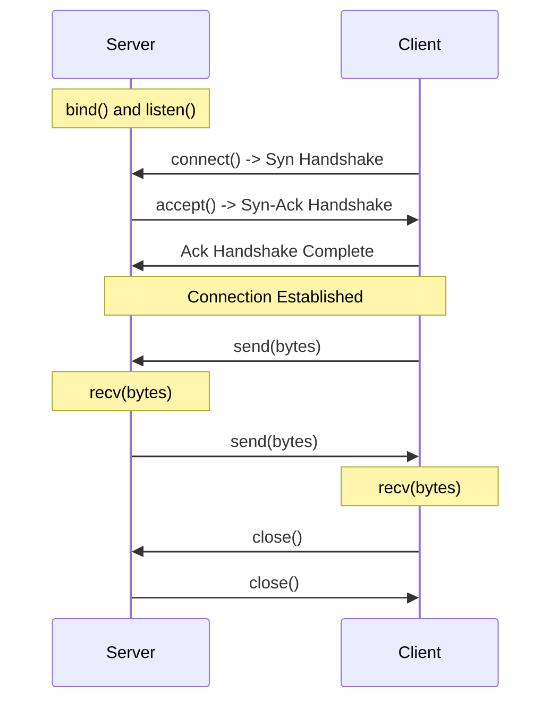

# Building TCP Servers and Clients

TCP (Transmission Control Protocol) is the bedrock of network communication. HTTP, SSH, FTP, and database connections all run on top of TCP. TCP is connection-oriented, meaning it establishes a reliable session between two endpoints before any data is sent. It guarantees that packets arrive in order and handles retransmission if any data is lost.

In this guide, we will learn how to build a basic TCP server that listens for incoming messages, and a TCP client that connects to it and exchanges data.

---

## TCP Socket Lifecycles

TCP server and client roles require different socket functions:

| Operation Stage | Server Socket | Client Socket | Description |
| :--- | :--- | :--- | :--- |
| **Creation** | `socket.socket()` | `socket.socket()` | Initializes the system socket object. |
| **Configuration** | `s.bind((ip, port))` | None | Server binds to a network card interface and port. |
| **Listening Mode** | `s.listen(backlog)` | None | Server enters passive listening state waiting for connections. |
| **Connecting** | None | `s.connect((ip, port))` | Client initiates connection handshake to the server. |
| **Accepting** | `conn, addr = s.accept()` | None | Server accepts connection, returning a new communication socket. |
| **Data Exchange** | `conn.recv()`, `conn.send()` | `s.recv()`, `s.send()` | Exchanging bytes streams between endpoints. |

---

## TCP Communication Flow

Here is the sequence of events during a single TCP conversation:



---

## Writing a TCP Server

Let us write a TCP server that listens on port `9999` and responds with a greeting to any client that connects.

```python
import socket

# Define host and port
HOST = "127.0.0.1" # Listen on localhost loopback interface
PORT = 9999

# 1. Create TCP IPv4 socket
server = socket.socket(socket.AF_INET, socket.SOCK_STREAM)

# 2. Configure socket to release port immediately when stopped
# Prevents 'Address already in use' errors on restart
server.setsockopt(socket.SOL_SOCKET, socket.SO_REUSEADDR, 1)

# 3. Bind socket to host and port
server.bind((HOST, PORT))

# 4. Put server into listening mode (queue up to 5 pending connections)
server.listen(5)
print(f"Server is listening on {HOST}:{PORT}...")

# In a real server, you run this loop continuously.
# For this demo, we will process one connection and then stop.
try:
    # 5. Accept client connection (blocks until client connects)
    conn, addr = server.accept()
    with conn:
        print(f"Connected successfully by client: {addr}")
        
        # 6. Read data sent by client (up to 1024 bytes)
        data = conn.recv(1024)
        if data:
            message = data.decode("utf-8")
            print(f"Received from client: {message}")
            
            # Send response back (must encode string to bytes)
            response = f"Hello Client, I received your message: '{message}'"
            conn.sendall(response.encode("utf-8"))
finally:
    server.close()
    print("Server socket closed.")
```

---

## Writing a TCP Client

Now let us write a TCP client script that connects to our server, sends a message, and prints the response.

```python
import socket

HOST = "127.0.0.1"
PORT = 9999

# 1. Create a TCP IPv4 socket
client = socket.socket(socket.AF_INET, socket.SOCK_STREAM)

try:
    # 2. Connect to the server
    client.connect((HOST, PORT))
    print(f"Connected to server at {HOST}:{PORT}")
    
    # 3. Send message (encoded to bytes)
    msg = "Ping command initiated"
    client.sendall(msg.encode("utf-8"))
    
    # 4. Receive response (up to 1024 bytes)
    response = client.recv(1024)
    print(f"Received from server: {response.decode('utf-8')}")
    
finally:
    # 5. Always close connection
    client.close()
    print("Client socket closed.")
```

---

## Running and Verifying Output

To test this interaction:
1. Run the Server script first. It will print `Server is listening on 127.0.0.1:9999...` and wait.
2. In a separate terminal or process run the Client script.

### Expected Server Output

```text
Server is listening on 127.0.0.1:9999...
Connected successfully by client: ('127.0.0.1', 54210)
Received from client: Ping command initiated
Server socket closed.
```

### Expected Client Output

```text
Connected to server at 127.0.0.1:9999
Received from server: Hello Client, I received your message: 'Ping command initiated'
Client socket closed.
```

---

## Common Mistakes

Here are some typical mistakes you will run into:

### 1. Forgetting `SO_REUSEADDR` on server sockets
If you stop and restart your server script quickly, the operating system keeps the port locked in a `TIME_WAIT` state for a minute. If you try to run your script again, it will crash with `OSError: [Errno 98] Address already in use`. Setting `SO_REUSEADDR` bypasses this lock.

### 2. Binding to port numbers below 1024
On Linux and macOS, port numbers from 1 to 1023 are reserved for system services (like port 80 for HTTP or 22 for SSH). If you try to bind your script to port `80` without root admin privileges (using `sudo`), the script will fail with a `PermissionError`. Always use ports higher than `1024` for custom automation tools.

### 3. Using `recv()` without specifying buffer size
The `recv(bufsize)` method requires you to pass the maximum number of bytes to read. If you pass a small buffer (like `recv(5)`) but send a large message, the message will be chopped off, and the remaining bytes will sit in the socket buffer, corrupting your next read. Use a standard buffer size like `1024` or `4096`.

---

## Summary

* TCP is connection-oriented, requiring a handshake before data is transferred.
* Create TCP sockets by combining `socket.AF_INET` and `socket.SOCK_STREAM`.
* Server sockets must bind to an IP/Port and call `listen()` to receive connections.
* Client sockets connect to servers using `connect((ip, port))`.
* Use `server.setsockopt(socket.SOL_SOCKET, socket.SO_REUSEADDR, 1)` to prevent port locking errors on restart.
* Remember that `server.accept()` returns a *new* socket object (`conn`) dedicated to communicating with the client, leaving the original socket free to listen.
* Encode all text strings to bytes before passing them to `send()` or `sendall()`.
* Decode byte arrays back to strings using `.decode('utf-8')` after receiving them.
* Avoid binding to port numbers below 1024 unless running with administrator permissions.
