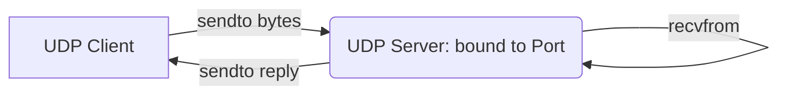

# UDP Communication with Python

While TCP is the standard for web traffic and shell access, there are times when its overhead is too high. If you are sending real-time logs, streaming server CPU metrics to a monitoring dashboard, or resolving DNS queries, establishing a full connection session via TCP handshakes takes too long. 

For these fast, "fire-and-forget" tasks, we use **UDP (User Datagram Protocol)**.

In this guide, we will learn what UDP is, how it compares to TCP, and how to write UDP servers and clients in Python.

---

## TCP vs. UDP Comparison

UDP is connectionless. It sends independent packets (datagrams) directly to an IP and Port without confirming that the target machine is listening or online.

| Feature | TCP (`SOCK_STREAM`) | UDP (`SOCK_DGRAM`) |
| :--- | :--- | :--- |
| **Connection State** | Connection-oriented (requires handshakes). | Connectionless (no handshake required). |
| **Reliability** | Guaranteed delivery (retransmits lost data). | Unreliable (packets can drop silently). |
| **Ordering** | Guaranteed order of arrival. | Packets can arrive out of order. |
| **Throughput Speed** | Slower (due to ack flow control). | Extremely fast (minimal packaging overhead). |
| **Best For** | HTTP, SSH, Database connections, File transfers. | Logs streaming, system metrics (StatsD), DNS queries. |

---

## UDP Communication Sequence

Because there is no active session establishment, the UDP flow is very flat compared to TCP:



---

## Writing a UDP Server

Let us write a UDP server that binds to port `9999`, receives metrics data packets, and prints them out along with the client's return address.

We use [socket.SOCK_DGRAM](https://docs.python.org/3/library/socket.html#socket.SOCK_DGRAM) to specify a UDP socket. Note that we call `recvfrom()` instead of `recv()`, which returns both the data and the sender's address.

```python
import socket

HOST = "127.0.0.1"
PORT = 9999

# 1. Create UDP IPv4 socket
server = socket.socket(socket.AF_INET, socket.SOCK_DGRAM)

# 2. Bind socket
server.bind((HOST, PORT))
print(f"UDP Server is listening on {HOST}:{PORT}...")

# For this demo, we will process one packet and exit
try:
    # 3. Read packet (recvfrom returns data and client address details)
    # 1024 is the buffer size in bytes
    data, addr = server.recvfrom(1024)
    
    message = data.decode("utf-8")
    print(f"\n[RECEIVED PACKET] From: {addr}")
    print(f"Content: '{message}'")
    
    # 4. Send response back
    response = "ACK: Metrics received"
    server.sendto(response.encode("utf-8"), addr)
finally:
    server.close()
    print("UDP Server closed.")
```

---

## Writing a UDP Client

Now let us write a UDP client that collects a server metric and fires it to the server. Since UDP is connectionless, the client does not need to call `connect()`. It simply uses `sendto()`.

```python
import socket

HOST = "127.0.0.1"
PORT = 9999
server_address = (HOST, PORT)

# 1. Create UDP IPv4 socket
client = socket.socket(socket.AF_INET, socket.SOCK_DGRAM)

try:
    # 2. Prepare mock metrics payload
    payload = "cpu_percent=12.5,mem_percent=55.2"
    print(f"Sending metrics payload: '{payload}' to {HOST}:{PORT}...")
    
    # 3. Send package (must specify destination address tuple every time)
    client.sendto(payload.encode("utf-8"), server_address)
    
    # 4. Optional: Receive acknowledgment from server
    # Set a short timeout so we do not hang forever if the package dropped
    client.settimeout(2.0)
    data, server = client.recvfrom(1024)
    print(f"Server response: {data.decode('utf-8')}")
    
except socket.timeout:
    print("Request timed out. Server response was not received (normal in UDP).")
finally:
    client.close()
    print("UDP Client closed.")
```

---

## Running and Verifying Output

Launch the UDP Server first, then run the UDP Client in another window.

### Expected Server Output

```text
UDP Server is listening on 127.0.0.1:9999...

[RECEIVED PACKET] From: ('127.0.0.1', 54390)
Content: 'cpu_percent=12.5,mem_percent=55.2'
UDP Server closed.
```

### Expected Client Output

```text
Sending metrics payload: 'cpu_percent=12.5,mem_percent=55.2' to 127.0.0.1:9999...
Server response: ACK: Metrics received
UDP Client closed.
```

---

## Common Mistakes

Here are some typical issues you will run into with UDP:

### 1. Using `send()` instead of `sendto()`
Because UDP sockets are connectionless, they do not store a default destination IP and Port. If you call `client.send(data)` on a UDP socket, Python will raise an `OSError: [Errno 89] Destination address required`. You must always use `sendto(data, (ip, port))`.

### 2. Assuming delivery success
UDP has no built-in feedback system. If you run a client script that sends data to a dead IP address (e.g. `client.sendto(msg, ('10.0.0.99', 9999))`), Python will successfully run the command and report 0 errors, even though the packet was lost. Do not use UDP for critical data transfers (like database transactions) where delivery must be guaranteed.

### 3. Exceeding maximum packet size
The maximum theoretical size of a UDP packet is 65,535 bytes (including headers), but in practice, standard network routes limit packets to an MTU (Maximum Transmission Unit) of 1,500 bytes. If you try to send massive log blocks (e.g. > 64KB) in one packet, it will be fragmented or outright discarded by network routers.

---

## Summary

* UDP is a connectionless, high-performance, fire-and-forget protocol.
* Create UDP sockets using `socket.AF_INET` and `socket.SOCK_DGRAM`.
* Always use `sendto(data, address_tuple)` to send UDP data.
* Use `recvfrom(buffer_size)` on the server to read both the incoming data and the client's return address.
* Remember that UDP does not guarantee packet delivery or packet order.
* Set timeouts using `settimeout(seconds)` on the client if you expect response ACKs.
* Keep UDP packet payloads small (ideally below 1,400 bytes) to prevent network router drops.
* Avoid using UDP for configurations or transactions; limit its use to logs, metrics, or DNS.
* Do not call `accept()` on a UDP server; it receives data directly.
