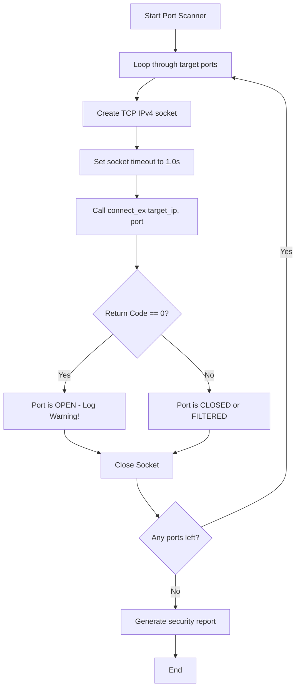

# Building a Port Scanner in Python

As a DevOps engineer, you are responsible for the network security of your infrastructure. You must make sure that only intended services (like web traffic on port 80 or 443) are accessible from the public internet. If a developer accidentally exposes a database port (like 3306 for MySQL or 5432 for Postgres) or an administrative interface (like 22 for SSH or 8080 for Jenkins), your system could be compromised.

To audit this, you can write a **port scanner**. A port scanner attempts to connect to a list of ports on a target host to see which ones are listening and open.

In this guide, we will learn how to build a basic port scanner, configure timeout limits, and check security footprints using Python.

---

## Understanding Port States

When your script attempts to connect to a remote port, the host replies in one of three ways:

| Port State | System Response | `connect_ex` Error Code | Meaning |
| :--- | :--- | :--- | :--- |
| **Open** | Handshake completes (SYN-ACK returned). | `0` | A service is actively listening on this port. |
| **Closed** | Connection rejected (RST packet returned). | e.g. `111` (`Connection refused`) | No application is listening, but the host is online. |
| **Filtered / Blocked** | No response (packet dropped by firewall). | e.g. `11` (`Resource temporarily unavailable`) | A firewall is blocking the traffic. The script hangs until timeout. |

---

## Scanning Process Flow Chart

Here is the logic our port scanner uses to inspect each port:



---

## Basic Port Scanner Script

Let us write a script that checks a local port. We will use `connect_ex((ip, port))` because it returns an integer error code instead of raising an exception, making our loop run much cleaner.

```python
import socket

target_host = "127.0.0.1" # Target localhost loopback
port_to_scan = 9999

# 1. Create socket
s = socket.socket(socket.AF_INET, socket.SOCK_STREAM)
# Set a short timeout (1 second is standard for local networks)
s.settimeout(1.0)

# 2. Attempt connection
result = s.connect_ex((target_host, port_to_scan))

if result == 0:
    print(f"Port {port_to_scan} is [OPEN]")
else:
    print(f"Port {port_to_scan} is [CLOSED] (Error code: {result})")

# 3. Always release file descriptors
s.close()
```

### Expected Output (if no service is running on port 9999)

```text
Port 9999 is [CLOSED] (Error code: 10061)
```

---

## Real-World DevOps Scenario: Infrastructure Port Auditor

Let us write a comprehensive scanning utility. It audits a host for common DevOps service ports and warns us if administration or database ports are exposed.

```python
import socket
import sys

def audit_host_security(target, ports_list):
    print(f"Starting security port audit on target: {target}")
    print("====================================================")
    
    open_ports = []
    
    # Try resolving hostname to IP
    try:
        target_ip = socket.gethostbyname(target)
        print(f"Target Resolved IP: {target_ip}\n")
    except socket.gaierror:
        print(f"Error: Host name '{target}' could not be resolved.")
        sys.exit(1)
        
    for port in ports_list:
        # Create socket using context manager to ensure it closes
        try:
            with socket.socket(socket.AF_INET, socket.SOCK_STREAM) as s:
                # Set a strict timeout so filtered firewalled ports do not hang the script
                s.settimeout(1.0)
                
                status = s.connect_ex((target_ip, port))
                
                if status == 0:
                    print(f"[WARNING] Port {port:<5} is OPEN!")
                    open_ports.append(port)
                else:
                    # In a real scanner, we might hide closed ports to keep output clean
                    print(f"[OK]      Port {port:<5} is closed/blocked.")
        except Exception as err:
            print(f"Error scanning port {port}: {err}")
            
    print("====================================================")
    print("Audit Summary:")
    if open_ports:
        print(f"ALERT: Found {len(open_ports)} exposed ports: {open_ports}")
    else:
        print("PASS: No common ports are exposed. Firewall rules look secure.")

# Common DevOps ports to audit
# 22 (SSH), 80 (HTTP), 443 (HTTPS), 3306 (MySQL), 8080 (Jenkins/Web)
devops_ports = [22, 80, 443, 3306, 8080]

# Run audit on a public DNS IP (which only has port 53 open, usually closed to TCP)
# Let us run it against localhost for demo safety
audit_host_security("127.0.0.1", devops_ports)
```

### Expected Output

```text
Starting security port audit on target: 127.0.0.1
Target Resolved IP: 127.0.0.1

[OK]      Port 22    is closed/blocked.
[OK]      Port 80    is closed/blocked.
[OK]      Port 443   is closed/blocked.
[OK]      Port 3306  is closed/blocked.
[OK]      Port 8080  is closed/blocked.
====================================================
Audit Summary:
PASS: No common ports are exposed. Firewall rules look secure.
```

---

## Common Mistakes

Here are some pitfalls when writing and running port scanners:

### 1. Scanning networks without authorization
Scanning systems you do not own or manage can be interpreted as a malicious activity (reconnaissance phase of an attack). It can trigger firewall alerts, blackhole your host IP address, or get you in trouble with network administrators. Always scan only your local development hosts or servers you have explicit permissions to test.

### 2. Forgetting to set a timeout
If you omit `s.settimeout(1.0)`, Python defaults to no timeout. If a port is filtered by a firewall (which drops packets silently), Python will hang for up to 2 minutes *per port* waiting for a connection timeout. Scanning a list of 100 ports would take hours.

### 3. Creating too many sockets without closing them
If you scan thousands of ports in a loop and forget to close the socket object (or do not use a `with` context manager), the running script will soon crash with a `Too many open files` OS error. Ensure socket cleanup happens immediately after each port check.

---

## Summary

* Port scanners audit network security by testing if ports are accepting connections.
* Use `socket.connect_ex()` in scans because it returns status codes rather than raising exceptions.
* A return code of `0` from `connect_ex` means the port is open and active.
* Always set socket timeouts (e.g. `1.0` seconds) to prevent scripts from hanging on firewalled ports.
* List standard port numbers (like 22, 80, 443, 8080) in your auditor checks.
* Use `socket.gethostbyname(hostname)` to resolve target DNS domains to IP addresses before scanning.
* Close socket objects inside loops immediately to prevent resource file leaks.
* Never scan public systems without explicit written permission from the system owners.
* Hide closed ports from output logs to keep execution reports readable for operators.
