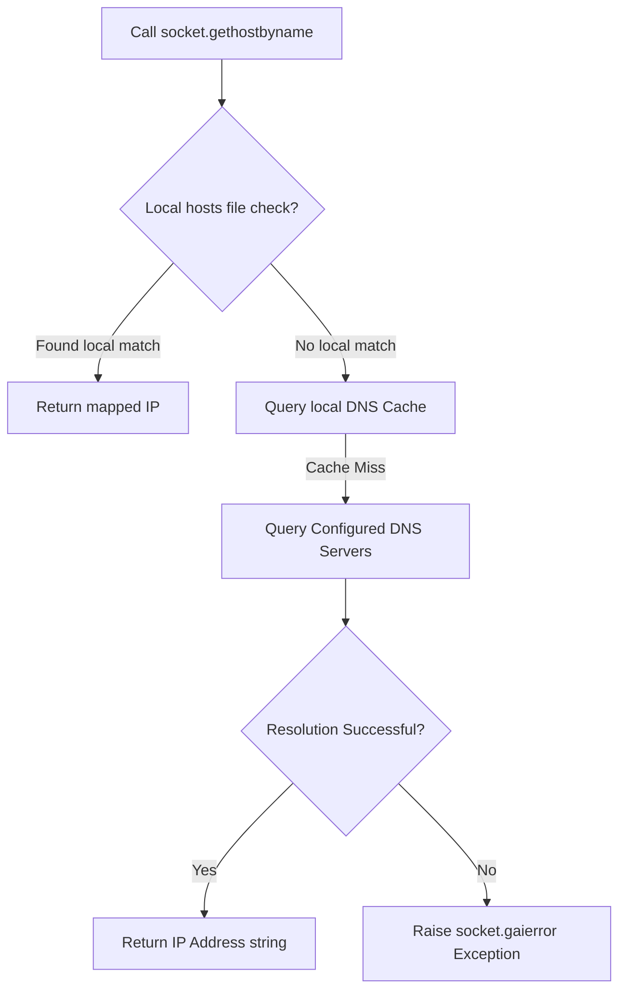

# DNS Resolution with Python

Every time your scripts make a request to a server (like connecting to `api.github.com` or downloading from `s3.amazonaws.com`), the operating system must translate that human-readable domain name into a machine-readable IP address. This translation service is called the **DNS (Domain Name System)**.

If DNS resolution fails, your scripts cannot reach any external resources. Understanding how to query and check DNS records is essential for troubleshooting connectivity problems on your servers.

In this guide, we will learn how to perform forward and reverse DNS lookups, query server connection parameters, and handle resolution failures using Python's built-in `socket` module.

---

## DNS Lookup Functions in Python

The `socket` module contains several functions for resolving hostnames and IP addresses:

| Function Name | Lookup Direction | Return Type | Best For |
| :--- | :--- | :--- | :--- |
| **`socket.gethostbyname(host)`** | Forward (Host -> IP) | `str` | Resolving a domain name to a standard IPv4 address. |
| **`socket.gethostbyaddr(ip)`** | Reverse (IP -> Host) | `tuple` | Finding the hostname associated with a given IP address (Pointer Record). |
| **`socket.getaddrinfo(host, port)`** | Detailed Address Info | `list` of tuples | Advanced queries. Retrieves both IPv4/IPv6, protocols, and exact connection addresses. |

---

## DNS Resolution Flow

Here is the path Python takes to translate a domain name:



---

## Basic DNS Lookups

Let us write a simple script that resolves a domain name to an IP address, and then performs a reverse lookup on that IP to find the host details.

```python
import socket

domain = "google.com"

try:
    # 1. Forward lookup (Domain -> IP)
    ip_address = socket.gethostbyname(domain)
    print(f"Forward Lookup: '{domain}' -> {ip_address}")
    
    # 2. Reverse lookup (IP -> Host Info)
    # We resolve the IP back to its hostname details
    hostname, alias_list, ip_list = socket.gethostbyaddr(ip_address)
    print(f"Reverse Lookup: {ip_address} -> Hostname: '{hostname}'")
    print(f"Aliases found: {alias_list} | IP List: {ip_list}")
    
except socket.gaierror as err:
    print(f"DNS lookup failed for {domain}: {err}")
except socket.herror as err:
    # herror is raised for address-specific errors (like missing PTR records)
    print(f"Reverse lookup failed: {err}")
```

### Expected Output

```text
Forward Lookup: 'google.com' -> 142.250.190.46
Reverse Lookup: 142.250.190.46 -> Hostname: 'ord37s35-in-f14.1e100.net'
Aliases found: [] | IP List: ['142.250.190.46']
```

---

## Detailed Address Resolution with getaddrinfo

When building modern, multi-protocol systems, you should not assume that your target only has one IPv4 address. Websites often resolve to multiple IP addresses (for load balancing) or support IPv6. 

To fetch all details, use `socket.getaddrinfo()`.

```python
import socket

# Get all connection info for github.com on port 443
addr_info = socket.getaddrinfo("github.com", 443)

print("Address Details:")
print("----------------")

# We only print the first 3 results to keep output clean
for item in addr_info[:3]:
    family, socktype, proto, canonname, sockaddr = item
    ip = sockaddr[0]
    
    # Identify family family (IPv4 or IPv6)
    family_label = "IPv4" if family == socket.AF_INET else "IPv6"
    
    print(f"Protocol family: {family_label} | IP Address: {ip}")
```

### Expected Output

```text
Address Details:
----------------
Protocol family: IPv4 | IP Address: 140.82.112.4
Protocol family: IPv4 | IP Address: 140.82.112.4
Protocol family: IPv6 | IP Address: 2001:4860:4860::8888
```

---

## Real-World DevOps Scenario: DNS Cluster Health Auditor

In production environments, DNS failures can break system updates or API calls. Let us write an automated script that scans a list of crucial domain endpoints, verifies their DNS health, and logs any failures.

```python
import socket

def audit_dns_health(endpoints):
    print("Initiating DNS Cluster Health Audit...")
    print("=======================================")
    
    failed_domains = []
    
    for domain in endpoints:
        try:
            # We attempt to resolve the domain
            ip = socket.gethostbyname(domain)
            print(f"[OK]      {domain:<25} -> {ip}")
        except socket.gaierror as err:
            # gaierror is thrown when DNS fails
            print(f"[CRITICAL] {domain:<25} -> RESOLUTION FAILED! ({err})")
            failed_domains.append(domain)
            
    print("=======================================")
    if failed_domains:
        print(f"Audit completed: {len(failed_domains)} endpoints are unreachable due to DNS failures!")
        return False
    else:
        print("Audit completed: All domain resolutions are healthy.")
        return True

# Crucial database, repository, and registry domains to check
services = [
    "github.com",
    "registry.hub.docker.com",
    "aws.amazon.com",
    "invalid-local-db-domain.local"
]

audit_dns_health(services)
```

### Expected Output

```text
Initiating DNS Cluster Health Audit...
=======================================
[OK]      github.com                -> 140.82.112.4
[OK]      registry.hub.docker.com   -> 34.205.13.154
[OK]      aws.amazon.com            -> 52.95.84.12
[CRITICAL] invalid-local-db-domain.local -> RESOLUTION FAILED! ([Errno -2] Name or service not known)
=======================================
Audit completed: 1 endpoints are unreachable due to DNS failures!
```

---

## Common Mistakes

Here are some typical errors when working with DNS lookups:

### 1. Failing to catch `socket.gaierror`
`gaierror` stands for **getaddrinfo error**. If you try to run `socket.gethostbyname()` on a broken domain and do not catch this exception, your script will crash immediately. Always wrap DNS lookups in a try-except block.

### 2. Performing reverse lookups on private IPs without local PTR records
If you run `socket.gethostbyaddr("192.168.1.99")` inside a script, it will often fail with a `herror: [Errno 1] Unknown host` exception. Private IP ranges (like `192.168.x.x` or `10.x.x.x`) do not have automatic PTR records configured in public DNS. Ensure reverse lookups are wrapped in `herror` blocks.

### 3. Assuming IP addresses are static
In cloud platforms, IP addresses of load balancers change frequently. Never save the resolved IP address to a static configuration file. Your scripts should resolve the domain name dynamically every time they connect.

---

## Summary

* DNS resolution translates domain names to machine-readable IP addresses.
* Resolve domain names to IPv4 strings using `socket.gethostbyname()`.
* Resolve IP addresses back to domain names using `socket.gethostbyaddr()`.
* Retrieve comprehensive IPv4, IPv6, and protocol details using `socket.getaddrinfo()`.
* Always catch the `socket.gaierror` exception class to handle DNS lookup failures.
* Catch address-specific lookup failures by trapping the `socket.herror` exception class.
* Do not cache resolved IP addresses in configuration files; resolve them dynamically.
* Remember that reverse DNS queries on private IP addresses will fail unless local DNS servers have PTR records.
* Use `getaddrinfo` when querying endpoints that support dual-stack IPv4/IPv6 connections.
