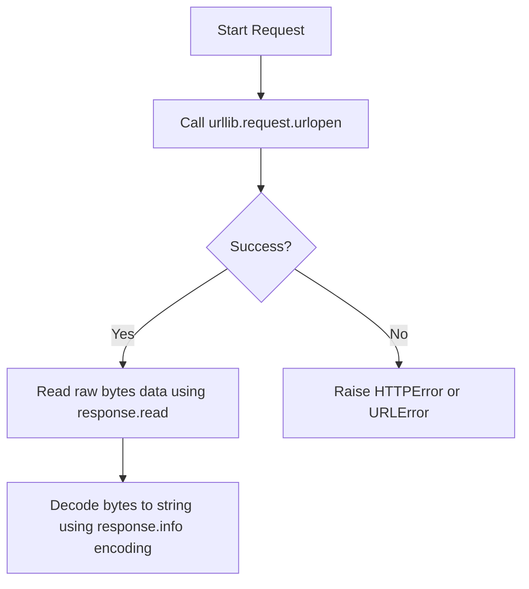

# HTTP Operations with urllib

When writing scripts that run on remote servers, you often need to make HTTP requests (like hitting a webhook to send a Slack notification or downloading configuration files). While many developers prefer third-party libraries, installing external packages is not always allowed or possible in secure production systems. 

For these environments, Python provides a built-in package called [urllib](https://docs.python.org/3/library/urllib.html). It contains modules for parsing URLs, sending HTTP requests, and handling errors.

In this guide, we will look at how to send HTTP GET and POST requests using only Python's built-in `urllib` toolset.

---

## The urllib Submodule Ecosystem

The `urllib` library is divided into four main submodules, each handling a specific part of the HTTP lifecycle:

| Submodule Name | Primary Purpose | Common Functions |
| :--- | :--- | :--- |
| **`urllib.request`** | Opening and reading URLs. | `urlopen()`, `Request()` |
| **`urllib.parse`** | Manipulating URL structures and query parameters. | `urlencode()`, `quote()`, `urlparse()` |
| **`urllib.error`** | Handling exceptions raised by request failures. | `HTTPError`, `URLError` |
| **`urllib.robotparser`** | Parsing `robots.txt` files. | `RobotFileParser` |

---

## Making a standard GET Request

To download page data or query a status endpoint, we use `urllib.request.urlopen()`. This function opens the target URL and returns a file-like response object.

Here is the request flow:



Let us write a script that queries a mock web server status page:

```python
import urllib.request
import urllib.error

# We query a public status API
url = "https://httpbin.org/status/200"

try:
    print(f"Sending GET request to {url}...")
    # Open URL connection
    with urllib.request.urlopen(url) as response:
        # Extract metadata
        status_code = response.status
        headers = response.info()
        
        # Read and decode body content
        body_bytes = response.read()
        body_str = body_bytes.decode("utf-8")
        
        print("\nResponse Received:")
        print("------------------")
        print(f"Status Code: {status_code}")
        print(f"Server Type: {headers.get('Server')}")
        print(f"Response Body Length: {len(body_str)} characters")
        
except urllib.error.HTTPError as err:
    print(f"HTTP Error occurred: Code {err.code} - {err.reason}")
except urllib.error.URLError as err:
    print(f"Failed to reach server: {err.reason}")
```

### Expected Output

```text
Sending GET request to https://httpbin.org/status/200...

Response Received:
------------------
Status Code: 200
Server Type: gunicorn
Response Body Length: 0 characters
```

---

## Sending POST Data and Encoding Parameters

If you need to send query parameters in a GET request (like `?env=prod&service=web`) or post JSON payloads, you must encode the parameters. 

We use `urllib.parse.urlencode()` to format dictionaries into URL queries, and convert them to bytes when sending a POST request.

```python
import urllib.request
import urllib.parse

url = "https://httpbin.org/post"

# 1. Prepare data parameters
data_fields = {
    "deployment_id": "job_998",
    "status": "success",
    "environment": "production"
}

# 2. Encode parameters to a URL-encoded string
# 'deployment_id=job_998&status=success...'
encoded_data = urllib.parse.urlencode(data_fields)

# 3. Convert string to bytes (required by urllib for POST data)
post_bytes = encoded_data.encode("utf-8")

try:
    print(f"Posting deployment stats to {url}...")
    # Passing the data argument automatically changes the HTTP method from GET to POST
    with urllib.request.urlopen(url, data=post_bytes) as response:
        result = response.read().decode("utf-8")
        
        # Check if output contains our posted data
        if "job_998" in result:
            print("Post verified! Data received by host.")
            
except Exception as err:
    print(f"Request failed: {err}")
```

### Expected Output

```text
Posting deployment stats to https://httpbin.org/post...
Post verified! Data received by host.
```

---

## Real-World DevOps Scenario: Web Server Health Auditor

Let us build an automated monitoring script. It checks if our web app's endpoints are online. If any page returns a code other than 200, or fails to resolve, it logs a warning.

```python
import urllib.request
import urllib.error

def audit_endpoint_health(endpoints_list):
    print("Starting Website Endpoint Auditing...")
    print("=======================================")
    
    for url in endpoints_list:
        try:
            # We set a timeout of 3 seconds to avoid hanging our monitor process
            with urllib.request.urlopen(url, timeout=3.0) as response:
                print(f"[OK]      Code {response.status:<3} | {url}")
        except urllib.error.HTTPError as err:
            # Server responded with an error code (like 404 or 500)
            print(f"[WARNING] Code {err.code:<3} | {url} - {err.reason}")
        except urllib.error.URLError as err:
            # DNS failure or host is offline
            print(f"[FAILED]  OFFLINE | {url} - Reason: {err.reason}")
            
    print("=======================================")

# Target URLs to audit
sites = [
    "https://httpbin.org/status/200",
    "https://httpbin.org/status/404",
    "https://invalid-host-dns-test.com"
]

audit_endpoint_health(sites)
```

### Expected Output

```text
Starting Website Endpoint Auditing...
=======================================
[OK]      Code 200 | https://httpbin.org/status/200
[WARNING] Code 404 | https://httpbin.org/status/404 - NOT FOUND
[FAILED]  OFFLINE | https://invalid-host-dns-test.com - Reason: [Errno -2] Name or service not known
=======================================
```

---

## Common Mistakes

Here are some typical mistakes you will run into:

### 1. Forgetting to encode POST data to bytes
If you pass a string to the `data` parameter in `urlopen` (like `urlopen(url, data='my_data')`), Python will throw a `TypeError`. You must always convert string variables to bytes using `.encode('utf-8')`.

### 2. Not setting request timeouts
By default, `urllib.request` uses the system's default timeout, which can be several minutes. If you run your script inside a deployment step and the target server is down, your pipeline will hang. Always pass the `timeout` parameter:

```python
# CORRECT
urllib.request.urlopen(url, timeout=2.0)
```

### 3. Attempting to parse complex JSON directly
`urllib` only downloads raw bytes data. It does not automatically parse JSON formats. If you receive JSON strings, you must load them manually using Python's built-in `json` module:

```python
import json
# Load parsed JSON dict from urllib bytes read
json_data = json.loads(response.read().decode('utf-8'))
```

---

## Summary

* `urllib` is Python's built-in, dependency-free HTTP request package.
* Use `urllib.request.urlopen(url)` to open connection streams and send GET requests.
* Use `urllib.parse.urlencode()` to format dictionaries into query strings.
* Trigger a POST request by passing encoded byte data to the `data` parameter of `urlopen()`.
* Always open `urlopen` inside `with` statement blocks to ensure streams are closed.
* Catch server status errors by trapping the `urllib.error.HTTPError` exception class.
* Catch network and DNS connection failures by trapping `urllib.error.URLError`.
* Set a strict timeout value (e.g. `3.0` seconds) to prevent scripts from hanging.
* Convert raw bytes response bodies back to strings using `.decode('utf-8')`.
* Use the built-in `json` module to parse JSON responses from raw read buffers.
