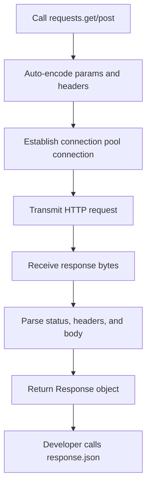

# Introduction to the Requests Library

While Python's built-in `urllib` module can handle HTTP requests, its syntax is verbose and requires you to handle low-level operations manually (like encoding query strings, translating text encodings, and parsing JSON payloads). 

To solve this, the Python community created the [requests](https://requests.readthedocs.io/) library. Often called "HTTP for Humans," it simplifies web requests, handling parameters, headers, cookies, redirects, and authentication automatically.

In this guide, we will look at why the `requests` library is the standard choice for API automation in DevOps, how to install it, and its basic usage patterns.

---

## Why Choose the Requests Library?

The `requests` library wraps complex HTTP protocols into clean, single-line functions. Let us look at how it compares to the built-in `urllib` module:

| Task | Using Built-in `urllib` | Using `requests` Library |
| :--- | :--- | :--- |
| **GET Request** | `urllib.request.urlopen(url)` | `requests.get(url)` |
| **Query Params** | `urllib.parse.urlencode(params)` | `requests.get(url, params=params)` |
| **POST JSON** | `json.dumps(data).encode('utf-8')` | `requests.post(url, json=data)` |
| **JSON Response** | `json.loads(response.read().decode('utf-8'))` | `response.json()` |
| **Status Codes** | Check `response.status` | Check `response.status_code` |
| **Error Checks** | Multi-level try-except with `HTTPError` | `response.raise_for_status()` |

---

## Installing requests

Because `requests` is a third-party package, you must install it using `pip` before you can import it in your scripts:

```bash
pip install requests
```

Once installed, you can query web endpoints with very few lines of code.

---

## HTTP Request Lifecycle Flow

Here is how the `requests` library simplifies HTTP operations internally:



---

## Basic Requests Example

Let us write a simple script that queries a mock web server to fetch IP details, demonstrating how easy it is to parse JSON outputs.

```python
import requests

url = "https://httpbin.org/ip"

try:
    print(f"Querying IP info endpoint from {url}...")
    # Send GET request
    response = requests.get(url, timeout=3.0)
    
    # 1. Verify status code
    print(f"HTTP Status: {response.status_code}")
    
    # 2. Check if request was successful (200-299)
    if response.ok:
        # 3. Retrieve body parsed directly as JSON
        data = response.json()
        print(f"Your Public IP Address: {data['origin']}")
    else:
        print(f"Request failed with status: {response.status_code}")
        
except requests.exceptions.RequestException as err:
    print(f"Network error occurred: {err}")
```

### Expected Output

```text
Querying IP info endpoint from https://httpbin.org/ip...
HTTP Status: 200
Your Public IP Address: 192.168.1.10, 34.205.15.99
```

---

## Real-World DevOps Scenario: System API Health Monitor

In cloud orchestration, we frequently query service status pages to check if virtual machines or services are running optimally. Let us write a health auditor that queries an API and raises alert flags on failures.

```python
import requests

def audit_api_health(api_url):
    print(f"Auditing API Gateway: {api_url}")
    print("---------------------------------")
    
    try:
        # We query the endpoint and check for errors
        response = requests.get(api_url, timeout=2.5)
        
        # raise_for_status() raises an exception if the code is 4xx or 5xx
        response.raise_for_status()
        
        print("[OK] Gateway responded successfully.")
        print(f"Server response header: {response.headers.get('Server')}")
        
    except requests.exceptions.HTTPError as err:
        print(f"[ALERT] HTTP Error occurred: {err}")
    except requests.exceptions.ConnectionError:
        print("[ALERT] Network connection failed. Server is offline!")
    except requests.exceptions.Timeout:
        print("[ALERT] Request timed out. Gateway is hanging!")
    except requests.exceptions.RequestException as err:
        print(f"[ALERT] System error: {err}")

# Run health checks
audit_api_health("https://httpbin.org/status/200")
```

### Expected Output

```text
Auditing API Gateway: https://httpbin.org/status/200
---------------------------------
[OK] Gateway responded successfully.
Server response header: gunicorn
```

---

## Common Mistakes

Here are some typical mistakes you will run into:

### 1. Forgetting to set a timeout limit
By default, the `requests` library has no timeout value. If a server is down or blocked by a firewall, your script will wait forever, hanging your deployment pipeline. Always include the `timeout` parameter:

```python
# WRONG - can hang forever
requests.get("https://host.com")

# CORRECT - timeout in seconds
requests.get("https://host.com", timeout=3.0)
```

### 2. Not handling JSON decode errors
If you call `response.json()`, but the server returned a plain text error page (like a "502 Bad Gateway" HTML page from Nginx), the JSON parser will crash with a `JSONDecodeError`. Always wrap your parsing code or verify content types:

```python
if "application/json" in response.headers.get("Content-Type", ""):
    data = response.json()
```

### 3. Missing `requests` in your server environment
Because `requests` is not in the Python standard library, scripts copied onto base server images (like minimal Alpine Linux containers) will crash immediately with `ModuleNotFoundError: No module named 'requests'`. Ensure you install the module first.

---

## Summary

* The third-party [requests](https://requests.readthedocs.io/) library is the standard choice for HTTP operations in Python.
* Install it using `pip install requests` before importing it.
* Use `requests.get()` to send GET requests and `requests.post()` to send POST payloads.
* Retrieve the parsed JSON response dictionary directly by calling `response.json()`.
* Inspect request success using the boolean flag `response.ok`.
* Raise exceptions automatically on HTTP 4xx or 5xx error codes using `response.raise_for_status()`.
* Always set a `timeout` value in seconds on all web requests to prevent script hangs.
* Catch general networking exceptions by wrapping code in `requests.exceptions.RequestException`.
* Filter connection specific issues using `ConnectionError` and `Timeout` classes.
