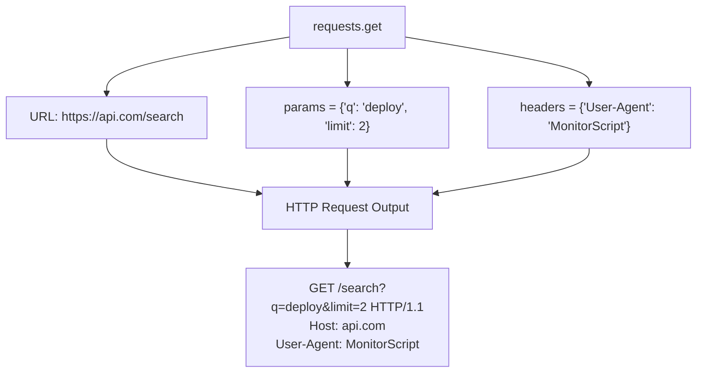

# Making GET Requests with Requests

An HTTP GET request is used to retrieve data from a server. It is the most common request type you will make. When query parameters (like sorting filters, search terms, or environment tags) are required, they are passed inside the URL as query strings (for example, `?env=prod&limit=10`).

With the `requests` library, you do not have to build these URL query strings manually. You pass parameters as a standard Python dictionary, and the library handles formatting and escaping characters automatically.

In this guide, we will learn how to make GET requests, pass query parameters, set custom HTTP headers, and read the returned response data.

---

## Response Properties Reference

When a GET request succeeds, it returns a `Response` object. Here is a summary of the properties you will use to read the data:

| Property | Return Type | Description | Best For |
| :--- | :--- | :--- | :--- |
| **`response.text`** | `str` | Returns the response body parsed as a Unicode string. | HTML pages, plain text logs. |
| **`response.content`** | `bytes` | Returns the raw binary bytes of the response body. | Downloading files, images, zip archives. |
| **`response.json()`** | `dict` / `list` | Parses a JSON response body directly into a Python object. | REST API payloads. |
| **`response.url`** | `str` | Returns the final, fully-resolved URL used for the request. | Verifying parameter encoding or redirects. |

---

## Query Parameters and Headers Mapping

Here is how the `requests` library maps your Python options into a standard HTTP request:



---

## Basic GET Request with Parameters

Let us write a script that queries a test API to verify how query parameters are encoded.

```python
import requests

url = "https://httpbin.org/get"

# 1. Define query parameters
query_params = {
    "module": "networking basics",
    "chapter": "3",
    "debug": "true"
}

# 2. Define custom headers
# Setting custom User-Agents is good practice to identify your scripts
custom_headers = {
    "User-Agent": "DevOpsAuditor/1.0",
    "Accept": "application/json"
}

try:
    print(f"Initiating GET request to {url}...")
    # Send request with params and headers
    response = requests.get(url, params=query_params, headers=custom_headers, timeout=3.0)
    
    # Check output
    print(f"\nFinal URL called: {response.url}")
    print(f"Status Code:      {response.status_code}")
    print(f"Content Type:     {response.headers.get('Content-Type')}")
    
    # Parse returned json data
    if response.ok:
        data = response.json()
        print(f"Reported User-Agent: {data['headers']['User-Agent']}")
        
except requests.exceptions.RequestException as err:
    print(f"Request failed: {err}")
```

### Expected Output

```text
Initiating GET request to https://httpbin.org/get...

Final URL called: https://httpbin.org/get?module=networking+basics&chapter=3&debug=true
Status Code:      200
Content Type:     application/json
Reported User-Agent: DevOpsAuditor/1.0
```

Notice how `networking basics` was automatically encoded to `networking+basics` inside the URL.

---

## Real-World DevOps Scenario: Searching Code Repositories

In automation scripts, you might want to query the GitHub API to check for repository updates or count issues. Let us write a script that searches for active Python projects on GitHub using query parameters and custom API headers.

```python
import requests

def search_github_repositories(topic, language="python"):
    url = "https://api.github.com/search/repositories"
    
    # Query parameters
    params = {
        "q": f"{topic} language:{language}",
        "sort": "stars",
        "order": "desc",
        "per_page": 3
    }
    
    # GitHub API requires a User-Agent header, otherwise it rejects requests with a 403
    headers = {
        "User-Agent": "DevOps-Script-Helper-v1",
        "Accept": "application/vnd.github.v3+json"
    }
    
    try:
        print(f"Searching GitHub repositories for topic: {topic}...")
        response = requests.get(url, params=params, headers=headers, timeout=5.0)
        
        # Check for HTTP errors
        response.raise_for_status()
        
        data = response.json()
        items = data.get("items", [])
        
        print(f"\nFound {data.get('total_count', 0)} repositories. Top 3 results:")
        print("-------------------------------------------------")
        for idx, repo in enumerate(items, 1):
            name = repo["full_name"]
            stars = repo["stargazers_count"]
            desc = repo["description"] or "No description"
            print(f"{idx}. {name} ({stars} Stars)")
            print(f"   Description: {desc[:60]}...")
            
    except requests.exceptions.HTTPError as err:
        print(f"API request failed: {err}")
    except requests.exceptions.RequestException as err:
        print(f"Connection failed: {err}")

# Run search
search_github_repositories("ansible")
```

### Expected Output

```text
Searching GitHub repositories for topic: ansible...

Found 4521 repositories. Top 3 results:
-------------------------------------------------
1. ansible/ansible (58200 Stars)
   Description: Ansible is a radically simple IT automation platform that deplo...
2. geerlingguy/ansible-for-devops (4200 Stars)
   Description: Ansible examples from the book Ansible for DevOps....
3. ansible-semaphore/semaphore (3900 Stars)
   Description: Modern UI for Ansible...
```

---

## Common Mistakes

Here are some errors to keep in mind when making GET requests:

### 1. Hardcoding parameters inside the URL string
If you write `requests.get('https://api.org/get?name=' + user_input)`, your script will break if the input contains spaces, hash symbols, or ampersands. Always pass parameters via the `params` dictionary to ensure they are encoded safely.

### 2. Confusing `response.text` and `response.content`
Use `response.text` when downloading text-based content (like JSON or HTML) as it decodes values using encoding mappings. If you are downloading binary files (like a `.zip` archive or `.png` image), using `.text` will corrupt the output files. Always use `response.content` for binary streams.

### 3. Missing API headers
Many modern APIs (like GitHub or cloud providers) block anonymous web clients. If you do not provide a `User-Agent` or `Accept` header, the server might return a `403 Forbidden` or `406 Not Acceptable` code. Always configure appropriate headers.

---

## Summary

* HTTP GET requests are used to query and retrieve data from web servers.
* Use `requests.get(url)` to send GET requests.
* Pass query parameters as a dictionary using the `params` parameter.
* The `requests` library automatically handles formatting and escaping characters in parameters.
* Define custom request metadata (like User-Agents) using the `headers` parameter.
* Read text-based responses using `response.text`.
* Read binary responses (like downloaded packages) using `response.content`.
* Parse JSON responses directly into Python structures using `response.json()`.
* Inspect the final resolved URL via the `response.url` property.
* Always wrap API checks in `raise_for_status()` to catch HTTP server errors immediately.
