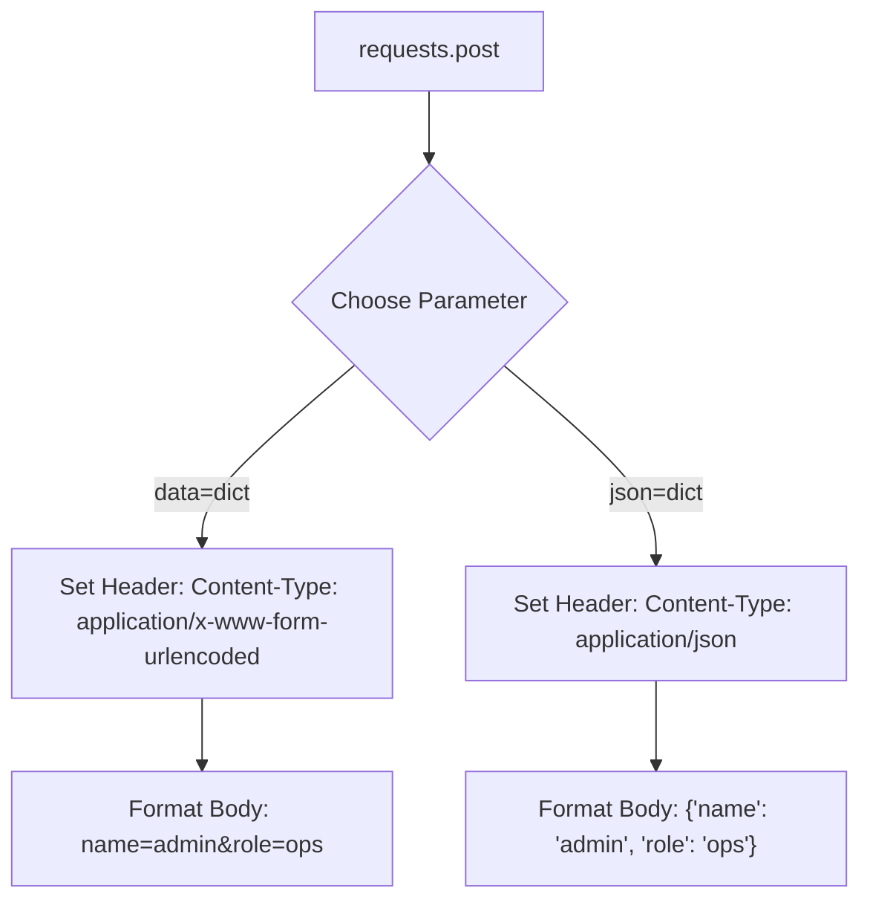

# Making POST Requests with Requests

While HTTP GET requests retrieve data, HTTP POST requests are used to send data to a server to create or update resources. In DevOps automation, you use POST requests to trigger remote builds, send alerts to chat apps like Slack or Teams, publish configuration stats, or authenticate to get session tokens.

When sending data via a POST request, you can format it as standard form-urlencoded parameters (like HTML forms) or as a structured JSON payload.

In this guide, we will learn how to send both form data and JSON data using the `requests` library.

---

## Form Data vs. JSON Payloads

When calling `requests.post()`, you have two main parameters for sending body data: `data` and `json`. The library configures the request differently based on which one you choose.

Let us compare their behavior:

| Parameter | Content-Type Header | Serialized Format | Best For |
| :--- | :--- | :--- | :--- |
| **`data=my_dict`** | `application/x-www-form-urlencoded` | URL query style: `key=val&key2=val2` | Submitting simple form fields, legacy APIs. |
| **`json=my_dict`** | `application/json` | JSON string format: `{"key": "val"}` | Modern REST APIs, webhooks. |
| **`data=my_string`** | None (must set manually) | Raw text string. | Sending raw text, XML, or custom formatted strings. |

---

## POST Payload Formatting

Here is how the requests library packages your payload data:



---

## Sending JSON and Form Data Examples

Let us write a script that sends both format types to a test API endpoint and checks how they are received by the server.

```python
import requests

post_url = "https://httpbin.org/post"

# 1. Sending Form-Encoded Data
form_payload = {
    "username": "deploy_user",
    "action": "restart_service"
}
print("Sending Form-Encoded POST request...")
response_form = requests.post(post_url, data=form_payload, timeout=3.0)
print(f"Form POST Status: {response_form.status_code}")
print(f"Detected Content-Type: {response_form.json()['headers'].get('Content-Type')}")
print("-" * 50)

# 2. Sending JSON Data
# Modern APIs expect structured JSON payloads
json_payload = {
    "build_id": 402,
    "success": True,
    "stages": ["lint", "test", "deploy"]
}
print("Sending JSON POST request...")
# Pass dict to json parameter; requests handles serialization automatically
response_json = requests.post(post_url, json=json_payload, timeout=3.0)
print(f"JSON POST Status: {response_json.status_code}")
print(f"Detected Content-Type: {response_json.json()['headers'].get('Content-Type')}")
```

### Expected Output

```text
Sending Form-Encoded POST request...
Form POST Status: 200
Detected Content-Type: application/x-www-form-urlencoded
--------------------------------------------------
Sending JSON POST request...
JSON POST Status: 200
Detected Content-Type: application/json
```

---

## Real-World DevOps Scenario: Slack Alert Webhook

Slack, Microsoft Teams, and Discord use incoming webhooks to post messages to specific chat channels. These integrations expect a JSON payload containing message details. Let us write a script that sends an alert to a simulated Slack channel.

```python
import requests

def send_slack_notification(message, status="INFO"):
    # We use httpbin to simulate the Slack webhook receiver
    webhook_url = "https://httpbin.org/post"
    
    # Choose color emoji based on warning severity
    emoji = "ℹ️" if status == "INFO" else "⚠️" if status == "WARNING" else "🚨"
    
    # Build standard Slack format
    payload = {
        "text": f"{emoji} *Deployment Alert* | Status: {status}\n{message}"
    }
    
    try:
        print(f"Sending alert to chat room: '{message}'...")
        response = requests.post(webhook_url, json=payload, timeout=4.0)
        
        # Check if the server accepted the alert
        response.raise_for_status()
        print("Alert notification delivered successfully.")
        
    except requests.exceptions.RequestException as err:
        print(f"Failed to deliver notification alert: {err}")

# Trigger backup failure alert
send_slack_notification(
    message="Production database backup failed! Check logs on db-server-01.", 
    status="CRITICAL"
)
```

### Expected Output

```text
Sending alert to chat room: 'Production database backup failed! Check logs on db-server-01.'...
Alert notification delivered successfully.
```

---

## Common Mistakes

Here are some pitfalls when making POST requests:

### 1. Passing a dictionary to `data` when the API expects JSON
If an API expects JSON, writing `requests.post(url, data=payload)` will send URL-encoded form data. The API will likely reject your request with a `415 Unsupported Media Type` or `400 Bad Request` code. Always use `json=payload` for JSON APIs.

### 2. Manually calling `json.dumps()` and passing it to `json`
If you write `requests.post(url, json=json.dumps(payload))`, the library will double-serialize the data, sending it as a JSON-encoded string wrapper rather than a raw JSON object. Either pass the raw dictionary to `json=payload`, or pass the stringified JSON to `data=json.dumps(payload)` while manually setting the `Content-Type` header:

```python
# CORRECT WAY 1 (easiest)
requests.post(url, json=payload)

# CORRECT WAY 2 (manual headers)
headers = {"Content-Type": "application/json"}
requests.post(url, data=json.dumps(payload), headers=headers)
```

### 3. Ignoring the response status codes
A POST request might return a `201 Created` or `202 Accepted` on success, or a `400 Bad Request` on failure. If your script does not verify the return codes (either checking `response.ok` or calling `raise_for_status()`), it will assume the operation succeeded even if the server rejected the data.

---

## Summary

* HTTP POST requests are used to transmit data payloads to servers.
* Use `requests.post(url)` to send POST requests in Python.
* Pass form-encoded data (URL parameters format) using the `data` parameter.
* Pass structured JSON objects directly using the `json` parameter.
* The `requests` library automatically configures the appropriate `Content-Type` headers for you.
* Webhooks (like Slack or Teams) require JSON formats to deliver alerts.
* Double-serializing data (using `json.dumps` inside `json=`) will cause API errors.
* Always check the response code to confirm that the server successfully stored or processed the data.
* Set timeouts on all POST requests to prevent execution pipelines from locking.
