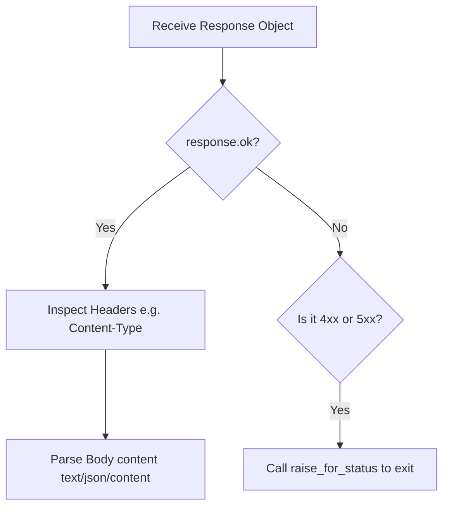

# Handling HTTP Responses

Every time your scripts send an HTTP request, the target web server replies with an HTTP response. To write reliable automation tools, you must inspect this response to confirm the request succeeded, read returned metadata, and parse the data body.

The `requests` library returns all of this information inside a single `Response` object. 

In this guide, we will learn how to check status codes, read response headers case-insensitively, follow redirection paths, and parse body content safely.

---

## HTTP Status Code Reference

HTTP servers use 3-digit status codes to report request outcomes. You should write logic checks based on these standard ranges:

| Code Range | Category | DevOps Meaning | Example |
| :--- | :--- | :--- | :--- |
| **`2xx`** (e.g. 200, 201) | Success | The operation completed successfully. | `200 OK`, `201 Created` |
| **`3xx`** (e.g. 301, 302) | Redirection | The resource has moved. The library follows it automatically. | `301 Moved Permanently` |
| **`4xx`** (e.g. 400, 403, 404) | Client Error | Your script sent an invalid parameter or is missing permissions. | `401 Unauthorized`, `404 Not Found` |
| **`5xx`** (e.g. 500, 503) | Server Error | The remote server crashed or is undergoing maintenance. | `500 Internal Server Error` |

---

## Response Inspection Flow

Here is the recommended sequence for processing a server response in Python:



---

## Basic Response Properties

Let us write a script that sends a query, and prints the basic response variables, headers, and history.

```python
import requests

url = "https://httpbin.org/redirect/1"

try:
    print(f"Sending request to redirect endpoint: {url}...")
    response = requests.get(url, timeout=3.0)
    
    # 1. Check status
    print(f"Final Status Code: {response.status_code}")
    print(f"Request OK?        {response.ok}")
    
    # 2. Check redirect history
    # response.history contains a list of preceding responses if redirected
    if response.history:
        print("\nRedirection path followed:")
        for resp in response.history:
            print(f"  - Code {resp.status_code} redirecting from: {resp.url}")
            
    # 3. Read headers
    # Response headers are returned as a case-insensitive dictionary
    headers = response.headers
    print(f"\nResponse Headers:")
    print(f"  Content-Type:   {headers.get('content-type')}") # lowercase works!
    print(f"  Content-Length: {headers.get('Content-Length')}") # standard casing works!
    
except requests.exceptions.RequestException as err:
    print(f"Request failed: {err}")
```

### Expected Output

```text
Sending request to redirect endpoint: https://httpbin.org/redirect/1...
Final Status Code: 200
Request OK?        True

Redirection path followed:
  - Code 302 redirecting from: https://httpbin.org/redirect/1

Response Headers:
  Content-Type:   application/json
  Content-Length: 450
```

---

## Real-World DevOps Scenario: Configuration Downloader

In automated server setups, you often need to download configuration archives or binaries. Before writing these files to your disk, you should verify that the server returned a successful status code and that the response is actually a binary zip file (by checking the `Content-Type` header).

```python
import os
import requests

def download_configuration_package(source_url, output_filename):
    print(f"Attempting to download artifact from: {source_url}")
    print("-------------------------------------------------")
    
    try:
        response = requests.get(source_url, timeout=5.0)
        
        # Raise exception on HTTP errors
        response.raise_for_status()
        
        # Verify content type
        content_type = response.headers.get("Content-Type", "")
        print(f"Verified server Content-Type: {content_type}")
        
        # We expect a zip file (application/zip) or json config.
        # For this test, we accept application/json since httpbin returns JSON
        if "application/json" in content_type or "application/zip" in content_type:
            # Save raw bytes using response.content
            with open(output_filename, "wb") as file:
                file.write(response.content)
            print(f"[SUCCESS] Package saved to {output_filename} ({len(response.content)} bytes)")
        else:
            print("[ERROR] Rejected: File content type is invalid.")
            
    except requests.exceptions.HTTPError as err:
        print(f"[ERROR] Download failed: {err}")
    except requests.exceptions.RequestException as err:
        print(f"[ERROR] Connection failed: {err}")
    finally:
        # Clean up local file if created
        if os.path.exists(output_filename):
            os.remove(output_filename)

# Run download check
download_configuration_package(
    source_url="https://httpbin.org/json", 
    output_filename="config.json"
)
```

### Expected Output

```text
Attempting to download artifact from: https://httpbin.org/json
-------------------------------------------------
Verified server Content-Type: application/json
[SUCCESS] Package saved to config.json (429 bytes)
```

---

## Common Mistakes

Here are some typical mistakes you will run into:

### 1. Hardcoding header key casing checks
If you use standard dictionaries, keys are case-sensitive. If you check `headers['content-type']` but the server sent `Content-Type`, a standard dictionary check would raise a `KeyError`. The `response.headers` object is case-insensitive, but if you extract it into a normal dictionary (e.g. `dict(response.headers)`), you lose this case-insensitivity. Always query directly from `response.headers`.

### 2. Forgetting that redirects are followed automatically
By default, `requests.get()` follows HTTP redirects (status codes in the 3xx range) automatically. If you are specifically testing redirection links and do not want to follow them, pass `allow_redirects=False`:

```python
# Stop on redirect rather than following it
response = requests.get(url, allow_redirects=False)
```

### 3. Reading large files using `response.content` in memory
If you are downloading a massive 5 Gigabyte database backup archive, calling `response.content` will try to load the entire 5GB file into your server's RAM, causing your script to crash with an out of memory error. For large files, stream the download in chunks:

```python
# Stream large file in chunks
with requests.get(url, stream=True) as r:
    r.raise_for_status()
    with open('local_file.zip', 'wb') as f:
        for chunk in r.iter_content(chunk_size=8192):
            f.write(chunk)
```

---

## Summary

* Web servers reply to requests using HTTP response objects containing status, headers, and body.
* Access the status code using the `response.status_code` property.
* Check if a request succeeded cleanly (codes 200–299) using the `response.ok` flag.
* Inspect response header metadata using the case-insensitive `response.headers` dictionary.
* Read preceding redirection history steps via the `response.history` list.
* Call `.raise_for_status()` to raise an exception automatically on any 4xx or 5xx server failure.
* Always read binary files using `response.content` rather than text blocks.
* Stream files larger than 100MB in chunks using `stream=True` to protect server RAM.
* Avoid casing checks on headers; query the case-insensitive headers list directly.
