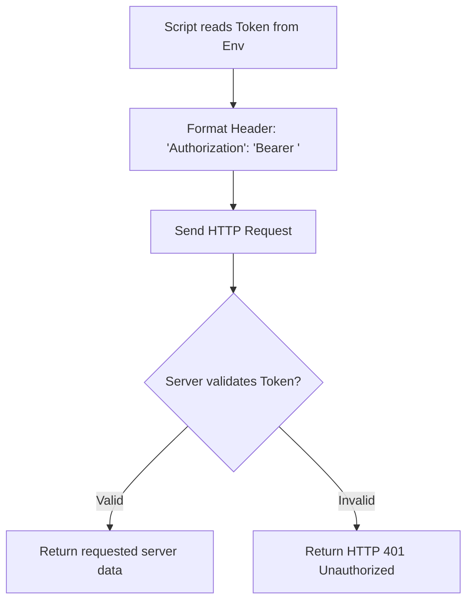

# Authentication in HTTP Requests

In production networks, APIs and web consoles are rarely open to the public. To query server status, trigger pipeline builds, or manage cloud configurations, your scripts must identify themselves. This is done through authentication.

The `requests` library provides simple ways to handle HTTP authentication, ranging from standard username/password combinations to API tokens and custom security keys.

In this guide, we will look at how to authenticate requests using Basic Auth, Bearer tokens, and custom API headers, while keeping credentials safe in environment variables.

---

## Authentication Methods Comparison

Here is a summary of the most common ways to authenticate your HTTP requests in DevOps:

| Auth Method | HTTP Header Format | Standard Requests Parameter | Best For |
| :--- | :--- | :--- | :--- |
| **Basic Authentication** | `Authorization: Basic <base64_string>` | `auth=(user, pass)` | Legacy internal tools, router interfaces, basic web logins. |
| **Bearer Token (OAuth2)** | `Authorization: Bearer <token_string>` | `headers={'Authorization': 'Bearer ...'}` | Cloud provider APIs, GitHub API, modern microservices. |
| **Custom API Header** | `X-API-Key: <key_value>` (variable names) | `headers={'X-API-Key': '...'}` | Third-party services, webhooks, SaaS APIs. |

---

## Bearer Token Authentication Flow

Here is how a Bearer token authorizes your script transactions:



---

## Basic Authentication and Custom Headers Examples

Let us write a script that demonstrates how to implement Basic Authentication and Custom Headers to pass credentials.

```python
import os
import requests
from requests.auth import HTTPBasicAuth

# We use httpbin endpoints designed to test auth formats
basic_auth_url = "https://httpbin.org/basic-auth/admin/ops_password"
api_key_url = "https://httpbin.org/headers"

# 1. Using Basic Authentication
# Pass credentials as a tuple (username, password)
print("Sending Basic Authentication request...")
response_basic = requests.get(basic_auth_url, auth=("admin", "ops_password"), timeout=3.0)
print(f"Basic Auth Status: {response_basic.status_code}")
print(f"Authenticated? {response_basic.json().get('authenticated')}")
print("-" * 55)

# 2. Using Custom API Headers
# Simulate retrieving an API token from system environments
os.environ["SYS_API_KEY"] = "prod_security_key_xyz123"
api_key = os.environ.get("SYS_API_KEY")

custom_headers = {
    "X-API-Key": api_key,
    "Accept": "application/json"
}

print("Sending API Key in headers...")
response_headers = requests.get(api_key_url, headers=custom_headers, timeout=3.0)
print(f"Custom Header Status: {response_headers.status_code}")
# Verify the header was received by the server
server_headers = response_headers.json().get("headers", {})
print(f"Server received X-API-Key? {'X-API-Key' in server_headers}")

# Clean up env
os.environ.pop("SYS_API_KEY")
```

### Expected Output

```text
Sending Basic Authentication request...
Basic Auth Status: 200
Authenticated? True
-------------------------------------------------------
Sending API Key in headers...
Custom Header Status: 200
Server received X-API-Key? True
```

---

## Bearer Token Authentication (OAuth)

Bearer tokens are the standard for modern cloud platforms. You authenticate by adding an `Authorization` header containing the word `Bearer` followed by a space and your token.

```python
import os
import requests

def check_cloud_instance_status():
    url = "https://httpbin.org/bearer"
    
    # Simulating secure token loading
    os.environ["API_BEARER_TOKEN"] = "token_abc_998877"
    token = os.environ.get("API_BEARER_TOKEN")
    
    if not token:
        print("Error: API_BEARER_TOKEN environment variable is missing.")
        return
        
    # Configure authorization header
    headers = {
        "Authorization": f"Bearer {token}",
        "Accept": "application/json"
    }
    
    try:
        print("Querying secure resource gateway using Bearer Token...")
        response = requests.get(url, headers=headers, timeout=3.0)
        
        # Check if auth succeeded
        response.raise_for_status()
        print(f"Auth Success! Status Code: {response.status_code}")
        print(f"Token Details: {response.json()}")
        
    except requests.exceptions.HTTPError as err:
        if err.response.status_code == 401:
            print("Access Denied: The Bearer Token is invalid or expired.")
        else:
            print(f"API returned error: {err}")
    except requests.exceptions.RequestException as err:
        print(f"Network error: {err}")
    finally:
        os.environ.pop("API_BEARER_TOKEN")

check_cloud_instance_status()
```

### Expected Output

```text
Querying secure resource gateway using Bearer Token...
Auth Success! Status Code: 200
Token Details: {'authenticated': True, 'token': 'token_abc_998877'}
```

---

## Common Mistakes

Here are some security and coding mistakes to avoid:

### 1. Hardcoding usernames and tokens in your script files
Never write code like this:
`token = "my-secret-key-123"`
If you check this script into a Git repository, anyone with access to the code can steal your credentials. Always load credentials from environment variables (`os.environ.get()`) or a secure Vault system.

### 2. Forgetting the word `Bearer` in Token headers
Bearer token APIs require the exact string format: `Bearer <token>`. If you just pass the raw token string (e.g. `headers={'Authorization': token}`), the API gateway will fail to identify the auth schema and return a `401 Unauthorized` error.

### 3. Sending credentials over unencrypted HTTP
Never send basic auth credentials or Bearer tokens to an `http://` address (unencrypted). If you do, your credentials are sent in plain text across the network, allowing attackers to sniff them. Always use secure `https://` endpoints.

---

## Summary

* Protect system resources by configuring HTTP authentication on target APIs.
* Use Basic Authentication by passing an `auth=(user, pass)` tuple to request functions.
* Pass Bearer tokens using the header structure `"Authorization": "Bearer <token>"`.
* Use custom header keys (like `"X-API-Key"`) for simple API service integrations.
* Always read credentials from environment variables to keep tokens out of repository code.
* Ensure all endpoints use `https://` to prevent token eavesdropping across networks.
* Check for authorization failures by trapping HTTP `401 Unauthorized` status codes.
* Avoid stringifying basic auth headers manually; let the library handle encoding parameters.
* Always test credential permissions in staging environments before deploying scripts.
